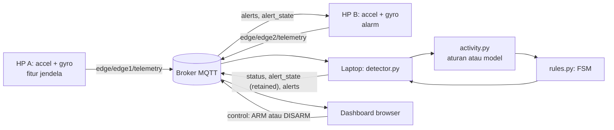

# WashAlert AI

Sistem IoT untuk memberi tahu pemilik saat mesin cuci selesai. Dua HP Android membaca sensor, laptop memproses data dan menjalankan classifier aktivitas, dan MQTT menghubungkan semuanya dua arah.

> **Status validasi.** Perangkat lunak sudah diuji dengan simulator, broker lokal, dan browser. **Belum ada pengujian pada mesin cuci nyata.** Satu-satunya model yang tersedia dilatih dari data **sintetis**, sehingga angkanya tidak menunjukkan performa nyata. Rincian: [laporan QA](docs/phase8_qa_report.md).

## 1. Ringkasan proyek

WashAlert AI adalah pengembangan dari WashAlert, tugas IoT Kelompok 12. Sistem lama memakai ambang dan finite state machine (FSM). Versi ini menambahkan model supervised yang menebak aktivitas mesin, sedangkan keputusan "cucian selesai" tetap dibuat FSM.

| Bagian yang memakai model terlatih | Bagian yang memakai aturan deterministik |
|---|---|
| Menebak aktivitas `IDLE`, `WASHING`, atau `SPIN` pada mode `HYBRID` dan `ML_ONLY` | Keputusan `DONE`, alert, pengingat, konfirmasi, watchdog, dan seluruh mode `RULE_ONLY` |

## 2. Masalah

Di kos dan laundry bersama, mesin cuci sering selesai tanpa ada yang tahu. Cucian terlalu lama di tabung, pengguna lain menunggu, dan pemilik harus sering mengecek. Menentukan selesai dari getaran juga tidak sederhana, karena mesin yang diam bisa sedang menunggu, jeda antar fase, atau benar-benar selesai.

## 3. Fitur utama

- Pembacaan accelerometer dan gyroscope di HP lewat Termux:API, dengan fitur dihitung di edge.
- Telemetri MQTT over TLS, dengan validasi skema, penolakan pesan basi, dan penolakan replay.
- Tiga mode deteksi, dan model yang gagal otomatis digantikan aturan secara terlihat.
- FSM dengan durasi minimum, batas diam, koreksi, watchdog HP A, dan pemulihan setelah restart.
- Alarm di HP B, pengingat berkala, dan konfirmasi dengan menggoyang HP.
- Dashboard real-time dengan linimasa, panel model, alert, kualitas data, dan ARM/DISARM yang dikonfirmasi detector.
- Alat rekam, pelabelan, validasi dataset, split per siklus, training, dan evaluasi.

## 4. WashAlert lama dan WashAlert AI

| Aspek | WashAlert lama | WashAlert AI |
|---|---|---|
| Aktivitas | Ambang `motion_rms` dan rotasi | Ambang, atau model dengan fallback |
| Fitur | RMS dan rotasi | Ditambah `acc_dyn_rms`, `acc_mag_ptp`, `gyro_rms`, `gyro_max` |
| Selesai | Diam 120 detik pada mode real | Ditambah kerja minimum dan batas lebih lama jika belum ada spin |
| Mesin aktif lagi setelah DONE | Tidak terdeteksi | Koreksi dan pengingat dihentikan |
| HP A berhenti mengirim | Tidak terdeteksi | `SENSOR_LOST` dan pemberitahuan |
| Broker putus | Program edge crash | Tersambung kembali |
| Konfirmasi | Satu jendela goyang | Dua jendela berurutan |
| HP B baru tersambung | Alert terlewat | `alert_state` retained |
| Dashboard | Status dan satu grafik | Lihat [desain dashboard](docs/dashboard_design.md) |

Peningkatan akurasi pada mesin nyata **belum terbukti**. Perbandingan yang ada memakai data sintetis, lihat bagian 17.

## 5. Arsitektur



Diagram lain ada di [`docs/system_diagrams/`](docs/system_diagrams/).

## 6. Kebutuhan perangkat keras

- 2 HP Android dengan accelerometer dan gyroscope.
- 1 laptop.
- Jaringan: internet untuk broker publik, atau satu WiFi/hotspot untuk broker lokal.
- Mesin cuci, hanya untuk pengujian nyata dan pengumpulan data.

## 7. Kebutuhan perangkat lunak

| Tempat | Kebutuhan | File |
|---|---|---|
| HP | Termux, Termux:API (keduanya dari sumber yang sama, misalnya F-Droid), Python ≥ 3.10 | `requirements.txt` |
| Laptop inti | Python ≥ 3.10 | `requirements.txt` |
| Laptop ML | Python ≥ 3.12. Versi tersemat diuji pada Python 3.13 | `requirements-ml.txt` |
| Pengujian | broker lokal dan browser test | `requirements-dev.txt` |

Yang sudah dijalankan hanya Linux dan Python 3.13. Windows dan HP belum saya uji.

## 8. Instalasi

```bash
python -m venv .venv
source .venv/bin/activate          # Windows: .venv\Scripts\activate
python -m pip install -r requirements.txt
python -m pip install -r requirements-ml.txt    # untuk HYBRID, ML_ONLY, dan training
python -m pip install -r requirements-dev.txt   # untuk test dan broker lokal
playwright install chromium                     # untuk test browser
python -m scripts.offline_demo                  # cek cepat, tanpa jaringan
```

## 9. Konfigurasi

```bash
cp .env.example .env               # Windows: Copy-Item .env.example .env
```

Ganti `PROJECT_ID` dengan nama unik, dan samakan di laptop serta kedua HP. Penjelasan semua nilai ada di [`.env.example`](.env.example). `.env` tidak boleh di-commit.

| Variabel | Arti |
|---|---|
| `CUCI_MODE` | `demo` memakai waktu singkat. `real` memakai waktu mesin cuci |
| `DETECTION_MODE` | `RULE_ONLY`, `HYBRID`, atau `ML_ONLY` |
| `MODEL_PATH` | Folder model |
| `ALLOW_SYNTHETIC_MODEL` | `true` hanya untuk uji perangkat lunak |

## 10. Menjalankan HP A

Di Termux, pada HP yang diletakkan di atas mesin cuci:

```bash
pkg install python termux-api git
git clone <url-repo> && cd <nama-repo>
pip install -r requirements.txt
cp .env.example .env               # samakan PROJECT_ID
python hp_mesin.py
```

`--debug-sensors` menampilkan nilai mentah sensor.

## 11. Menjalankan HP B

Persiapannya sama dengan HP A, lalu:

```bash
python hp_pemilik.py
```

Saat mesin selesai, HP bergetar dan menampilkan notifikasi. Goyang HP untuk konfirmasi.

## 12. Menjalankan detector

```bash
python detector.py                 # RULE_ONLY, sesuai .env.example
```

Mode model dengan artefak sintetis, hanya untuk uji perangkat lunak:

```bash
DETECTION_MODE=HYBRID ALLOW_SYNTHETIC_MODEL=true \
MODEL_PATH=models/development/SYNTHETIC_syn_hard_v1-v1-decision_tree-F2-624d6645 python detector.py
```

ARM/DISARM dari terminal: `python send_control.py DISARM`.

## 13. Menjalankan dashboard

`python detector.py` sekaligus menjalankan dashboard di `http://localhost:8000`. Panduan: [dashboard_user_guide.md](docs/dashboard_user_guide.md).

## 14. Pengumpulan dataset

Dataset nyata belum ada, jadi langkah ini menjadi pekerjaan utama berikutnya. Baca [panduan pengumpulan](docs/data_collection_guide.md) dan [protokol label](docs/labeling_protocol.md) sebelum merekam.

```bash
python -m ml.measure_sampling --phone hpA --duration 120
python -m ml.record_session --help
python -m ml.label_session --help
python -m ml.validate_dataset --root data/real
```

Alat rekam baru diuji dengan `termux-sensor` tiruan.

## 15. Training model

```bash
python -m ml.build_dataset --root data/real --dataset-id real_v1
python -m ml.split_dataset --dataset real_v1 --version v1
python -m ml.train --dataset real_v1 --split v1
```

Mengulang pipeline dengan data sintetis:

```bash
python -m ml.generate_synthetic --difficulty hard
python -m ml.build_dataset --root data/synthetic --dataset-id syn_hard_v1
python -m ml.train --dataset syn_hard_v1 --split v1
```

Split `v1` sudah terkunci di `data/manifests`. Dari clone bersih, urutan ini menghasilkan `model.joblib` yang identik byte per byte dengan artefak di repo (diuji pada lingkungan yang sama).

## 16. Evaluasi model

```bash
python -m ml.evaluate --model-dir models/development/<versi-model>
```

Evaluasi test hanya boleh sekali per model. Percobaan kedua ditolak dan tercatat.

## 17. Hasil saat ini: semuanya sintetis

| Metode pada 2 siklus test sintetis | Macro-F1 |
|---|---:|
| Model terpilih (decision tree, fitur F2) | 0,920 |
| Baseline ambang | 0,628 |
| FSM lama dipetakan ke aktivitas | 0,607 |
| Baseline kelas mayoritas | 0,268 |

Skor ini mengikuti cara data dibuat dan **tidak boleh dipakai sebagai klaim performa**. Pada tingkat siklus, FSM lama dan FSM baru dengan aturan mendeteksi 0 dari 2 penyelesaian, sedangkan `HYBRID` dan `ML_ONLY` masing-masing 1 dari 2. Lihat [laporan evaluasi](docs/ml_evaluation_report.md).

## 18. Mode deteksi

| Mode | Sumber aktivitas | Jika prediksi tidak tersedia | Status |
|---|---|---|---|
| `RULE_ONLY` | Ambang yang ditulis manusia, bukan ML | Tidak berlaku | Default |
| `HYBRID` | Model | Aturan untuk jendela itu | Eksperimen |
| `ML_ONLY` | Model | `UNKNOWN`, timer FSM ditahan | Eksperimen |

Jika model gagal dimuat atau gagal berulang, `effective_mode` menjadi `RULE_ONLY` dan `fallback_reason` terisi. Mode berubah hanya lewat restart.

## 19. Simulasi dan demo

Tanpa jaringan:

```bash
python -m scripts.offline_demo
```

Broker lokal dan HP simulator, masing-masing di terminal terpisah:

```bash
cp demo/env.lokal.example .env
amqtt -c demo/broker_lokal.yaml
python detector.py
python hp_mesin.py --source simulator --scenario washer
python hp_pemilik.py --source simulator --scenario ack
```

Demo otomatis skenario A sampai J, sekitar 8 menit:

```bash
python -m scripts.e2e_demo --model models/development/SYNTHETIC_syn_hard_v1-v1-decision_tree-F2-624d6645 --browser --out reports/e2e/phase7
```

`e2e_demo` membutuhkan `data/synthetic`, jadi buat dulu dengan perintah pada bagian 15. Panduan presentasi: [demo/](demo/). Simulator tidak dihitung sebagai edge fisik.

## 20. Pengujian

```bash
python -m unittest discover -s tests -t .                  # test lambat dilewati
WASHALERT_SLOW=1 python -m unittest discover -s tests -t . # lengkap
python -m scripts.soak_test --minutes 60                   # uji ketahanan
```

Test yang butuh paket atau artefak yang belum ada akan dilewati, bukan gagal. Hasil terakhir: [laporan QA](docs/phase8_qa_report.md).

## 21. Masalah umum

| Gejala | Periksa |
|---|---|
| `termux-sensor is missing` | `pkg install termux-api`, dan aplikasi Termux:API terpasang |
| Sensor tidak terbaca | `termux-sensor -c`, lalu `termux-sensor -l` |
| Dashboard "Belum ada" | Detector berjalan dan `PROJECT_ID` sama |
| Telemetri ditolak basi | Jam HP dan laptop selisih lebih dari 30 detik |
| `fallback_reason` terisi | Panel AI menjelaskan alasannya |
| `synthetic_not_allowed` | Model sintetis butuh `ALLOW_SYNTHETIC_MODEL=true` |
| Port 8000 terpakai | Ubah `DASHBOARD_PORT` |
| HiveMQ tidak terjangkau | Pakai broker lokal, bagian 19 |

## 22. Keterbatasan

- Belum ada dataset nyata, sehingga model belum tervalidasi pada mesin cuci.
- Belum ada pengujian di HP pada versi ini, termasuk notifikasi Termux.
- Koneksi TLS ke HiveMQ belum diuji pada versi ini karena lingkungan pengujian tidak dapat menjangkaunya.
- Nilai ambang dan durasi masih diusulkan, dan `CUCI_DONE_S` harus ditetapkan dari jeda nyata.
- Prediksi yang berubah-ubah dapat menunda DONE, karena satu jendela non-IDLE mereset timer diam.
- Pada broker publik, siapa pun dapat membaca dan memalsukan pesan. `PROJECT_ID` bukan autentikasi.
- Riwayat dashboard hanya ada selama tab terbuka.
- Satu mesin, satu HP A, dan satu HP B per `PROJECT_ID`.

Daftar lengkap ada di [laporan QA](docs/phase8_qa_report.md).

## 23. Struktur proyek

```text
hp_mesin.py  hp_pemilik.py  detector.py  send_control.py    titik masuk
shared/      sensor, fitur, pesan MQTT, edge runner, alarm, server dashboard
nodes/detector_service/   FSM, sumber aktivitas, inference, layanan MQTT, penyimpanan state
dashboard/   halaman, CSS, JavaScript, pustaka lokal
ml/          rekam, label, validasi, dataset, split, training, evaluasi, replay
models/      artefak model, development dan production
data/        real, synthetic, processed, manifests
scripts/     demo offline, demo end-to-end, uji ketahanan
demo/        konfigurasi broker lokal, panduan demo dan video
presentation/ presentasi dan speaker notes
tests/       test otomatis
docs/        SRS, SDD, laporan, panduan
reports/     hasil pengujian
```

## 24. Dokumentasi

Indeks lengkap: [docs/README.md](docs/README.md). Yang utama: [Laporan teknis](docs/laporan_teknis_WashAlert_AI.md), [SRS](docs/SRS_WashAlert_AI.md), [SDD](docs/SDD_WashAlert_AI.md), [RTM](docs/requirements_traceability_matrix.md), [Dokumentasi ML](docs/ml_documentation.md).

## 25. Referensi akademik

Lihat daftar pustaka pada [laporan teknis](docs/laporan_teknis_WashAlert_AI.md#daftar-pustaka).
