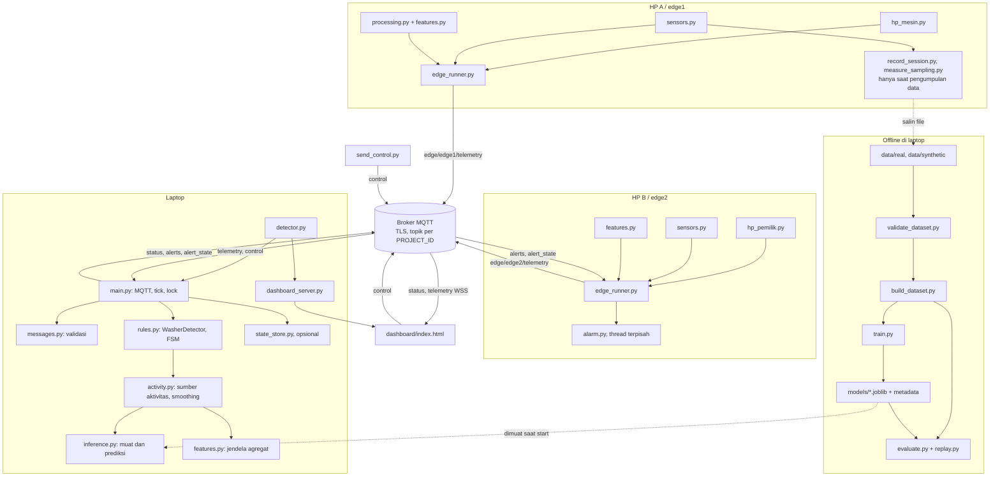
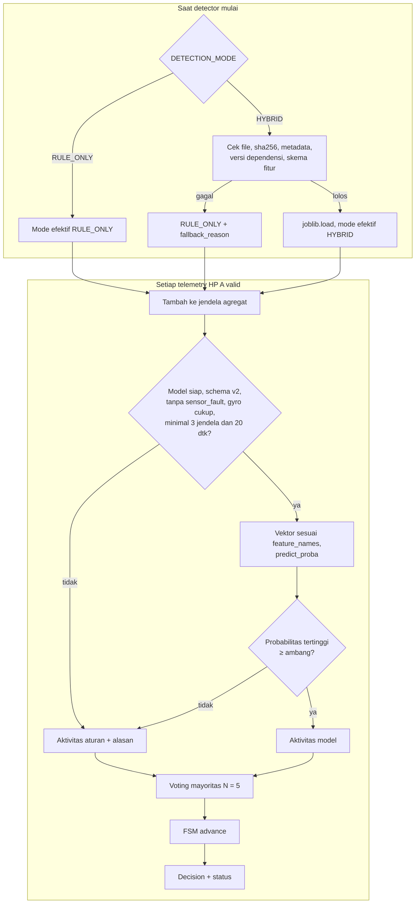
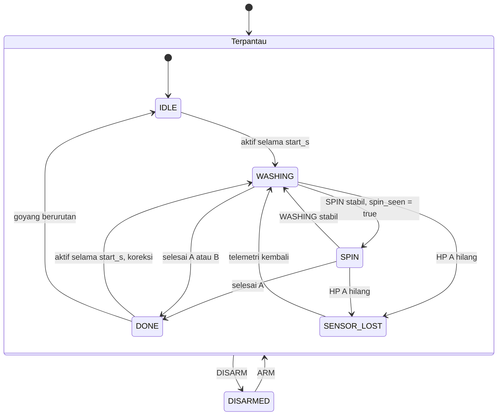
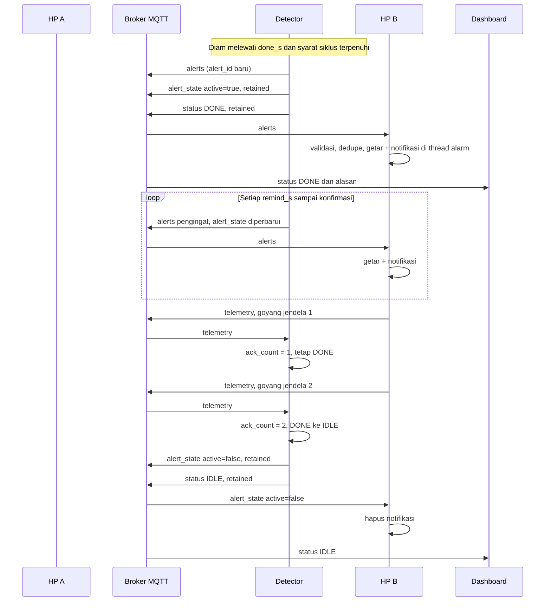
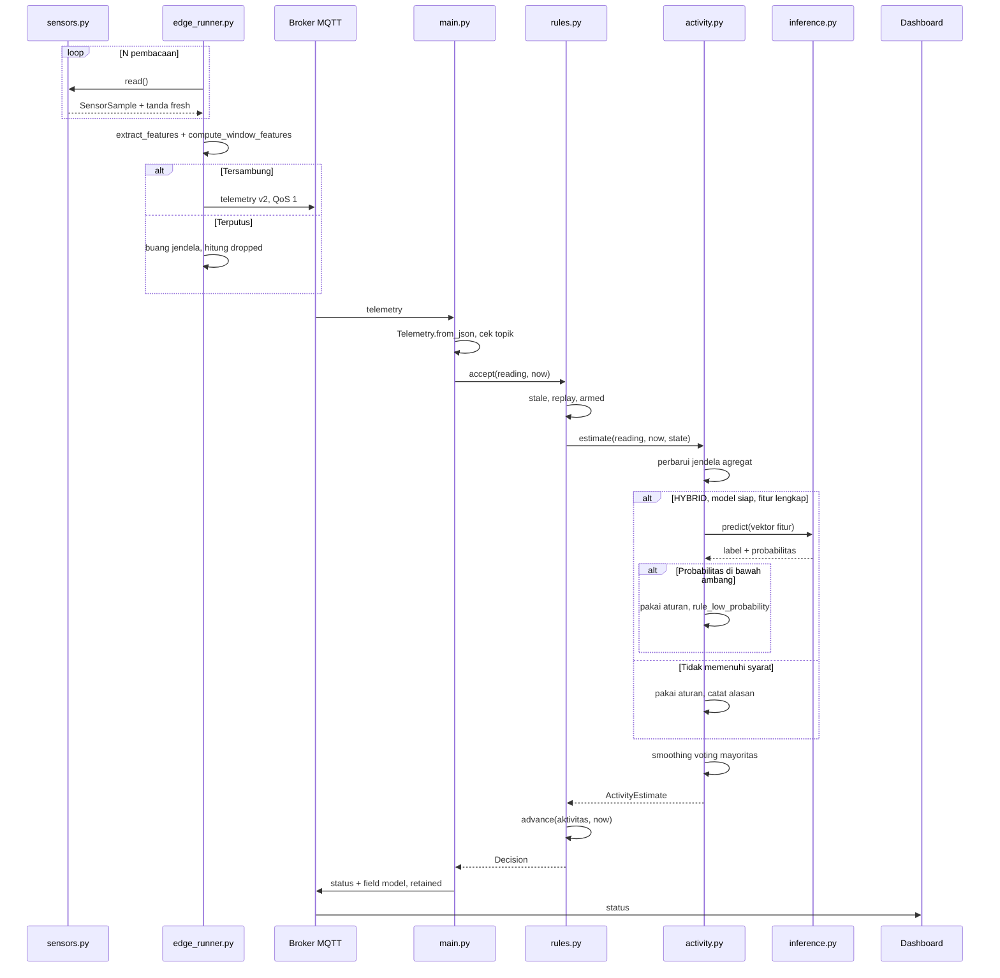
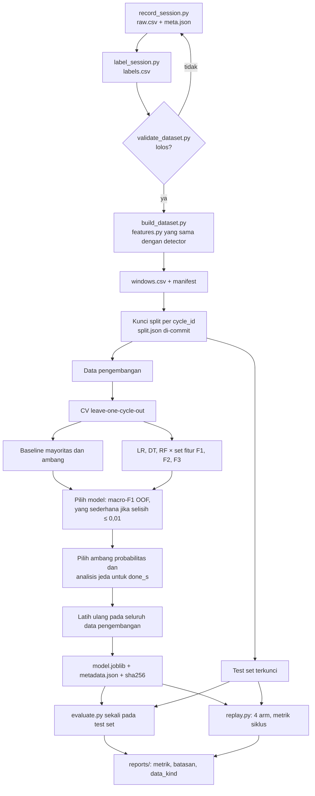
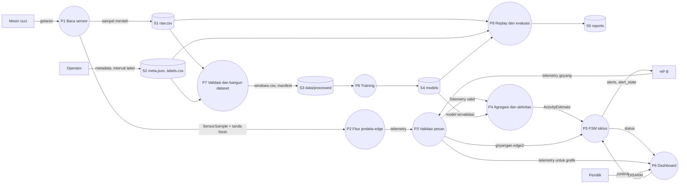

# Software Design Document: WashAlert AI

| Atribut | Nilai |
|---|---|
| Versi | 0.6, diperbarui setelah Phase 8 (CR-007 sampai CR-012) |
| Acuan | SRS v0.7, baseline kerja BL-0.7 |
| Tanggal | 4 November 2026 |
| Status kode | Infrastruktur data dan pipeline ML sudah diimplementasikan, diuji sintetis. ML belum masuk detector |
| Dokumen terkait | `dataset_schema.md`, `design_traceability_matrix.md`, `SRS_WashAlert_AI.md` |

> **Batas bukti.** Dokumen ini adalah rancangan. Tidak ada model yang dilatih dengan data nyata dan tidak ada metrik performa deteksi di sini. Prototipe di bagian 9.2 memakai salinan sementara dan data buatan untuk menguji kelayakan perangkat lunak saja.

## 1. Ringkasan keputusan

| # | Keputusan | Alasan utama | Kebutuhan |
|---|---|---|---|
| D-1 | Model mengklasifikasikan aktivitas, FSM memutuskan DONE | DONE bergantung pada riwayat; satu siklus hanya memberi satu contoh selesai | FR-040 |
| D-2 | Fitur dihitung di HP, inference di laptop | Getaran horizontal hilang pada `motion_rms`, sedangkan scikit-learn tidak perlu ada di HP | FR-010, NFR-023 |
| D-3 | Satu modul fitur `shared/features.py`, Python murni | Training dan inference memakai kode yang sama, dan HP tidak butuh NumPy | NFR-018 |
| D-4 | Simpan sampel mentah, lalu fitur dihitung ulang | Definisi jendela dapat diubah tanpa merekam ulang berjam-jam | FR-024 |
| D-5 | `RULE_ONLY` tetap menjadi default | Sistem lama tetap berjalan dengan `.env` lama | FR-039 |
| D-6 | Pembanding FSM lama memakai salinan beku `legacy_rules.py` | Refactor FSM tidak boleh mengubah kondisi awal yang dibandingkan | DML-020 |
| D-7 | Topik baru `alert_state` retained | Satu mekanisme untuk konfirmasi dan HP B yang baru tersambung | FR-066, FR-061 |
| D-8 | Akuisisi tetap per panggilan sampai ada hasil ukur | Laju Termux belum diketahui. Streaming hanya dibuat jika pengukuran membenarkannya | FR-006 |

**Yang belum bisa diputuskan tanpa data:** nilai `CUCI_DONE_S`, panjang jendela final, ambang probabilitas, model terpilih, dan pemakaian fitur frekuensi.

## 2. Arsitektur sistem

### 2.1 Diagram



### 2.2 Aliran data

**Runtime naik:** sensor, `SensorSample`, fitur jendela, telemetri, broker, validasi detector.

**Runtime keputusan:** telemetri valid, jendela agregat, aktivitas dari model atau aturan, smoothing, FSM, `Decision`, status.

**Runtime turun:** FSM memutuskan DONE, lalu `alerts` dan `alert_state` sampai ke HP B, yang bergetar dan menampilkan notifikasi.

**Konfirmasi:** HP B digoyang, telemetri HP B naik, FSM menghitung jendela berurutan, lalu `alert_state.active=false` menghapus notifikasi.

**Kontrol:** dashboard atau `send_control.py` menerbitkan ARM atau DISARM ke `control`.

**Offline:** rekaman disalin dari HP A ke laptop, divalidasi, menjadi dataset, dilatih, dievaluasi, lalu model dimuat oleh detector saat start.

### 2.3 Elemen lama yang dipertahankan

| Elemen | Bentuk dalam desain |
|---|---|
| HP A sebagai monitoring device | `hp_mesin.py`, tanpa perubahan |
| HP B sebagai owner device | `hp_pemilik.py`, tanpa perubahan |
| Accelerometer dan gyroscope | Tetap lewat Termux:API, `SensorSource.read()` tetap |
| MQTT dua arah | Empat topik lama tetap, satu topik ditambah |
| Laptop sebagai server | `detector.py`, perintahnya tetap |
| Dashboard | Halaman statis `dashboard/` dengan aset lokal (CR-011), lihat `dashboard_design.md` |
| Alert dan konfirmasi | Payload lama tetap, field ditambah |
| ARM/DISARM | Payload teks tetap |

## 3. Arsitektur machine learning

### 3.1 Masalah

**Supervised multiclass classification:** memetakan statistik getaran 30 detik terakhir menjadi aktivitas mesin saat ini. Rumusan A → B ini mengikuti materi dosen.

| Unsur | Isi |
|---|---|
| Input A | Vektor fitur jendela agregat |
| Output B | `IDLE`, `WASHING`, `SPIN` |
| Label | Observasi manusia, bukan keluaran aturan |
| Bukan tugas model | Memutuskan cucian selesai |

Label tidak boleh berasal dari FSM lama. Jika itu dilakukan, model hanya meniru ambang lama, dan evaluasinya menjadi tidak bermakna.

### 3.2 Mengapa hybrid, bukan klasifikasi DONE

| Kriteria | Hybrid | Klasifikasi DONE langsung |
|---|---|---|
| Informasi yang dibutuhkan | Sinyal sesaat untuk aktivitas, riwayat untuk selesai | Harus menyimpan riwayat seluruh siklus |
| Contoh per siklus | Ratusan jendela (saling berkorelasi) | Satu kejadian selesai |
| 8 siklus memberi | Cukup untuk uji awal aktivitas | 8 contoh positif |
| Menjelaskan alert | Aktivitas, lama diam, ada spin | Sulit |
| Saat model gagal | Aturan mengisi aktivitas, FSM tetap jalan | Tidak ada keputusan |

Penilaian ini adalah analisis desain, belum hasil eksperimen. Perbandingan empat arm akan menunjukkan apakah model menambah manfaat.

### 3.3 Algoritma dan pemilihan

| Peran | Model | Ruang hyperparameter |
|---|---|---|
| Baseline | Kelas mayoritas | Tidak ada |
| Baseline, bukan ML | Ambang lama per jendela | Nilai `Config` lama |
| Kandidat | `StandardScaler` + `LogisticRegression(class_weight="balanced")` | `C` ∈ {0.1, 1, 10} |
| Kandidat | `DecisionTreeClassifier(class_weight="balanced")` | `max_depth` ∈ {3, 5, 8} |
| Kandidat | `RandomForestClassifier(class_weight="balanced")` | `n_estimators` = 100; `max_depth` ∈ {5, 8, None} |
| Opsional | SVM RBF | Hanya jika tiga kandidat tidak memadai |

Setiap kandidat diuji pada tiga set fitur:

| Set | Isi | Pertanyaan |
|---|---|---|
| F1 | `motion_rms`, `rotation_rad` | Seberapa baik model dengan telemetri lama? Ini Strategi A di audit |
| F2 | Fitur getaran dan gyro baru | Apakah fitur tanpa offset cukup? |
| F3 | F1 + F2 | Apakah gabungan menambah sesuatu? |

**Aturan pemilihan, ditetapkan sebelum melihat test set:**

1. Skor utama: macro-F1 dari prediksi out-of-fold.
2. Jika selisih dengan model terbaik ≤ 0,01 (diusulkan), pilih urutan Decision Tree, Logistic Regression, Random Forest, karena lebih mudah dijelaskan dan lebih ringan.
3. Latensi harus memenuhi NFR-001.
4. Jika tidak ada kandidat yang mengalahkan baseline ambang pada data pengembangan, hasil itu dilaporkan dan diselidiki dulu sebelum test set dibuka.

### 3.4 Training

Diagram ada di 6.3. Pembagian data ada di 4.5. Satu perintah: `python -m ml.train --dataset <id> --split <file>`. Seed ditetapkan, dan `n_jobs=1` agar hasil dapat diulang.

### 3.5 Inference



| Masalah | Perilaku |
|---|---|
| Model belum siap | Aktivitas dari aturan, mode efektif `RULE_ONLY` |
| Telemetri v1 atau fitur rusak | Aturan untuk jendela itu, alasan `missing_features` |
| Jendela kurang | Aturan, alasan `incomplete_window` |
| Probabilitas rendah | Aturan, `rule_low_probability` |

Ambang awal 0,60 diusulkan, lalu diganti nilai yang dipilih dari prediksi out-of-fold. Probabilitas ditampilkan sebagai "probabilitas model", bukan confidence.

### 3.6 Hubungan dengan FSM lama

```text
Lama:  motion_rms -> moving average -> ambang -> transisi FSM
Baru:  motion_rms -> moving average -> ambang --+
                                                 +-> smoothing -> transisi FSM
       fitur v2 -> jendela agregat -> model ----+
```

Timer, pengingat, konfirmasi, ARM/DISARM, stale, dan replay tetap milik FSM. Moving average tetap dihitung untuk jalur aturan dan dashboard.

| Keputusan | Pemutus | Jenis |
|---|---|---|
| Aktivitas | Model, atau aturan saat fallback | Dipelajari, atau aturan |
| Mulai siklus | FSM | Aturan |
| Selesai | FSM | Aturan, `CUCI_DONE_S` diukur dari data |
| Mode dan fallback | Detector | Aturan |

### 3.7 Mode

| Mode | Runtime | Evaluasi offline | Sumber aktivitas |
|---|---|---|---|
| `RULE_ONLY` | Ya | Ya | Aturan |
| `HYBRID` | Ya | Ya | Model, fallback aturan |
| `ML_ONLY` | Ya, eksperimen (CR-009) | Ya | Model. Saat prediksi tak tersedia, aktivitas `UNKNOWN` dan timer FSM ditahan |

## 4. Dataset dan rekayasa fitur

Skema lengkap dan contoh ilustratif ada di `dataset_schema.md`.

### 4.1 Struktur

```text
data/
  real/<session_id>/      raw.csv, meta.json, labels.csv
  synthetic/<session_id>/ struktur sama, data_kind=synthetic
  processed/<dataset_id>/ windows.csv, manifest.json, quality_report.md
  manifests/              split_<versi>.json
```

Video dan nama lengkap tidak masuk repository.

### 4.2 Label

Kelas dan definisinya mengikuti SRS Tabel 6.4: `IDLE`, `WASHING`, `SPIN`, dan `UNCERTAIN`. `UNCERTAIN` tidak dipakai sebagai kelas training.

Jeda dalam siklus berlabel `IDLE`, karena sinyalnya memang diam. Dari interval label itu, analisis jeda menghitung jeda terpanjang per siklus untuk menetapkan `CUCI_DONE_S`. Kelas PAUSE hanya ditambahkan lewat CR.

### 4.3 Pengumpulan data nyata

1. Ukur HP dengan `ml.measure_sampling`.
2. Pasang HP A pada posisi tetap. Foto posisi disimpan di luar repository, sedangkan kodenya dicatat di metadata.
3. Mulai `ml.record_session` di HP A. Perekam memakai `select_source`, `--samples`, dan `--interval` yang sama dengan edge.
4. Mulai `ml.label_session` di HP B atau laptop.
5. Sinkronkan waktu: tekan tombol sinkron pada alat label sambil mengetuk mesin tiga kali. Ketukan ini berlabel `UNCERTAIN` dan dipakai menghitung `clock_offset_ms`.
6. Mulai mesin. Pengamat menandai setiap perubahan fase.
7. Setelah selesai, rekam 5 menit lagi sebagai IDLE (diusulkan).
8. Salin file ke laptop, lalu jalankan validator.

Sesi tambahan yang dibutuhkan: IDLE, gangguan senggolan dan pintu, mesin tetangga jika ada, dan posisi HP berbeda.

**Risiko operasional yang perlu dicoba pada sesi pertama:** Android dapat menghentikan Termux saat layar mati. Gunakan `termux-wake-lock`, dan perekam harus flush per baris agar rekaman yang putus tetap dapat dipakai.

### 4.4 Jendela dan fitur

| Tingkat | Bentuk | Nilai awal | Sifat |
|---|---|---|---|
| Sampel | Satu hasil `read()` | Laju belum diketahui | Dicatat dalam `actual_hz` |
| Jendela edge | Tumbling, N sampel | N = 5, sama dengan sistem lama | Menjadi satu telemetri |
| Jendela agregat | Sliding berbasis waktu, bergeser setiap telemetri | 30 detik, minimal 3 jendela dan cakupan ≥ 20 detik | Masukan model. Diusulkan |

Setiap fitur dasar diringkas dengan rata-rata, SD, dan maksimum. Nama kolom mengikuti pola `gyro_rms_mean`. Urutan disimpan pada `feature_names`.

| Masalah | Penanganan training | Penanganan runtime |
|---|---|---|
| NaN atau Infinity | Validator menolak file | Jendela tidak terbit |
| Gyro kosong sementara | Sampel `gyro_fresh=0`. Jendela dengan fresh < 60% dibuang (diusulkan) | Aturan, `stale_sensor` |
| Sensor beku | Sesi ditandai, bagian itu dibuang | `sensor_fault`, aturan |
| Gap antar sampel > 5× median | Jendela dibuang | Cakupan kurang, aturan |
| Timestamp mundur | File ditolak | Δt = 0, seperti kode lama |
| Telemetri hilang | Tidak berlaku | Jendela agregat berkurang, atau watchdog |

Imputasi tidak dipakai: mengisi nilai sensor yang hilang akan menciptakan data yang tidak pernah diukur.

### 4.5 Pembagian data dan pencegahan kebocoran

| Bagian | Isi | Peran |
|---|---|---|
| Test | Minimal 2 siklus penuh, dipilih sebelum training | Dibuka sekali di akhir |
| Pengembangan | Sisa siklus dan sesi non-siklus | Training dan validation lewat leave-one-cycle-out |
| Validation | Satu siklus bergantian pada tiap fold | Seleksi model, ambang, dan set fitur |

Project Instructions meminta train/validation/test. Dengan data sedikit, satu validation tetap terlalu bergantung pada satu siklus, sehingga validation dilakukan bergilir.

Aturan pencegahan kebocoran:

- Tidak ada `cycle_id` atau `session_id` pada dua bagian. Test otomatis memeriksa ini.
- Scaler berada di dalam `Pipeline`, sehingga di-fit per fold.
- `CUCI_DONE_S`, ambang, dan seleksi hanya memakai data pengembangan.
- `machine_id`, `session_id`, waktu, dan posisi bukan fitur.
- `split_<versi>.json` di-commit dengan hash sebelum training final.
- Evaluasi test ulang dicatat pada laporan, bukan disembunyikan.

Dengan 8 siklus, angka-angka hanya memberi gambaran awal. Hasil disajikan bersama jumlah siklus, dan klaim dibatasi pada mesin, HP, dan posisi yang diuji.

### 4.6 Evaluasi

| Tingkat | Metrik | Data |
|---|---|---|
| Aktivitas | Accuracy, precision, recall, F1 per kelas, macro-F1, confusion matrix | `windows.csv`, tanpa zona transisi |
| Siklus | Alert benar, palsu, terlewat, keterlambatan | Rekaman utuh lewat `replay.py`, termasuk transisi |
| Stabilitas | Jumlah perubahan aktivitas per jam | Rekaman utuh |

Perbandingan empat arm:

| Arm | Aktivitas | FSM |
|---|---|---|
| 1 | Ambang | `legacy_rules.py`, salinan beku |
| 2 | Ambang | FSM baru |
| 3 | Model tanpa fallback (`ML_ONLY`) | FSM baru |
| 4 | Model + fallback (`HYBRID`) | FSM baru |

Selisih arm 1 dan 2 adalah manfaat perbaikan logika. Selisih arm 2 dan 3 atau 4 adalah manfaat tambahan ML.

## 5. Spesifikasi komponen

### 5.1 Struktur direktori

Tanda: `=` tidak berubah, `~` diubah, `+` baru. Modul lama tetap di tempatnya.

```text
WashAlert/
= hp_mesin.py
= hp_pemilik.py
= detector.py
= send_control.py
~ README.md
~ .env.example
~ .gitignore                     tambah data/real/*/video, models/*.tmp
= requirements.txt               HP tetap ringan
+ requirements-ml.txt            scikit-learn, numpy, joblib, disematkan
+ requirements-dev.txt           amqtt untuk test broker lokal
~ dashboard/index.html  assets/
  nodes/detector_service/
~   main.py
~   rules.py
+   activity.py
+   inference.py
+   state_store.py               Should
  shared/
~   sensors.py
~   processing.py                field opsional pada SensorSample saja
+   features.py
~   messages.py
~   mqtt_connection.py
~   edge_runner.py
~   alarm.py
=   dashboard_server.py
  scripts/
=   offline_demo.py
+ ml/
+   dataset_io.py                skema dan baca-tulis file (CR-007)
+   split_dataset.py             split dan kunci test (CR-007)
+   measure_sampling.py
+   record_session.py
+   label_session.py
+   validate_dataset.py
+   build_dataset.py
+   generate_synthetic.py
+   train.py
+   evaluate.py
+   replay.py  compare_arms.py   empat kelompok (CR-010)
+   metrics.py  figures.py  predict.py    (CR-008)
+   baselines/legacy_rules.py    salinan beku rules.py lama
+   baselines/rule_activity.py   baseline ambang, bukan ML
+ data/real/  data/synthetic/  data/processed/  data/manifests/
+ models/development/  models/production/
+ reports/experiments/
  tests/
=   test_rules.py  test_processing.py  test_messages_alarm.py  test_dashboard_server.py
+   test_sensors.py  test_features.py  test_messages_v2.py  test_mqtt_integration.py
+   test_data_collection.py  test_dataset_validation.py  test_build_dataset.py
+   test_dataset_splitting.py  test_synthetic_policy.py  test_backward_compat.py
+   test_cli_fake_termux.py  data_helpers.py
    test_activity  test_fsm_v2  test_alert_flow  test_dashboard_ui  test_dashboard_contract  test_release_consistency
+   test_ml_pipeline.py  test_ml_inference.py
  docs/
```

### 5.2 Spesifikasi per komponen

#### C-01 `shared/sensors.py` (Diubah)

| Aspek | Isi |
|---|---|
| Tanggung jawab | Membaca sensor dan menandai kesegaran sampel, gagal sensor |
| Input dan output | Masuk: `termux-sensor`. Keluar: `SensorSample` + fresh |
| Dependensi | `processing`, stdlib |
| Hubungan dengan modul lama | `read()` dan `Simulator` tetap |
| Kebutuhan | FR-001, FR-002, FR-003, FR-004, FR-007, FR-079 |
| Risiko perubahan | Sedang: perilaku HP sulit diuji di luar perangkat |
| Strategi pengujian | Mock subprocess, lalu demo HP |

#### C-02 `shared/processing.py` (Diubah aditif)

| Aspek | Isi |
|---|---|
| Tanggung jawab | Tetap menghitung `motion_rms` dan `rotation_rad`; `SensorSample` mendapat field opsional |
| Input dan output | Masuk: sampel. Keluar: `Features` |
| Dependensi | stdlib |
| Hubungan dengan modul lama | `extract_features` tidak berubah |
| Kebutuhan | FR-008, FR-009 |
| Risiko perubahan | Rendah |
| Strategi pengujian | `test_processing.py` lama |

#### C-03 `shared/features.py` (Baru)

| Aspek | Isi |
|---|---|
| Tanggung jawab | Satu-satunya definisi fitur v2, agregasi, dan nama fitur |
| Input dan output | Masuk: sampel atau jendela. Keluar: dict fitur |
| Dependensi | stdlib |
| Hubungan dengan modul lama | Dipakai edge, detector, `ml/` |
| Kebutuhan | FR-003, FR-005, FR-010, FR-013, FR-014, FR-029, NFR-018, DML-008, DML-009 |
| Risiko perubahan | Sedang: perubahan definisi membuat model lama tidak berlaku |
| Strategi pengujian | Nilai numerik diketahui, determinisme, kesamaan jalur |

#### C-04 `shared/messages.py` (Diubah aditif)

| Aspek | Isi |
|---|---|
| Tanggung jawab | Skema telemetri v1/v2, status, alert, `alert_state` |
| Input dan output | Masuk: JSON. Keluar: objek tervalidasi |
| Dependensi | stdlib |
| Hubungan dengan modul lama | `Telemetry` dan `status_json` kompatibel |
| Kebutuhan | FR-016, FR-017, FR-037, FR-059, FR-060, NFR-012 |
| Risiko perubahan | Rendah sampai sedang |
| Strategi pengujian | Variasi rusak, kompatibilitas dua arah |

#### C-05 `shared/mqtt_connection.py` (Diubah)

| Aspek | Isi |
|---|---|
| Tanggung jawab | Koneksi dengan retry, reconnect, dan autentikasi |
| Input dan output | Masuk: `.env`. Keluar: `Client` |
| Dependensi | paho-mqtt, dotenv |
| Hubungan dengan modul lama | `topic`, `create_client` tetap; `send_control` tetap memakai connect blocking |
| Kebutuhan | FR-023, FR-087, NFR-010, NFR-011 |
| Risiko perubahan | Sedang: dipakai semua node |
| Strategi pengujian | Broker lokal, broker mati dan hidup |

#### C-06 `shared/edge_runner.py` (Diubah)

| Aspek | Isi |
|---|---|
| Tanggung jawab | Loop edge tahan putus, kirim fitur v2, terima alert tervalidasi |
| Input dan output | Masuk: sampel, alert. Keluar: telemetri |
| Dependensi | C-01 sampai C-05 |
| Hubungan dengan modul lama | Argumen CLI tetap |
| Kebutuhan | FR-004, FR-013, FR-015, FR-022, FR-059, FR-060, FR-061, FR-062, NFR-005 |
| Risiko perubahan | Sedang |
| Strategi pengujian | Integrasi broker, proses tetap hidup |

#### C-07 `shared/alarm.py` (Diubah aditif)

| Aspek | Isi |
|---|---|
| Tanggung jawab | Alarm di thread, hapus notifikasi |
| Input dan output | Masuk: alert. Keluar: perintah Termux |
| Dependensi | stdlib |
| Hubungan dengan modul lama | `ring_alarm` tetap |
| Kebutuhan | FR-058, FR-062, FR-066 |
| Risiko perubahan | Rendah |
| Strategi pengujian | Test lama + mock |

#### C-08 `nodes/detector_service/rules.py` (Diubah)

| Aspek | Isi |
|---|---|
| Tanggung jawab | FSM, `advance`, `tick`, stale, replay, konfirmasi |
| Input dan output | Masuk: `Telemetry`, waktu. Keluar: `Decision` |
| Dependensi | C-04, C-09 |
| Hubungan dengan modul lama | `accept` dan `Config` lama tetap |
| Kebutuhan | FR-011, FR-012, FR-019, FR-020, FR-040, FR-044, FR-045, FR-046, FR-047, FR-048, FR-049, FR-050, FR-051, FR-052, FR-053, FR-054, FR-055, FR-057, FR-063, FR-064, FR-065, FR-067, NFR-016, NFR-026, DML-020 |
| Risiko perubahan | Tinggi: inti sistem |
| Strategi pengujian | 15 test lama, skenario siklus, replay |

#### C-09 `nodes/detector_service/activity.py` (Baru)

| Aspek | Isi |
|---|---|
| Tanggung jawab | Sumber aktivitas aturan dan model, smoothing, alasan |
| Input dan output | Masuk: `Telemetry`. Keluar: `ActivityEstimate` |
| Dependensi | C-03, C-10 |
| Hubungan dengan modul lama | Memindahkan ambang lama ke sumber aturan |
| Kebutuhan | FR-036, FR-040, FR-041, FR-042, FR-043, FR-084, NFR-016 |
| Risiko perubahan | Sedang |
| Strategi pengujian | Tabel masukan dan keluaran |

#### C-10 `nodes/detector_service/inference.py` (Baru)

| Aspek | Isi |
|---|---|
| Tanggung jawab | Memuat dan memverifikasi model, prediksi aman |
| Input dan output | Masuk: path, vektor. Keluar: label, probabilitas, alasan |
| Dependensi | joblib, scikit-learn, opsional |
| Hubungan dengan modul lama | Baru |
| Kebutuhan | FR-034, FR-035, FR-083, FR-084, NFR-001, NFR-013, DML-010, DML-023 |
| Risiko perubahan | Sedang: file joblib tidak tepercaya bila hash salah |
| Strategi pengujian | File rusak, hash salah, tanpa scikit-learn |

#### C-11 `nodes/detector_service/main.py` (Diubah)

| Aspek | Isi |
|---|---|
| Tanggung jawab | Jembatan MQTT, mode, tick, publikasi |
| Input dan output | Masuk: MQTT. Keluar: status, alert, `alert_state` |
| Dependensi | C-04, C-05, C-08, C-09 |
| Hubungan dengan modul lama | Topik dan Will tetap |
| Kebutuhan | FR-018, FR-021, FR-037, FR-038, FR-039, FR-054, FR-056, FR-061, FR-066, FR-067, FR-068, FR-069, FR-083, FR-085, FR-086, FR-087, NFR-002, NFR-015 |
| Risiko perubahan | Sedang: berpindah ke `loop_start` |
| Strategi pengujian | Integrasi broker, Ctrl+C, watchdog |

#### C-12 `nodes/detector_service/state_store.py` (Baru, Should)

| Aspek | Isi |
|---|---|
| Tanggung jawab | Menyimpan state siklus secara atomik |
| Input dan output | Masuk: state. Keluar: JSON |
| Dependensi | stdlib |
| Hubungan dengan modul lama | Dipanggil `main.py` |
| Kebutuhan | FR-055 |
| Risiko perubahan | Rendah |
| Strategi pengujian | Restart, file rusak |

#### C-13 `dashboard/index.html` (Ditulis ulang (CR-011))

| Aspek | Isi |
|---|---|
| Tanggung jawab | Status, linimasa, grafik, model, alert, kualitas, kontrol terkonfirmasi |
| Input dan output | Masuk: `status`, telemetri. Keluar: `control` |
| Dependensi | mqtt.js |
| Hubungan dengan modul lama | Kartu lama tetap |
| Kebutuhan | FR-070, FR-071, FR-072, FR-074, FR-075, FR-076, FR-077, FR-078, NFR-011, NFR-020, NFR-021 |
| Risiko perubahan | Rendah sampai sedang |
| Strategi pengujian | Playwright dengan broker lokal |

#### C-14 `shared/dashboard_server.py` (Diubah aditif)

| Aspek | Isi |
|---|---|
| Tanggung jawab | Melayani dashboard dan `/config.json` |
| Input dan output | Masuk: `.env`. Keluar: HTTP |
| Dependensi | stdlib |
| Hubungan dengan modul lama | Field config tambahan |
| Kebutuhan | FR-073, NFR-009 |
| Risiko perubahan | Rendah |
| Strategi pengujian | Test lama |

#### C-15 `send_control.py` (Tetap)

| Aspek | Isi |
|---|---|
| Tanggung jawab | Mengirim ARM atau DISARM |
| Input dan output | Masuk: argumen. Keluar: `control` |
| Dependensi | C-05 |
| Hubungan dengan modul lama | Tanpa perubahan |
| Kebutuhan | FR-068 |
| Risiko perubahan | Rendah |
| Strategi pengujian | Integrasi broker |

#### C-16 `scripts/offline_demo.py` (Tetap)

| Aspek | Isi |
|---|---|
| Tanggung jawab | Demo processing dan FSM |
| Input dan output | Masuk: skenario. Keluar: log |
| Dependensi | C-02, C-08 |
| Hubungan dengan modul lama | Tanpa perubahan |
| Kebutuhan | FR-080 |
| Risiko perubahan | Rendah |
| Strategi pengujian | Exit code dan satu alert |

#### C-17 `ml/measure_sampling.py` (Baru)

| Aspek | Isi |
|---|---|
| Tanggung jawab | Mengukur laju, kekosongan, offset |
| Input dan output | Masuk: sensor. Keluar: ringkasan |
| Dependensi | C-01 |
| Hubungan dengan modul lama | Memakai sumber sensor lama |
| Kebutuhan | FR-006 |
| Risiko perubahan | Rendah |
| Strategi pengujian | Mock, lalu HP |

#### C-18 `ml/record_session.py` (Baru)

| Aspek | Isi |
|---|---|
| Tanggung jawab | Merekam sampel mentah, metadata, mencegah sesi tercampur |
| Input dan output | Masuk: sensor, metadata. Keluar: `raw.csv`, `meta.json` |
| Dependensi | C-01 |
| Hubungan dengan modul lama | Memakai akuisisi edge, tanpa MQTT |
| Kebutuhan | FR-024, FR-025, FR-027 |
| Risiko perubahan | Sedang: rekaman panjang |
| Strategi pengujian | Mock, sesi nyata pendek |

#### C-19 `ml/label_session.py` (Baru)

| Aspek | Isi |
|---|---|
| Tanggung jawab | Mencatat interval label dan ketukan sinkron |
| Input dan output | Masuk: tombol pengamat. Keluar: `labels.csv` |
| Dependensi | stdlib |
| Hubungan dengan modul lama | Baru |
| Kebutuhan | FR-026, DML-003, DML-006 |
| Risiko perubahan | Rendah |
| Strategi pengujian | Masukan tiruan |

#### C-20 `ml/validate_dataset.py` (Baru)

| Aspek | Isi |
|---|---|
| Tanggung jawab | Memvalidasi file dan kemurnian real atau synthetic |
| Input dan output | Masuk: folder sesi. Keluar: laporan, exit code |
| Dependensi | stdlib atau pandas opsional |
| Hubungan dengan modul lama | Baru |
| Kebutuhan | FR-028, FR-030, DML-001, DML-002 |
| Risiko perubahan | Rendah |
| Strategi pengujian | Kumpulan file rusak |

#### C-21 `ml/build_dataset.py` (Baru)

| Aspek | Isi |
|---|---|
| Tanggung jawab | Membangun `windows.csv`, manifest, laporan kualitas |
| Input dan output | Masuk: sesi. Keluar: dataset |
| Dependensi | C-03, C-20 |
| Hubungan dengan modul lama | Fitur dari modul yang sama dengan detector |
| Kebutuhan | FR-029, DML-004, DML-007 |
| Risiko perubahan | Sedang |
| Strategi pengujian | Hash identik, zona transisi |

#### C-22 `ml/generate_synthetic.py` (Baru)

| Aspek | Isi |
|---|---|
| Tanggung jawab | Membuat data sintetis berlabel untuk test |
| Input dan output | Masuk: seed. Keluar: `data/synthetic` |
| Dependensi | stdlib |
| Hubungan dengan modul lama | Baru |
| Kebutuhan | FR-030 |
| Risiko perubahan | Sedang: disalahartikan sebagai data nyata |
| Strategi pengujian | Penanda `data_kind`, peringatan laporan |

#### C-23 `ml/train.py` (Baru)

| Aspek | Isi |
|---|---|
| Tanggung jawab | Baseline, kandidat, CV, seleksi, artefak |
| Input dan output | Masuk: dataset, split. Keluar: model, metadata, laporan |
| Dependensi | scikit-learn, numpy, joblib, C-03 |
| Hubungan dengan modul lama | Baru |
| Kebutuhan | FR-014, FR-031, FR-033, NFR-027, DML-015, DML-016, DML-019, DML-022, DML-024 |
| Risiko perubahan | Sedang |
| Strategi pengujian | Pipeline sintetis, seed, split |

#### C-24 `ml/evaluate.py` (Baru)

| Aspek | Isi |
|---|---|
| Tanggung jawab | Metrik aktivitas, siklus, empat arm, analisis jeda |
| Input dan output | Masuk: model, split, rekaman. Keluar: `reports/` |
| Dependensi | C-23, C-25 |
| Hubungan dengan modul lama | Baru |
| Kebutuhan | FR-032, FR-043, FR-049, NFR-004, NFR-007, NFR-008, DML-005, DML-017, DML-018, DML-020, DML-021 |
| Risiko perubahan | Tinggi: kesalahan metrik merusak kesimpulan |
| Strategi pengujian | Contoh yang dihitung manual |

#### C-25 `ml/replay.py` (Baru)

| Aspek | Isi |
|---|---|
| Tanggung jawab | Memutar rekaman lewat fitur, aktivitas, dan FSM tanpa broker |
| Input dan output | Masuk: sesi, arm. Keluar: urutan keputusan |
| Dependensi | C-03, C-08, C-09, C-26 |
| Hubungan dengan modul lama | Memakai `accept(now_ms)` yang sudah ada |
| Kebutuhan | FR-081, DML-020 |
| Risiko perubahan | Sedang |
| Strategi pengujian | Determinisme |

#### C-26 `ml/baselines/legacy_rules.py` (Baru)

| Aspek | Isi |
|---|---|
| Tanggung jawab | Salinan beku `rules.py` lama untuk arm 1 |
| Input dan output | Masuk: `Telemetry`. Keluar: `Decision` |
| Dependensi | C-04 |
| Hubungan dengan modul lama | Salinan persis |
| Kebutuhan | DML-020 |
| Risiko perubahan | Rendah |
| Strategi pengujian | Hash, hasil sama dengan kode lama |

#### C-29 `ml/split_dataset.py` (Baru, CR-007)

| Aspek | Isi |
|---|---|
| Tanggung jawab | Split per siklus, kunci test, CV, peringatan kecukupan |
| Input dan output | Masuk: dataset. Keluar: `split_*.json`, CSV per bagian |
| Dependensi | stdlib, C-30 |
| Hubungan dengan modul lama | Baru |
| Kebutuhan | DML-011, DML-012, DML-013, DML-014 |
| Risiko perubahan | Tinggi: kesalahan membocorkan data |
| Strategi pengujian | Kebocoran, hash, kunci, data kecil |

#### C-30 `ml/dataset_io.py` (Baru, CR-007)

| Aspek | Isi |
|---|---|
| Tanggung jawab | Skema dan baca-tulis file dataset |
| Input dan output | Masuk: baris. Keluar: file |
| Dependensi | stdlib |
| Hubungan dengan modul lama | Dipakai semua alat `ml/` |
| Kebutuhan | - |
| Risiko perubahan | Rendah |
| Strategi pengujian | Melalui test alat |

#### C-31 `ml/metrics.py, ml/figures.py, ml/predict.py` (Baru, CR-008)

| Aspek | Isi |
|---|---|
| Tanggung jawab | Metrik aktivitas, grafik berlabel asal data, contoh prediksi |
| Input dan output | Masuk: prediksi. Keluar: metrik, PNG |
| Dependensi | scikit-learn, matplotlib |
| Hubungan dengan modul lama | Baru |
| Kebutuhan | - |
| Risiko perubahan | Sedang: kesalahan metrik |
| Strategi pengujian | Contoh hitung manual |

#### C-32 `ml/baselines/rule_activity.py` (Baru, CR-008)

| Aspek | Isi |
|---|---|
| Tanggung jawab | Baseline ambang, bukan ML |
| Input dan output | Masuk: fitur agregat. Keluar: label |
| Dependensi | stdlib |
| Hubungan dengan modul lama | Memakai ambang Config lama |
| Kebutuhan | - |
| Risiko perubahan | Rendah |
| Strategi pengujian | Tabel masukan dan keluaran |

#### C-27 `tests/` (Diperluas)

| Aspek | Isi |
|---|---|
| Tanggung jawab | Test lama, test baru, integrasi |
| Input dan output | Masuk: kode. Keluar: hasil test |
| Dependensi | unittest, amqtt, Playwright opsional |
| Hubungan dengan modul lama | Test lama tidak diubah |
| Kebutuhan | FR-082, NFR-017, NFR-019 |
| Risiko perubahan | Rendah |
| Strategi pengujian | Berjalan pada setiap tahap |

#### C-28 `Konfigurasi dan dokumen` (Diubah)

| Aspek | Isi |
|---|---|
| Tanggung jawab | `.env.example`, `requirements-ml.txt`, README, `data/`, laporan |
| Input dan output | Tidak berlaku |
| Dependensi | Tidak berlaku |
| Hubungan dengan modul lama | Aditif |
| Kebutuhan | NFR-003, NFR-006, NFR-009, NFR-014, NFR-022, NFR-023, NFR-024, NFR-025, NFR-028, NFR-029, DML-025, DML-026, DML-027 |
| Risiko perubahan | Rendah |
| Strategi pengujian | Inspeksi, pemindaian rahasia |


### 5.3 Antarmuka internal utama

Ini kontrak rancangan, bukan kode yang sudah ada.

```python
# shared/features.py
FEATURE_SCHEMA_VERSION = 1
BASE_F2 = ("acc_dyn_rms", "acc_mag_ptp", "gyro_rms", "gyro_max")
def compute_window_features(samples: list[SensorSample]) -> dict[str, float]: ...
def aggregate_windows(windows: list[dict], names: tuple[str, ...]) -> dict[str, float]: ...

# nodes/detector_service/activity.py
@dataclass(frozen=True)
class ActivityEstimate:
    activity: str            # IDLE | WASHING | SPIN
    source: str              # rule | model | rule_low_probability | rule_fallback
    probability: float | None
    reason: str | None

class ActivityProvider(Protocol):
    def estimate(self, reading: Telemetry, now_ms: int, state: str, avg_rms: float) -> ActivityEstimate: ...

# nodes/detector_service/rules.py
class WasherDetector:
    def accept(self, data: Telemetry, now_ms: int | None = None) -> Decision: ...  # tetap
    def tick(self, now_ms: int) -> Decision | None: ...                            # baru
```

`Decision` hanya mendapat field baru dengan nilai bawaan, sehingga pemakai lama tetap berjalan.

## 6. Perilaku sistem

### 6.1 State machine



| Parameter `Config` | Bawaan konstruktor (test lama) | `from_env` demo | `from_env` real | Status |
|---|---|---|---|---|
| `start_s` | Wajib diisi | 6 | 60 | Lama |
| `done_s` (`CUCI_DONE_S`) | Wajib diisi | 8 | 120, harus diganti hasil analisis jeda | Lama |
| `remind_s` | Wajib diisi | 20 | 300 | Lama |
| `min_run_s` | 0 | 0 | 600, diusulkan | Baru |
| `done_nospin_s` | Sama dengan `done_s` | Sama dengan `done_s` | 2 × `done_s`, diusulkan | Baru |
| `ack_windows` | 1 | 2 | 2, diusulkan | Baru |
| `spin_windows` | 3 | 3 | 3, diusulkan | Baru |
| `sensor_lost_s` | Nonaktif | 20 | 60, diusulkan | Baru |

**Nilai bawaan membuat 15 test lama tetap lulus tanpa perubahan.** Selama `CUCI_DONE_S` belum ditetapkan dari data, detector mode real mencetak peringatan, karena A-10 masih mungkin terjadi.

Aturan transisi penting:

- **Mulai:** dua dari tiga jendela mentah terakhir harus aktif, selain rata-rata dan `start_s`. Ini menghilangkan efek periode telemetri.
- **Spin:** rata-rata tinggi, atau `spin_windows` jendela rotasi tinggi. `spin_seen` tetap benar selama siklus.
- **Selesai:** `min_run_s` dihitung sampai awal diam. Batas diam memakai `done_s` jika `spin_seen`, dan `done_nospin_s` jika tidak.
- **Koreksi:** DONE dan aktivitas aktif selama `start_s` memicu koreksi, kembali ke WASHING, dan `started_at` dipertahankan. Jika sebelumnya memang siklus baru dan belum dikonfirmasi, `run_minutes` akan mencakup keduanya. Batasan ini diterima pada rilis ini.
- **HP A hilang:** saat aktif, timer diam di-reset sehingga waktu tanpa data bukan bukti diam. Saat DONE, tetap DONE. Reminder berjalan dari `tick`.

### 6.2 Alarm dan konfirmasi



- `alert_id` baru pada alert dan pengingat. `alert_state` membawa ID terakhir, sehingga HP B tidak berbunyi dua kali untuk ID yang sama.
- `valid_for_s` = 2 × `remind_s` + 60. Alert yang kedaluwarsa tidak membunyikan alarm, sehingga status retained dari detector yang sudah mati tidak berbunyi terus.
- Dua jendela goyang berarti goyangan harus bertahan melewati dua periode telemetri. Lamanya bergantung pada laju nyata HP B, sehingga `ack_windows` perlu dicoba di HP. Teks notifikasi dapat meminta "goyang sampai notifikasi hilang".

### 6.3 Sensor sampai prediksi



### 6.4 Pipeline training



### 6.5 Data flow



### 6.6 Concurrency detector

`main.py` berpindah dari `loop_forever` ke `loop_start` + loop `tick` per detik. Callback MQTT dan `tick` berjalan pada thread berbeda, sehingga semua pemanggilan `WasherDetector` dilindungi satu `threading.Lock`. Publikasi MQTT dilakukan di luar lock. `rules.py` tetap murni, tanpa thread dan tanpa MQTT.

## 7. Integrasi dan kompatibilitas

### 7.1 Dipertahankan, diubah, ditambah

| Perlakuan | Bagian |
|---|---|
| Tidak diubah | `hp_mesin.py`, `hp_pemilik.py`, `detector.py`, `send_control.py`, `extract_features`, `offline_demo.py`, 15 test lama, struktur topik lama |
| Diubah secara aditif | `sensors.py`, `processing.py`, `messages.py`, `alarm.py`, `dashboard_server.py`, `.env.example`, `README.md` |
| Diubah perilakunya | `edge_runner.py`, `mqtt_connection.py`, `main.py`, `rules.py` |
| Baru | `shared/features.py`, `activity.py`, `inference.py`, `state_store.py`, `ml/`, `data/`, `models/`, `reports/` |

`scripts/offline_demo.py` memakai `Telemetry` dan `Config` lama, sehingga tetap berjalan sebagai penjaga regresi.

### 7.2 Perubahan MQTT

Semua perubahan bersifat aditif. Format lengkap ada di SRS 5.7.

| Topik | Perubahan |
|---|---|
| `edge/+/telemetry` | Tambah `schema_version` dan fitur v2 |
| `status` | Tambah mode, aktivitas, sumber, probabilitas, versi model, fallback, sensor, penolakan. Field kosong tidak dikirim |
| `alerts` | Tambah `alert_id`, `kind`, `is_reminder`, `valid_for_s` |
| `alert_state` | Baru, retained |
| `control` | Tetap |

**Kombinasi versi:**

| HP | Detector | Hasil |
|---|---|---|
| Lama | Lama | Perilaku lama |
| Lama | Baru `RULE_ONLY` | Berjalan |
| Lama | Baru `HYBRID` | Aturan, `missing_features` tampil |
| Baru | Lama | Field baru diabaikan oleh `from_json` |
| HP B lama | Baru | Alarm berbunyi, tanpa penghapusan notifikasi |

Karena field lama tetap ada, migrasi HP dan laptop tidak harus bersamaan.

### 7.3 Integrasi dengan detector

1. `main.py` membaca `DETECTION_MODE`, lalu membuat `ActivityProvider`.
2. Provider diberikan ke `WasherDetector`. Bawaan konstruktor adalah aturan, sehingga test lama tidak perlu mengubah pemanggilan.
3. `_machine_phone` tetap menghitung moving average, lalu memanggil provider dan `advance()`.
4. `main.py` meneruskan field provider ke `status_json`, yang menerima argumen opsional.

### 7.4 Dashboard

Tampilan dirancang ulang pada Phase 7 (CR-011). Informasi lama tetap ada. Rincian ada di `dashboard_design.md`.

Saat `automatic_connection=false`, dashboard menampilkan form kredensial yang tidak disimpan. Kredensial browser harus akun terbatas.

### 7.5 Fallback

| Kondisi | Deteksi | Perilaku | Terlihat di |
|---|---|---|---|
| File model hilang | Cek file saat start | `RULE_ONLY` | `fallback_reason=model_missing` |
| Hash salah | sha256 sebelum load | Tidak di-load, `RULE_ONLY` | `model_hash_mismatch` |
| scikit-learn tidak ada | `ImportError` | `RULE_ONLY` | `dependency_missing` |
| Versi tidak cocok | Banding metadata | `RULE_ONLY` | `dependency_mismatch` |
| Skema fitur beda | Banding metadata | `RULE_ONLY` | `feature_schema_mismatch` |
| Exception saat prediksi | `try/except` | Aturan untuk jendela itu. Setelah 5 kali berturut-turut, model dinonaktifkan sampai restart | `prediction_error` |
| MQTT putus di edge | `is_connected()` | Jendela dibuang, reconnect otomatis | Log, gap grafik |
| MQTT putus di detector | Callback | Reconnect, state tetap | Will OFFLINE, lalu status |
| HP A hilang | `tick` | `SENSOR_LOST` | Status, alert |

Pemeriksaan hash melindungi dari file salah atau rusak. Ini bukan pertahanan terhadap penyerang yang dapat mengubah file model sekaligus file hash, karena akses seperti itu berarti laptop sudah disusupi.

### 7.6 Strategi migrasi

1. Kerjakan di branch `washalert-ai`, dan beri tag kode lama `v1-baseline`.
2. Buat `legacy_rules.py` lebih dulu, dan catat hash-nya.
3. Setiap tahap harus meloloskan 15 test lama.
4. Fitur HYBRID hanya aktif lewat konfigurasi.
5. Rollback cukup dengan `DETECTION_MODE=RULE_ONLY`, atau kembali ke tag.

## 8. Roadmap implementasi

Urutan mengikuti permintaan Phase 3, dengan satu tambahan: **Tahap 1a dikerjakan lebih dulu** karena perekam memakai kode sensor yang sama, dan rekaman panjang tidak boleh rusak karena bug akuisisi. Durasi tidak dicantumkan karena deadline belum diketahui.

### Tahap 1: Pengumpulan data

- **Deliverables:** 1a: tandai sampel, alat ukur, perbaikan crash MQTT. 1b: perekam, label, validator, data sintetis, protokol.
- **Kebutuhan (6):** FR-007, FR-022, FR-023, NFR-005, DML-005, DML-027.
- **Definition of Done:** Satu sesi nyata pendek lolos validator. Laporan ukur HP ada. Broker restart tidak mematikan edge. 8 siklus target terjadwal. 15 test lama lulus.

### Tahap 2: Rekayasa fitur

- **Deliverables:** `shared/features.py`, telemetri v2, `build_dataset.py`.
- **Kebutuhan (3):** FR-014, FR-016, NFR-018.
- **Definition of Done:** Nilai fitur cocok dengan hitungan yang diketahui. Hash dataset identik pada dua proses. Telemetri v1 dan v2 diterima. Gerbang G1 diputuskan.

### Tahap 3: Training model

- **Deliverables:** `train.py`, split, baseline, kandidat, artefak, metadata.
- **Kebutuhan (6):** FR-033, NFR-028, DML-014, DML-019, DML-022, DML-023.
- **Definition of Done:** Pipeline berjalan pada data sintetis dan nyata. Test memastikan split tidak bocor. Dua training memberi metrik identik. Model dan metadata tersimpan.

### Tahap 4: Evaluasi model

- **Deliverables:** `replay.py`, `legacy_rules.py`, `evaluate.py`, analisis jeda, empat arm.
- **Kebutuhan (12):** FR-032, FR-081, NFR-004, NFR-007, NFR-008, DML-017, DML-018, DML-020, DML-021, DML-024, DML-025, DML-026.
- **Definition of Done:** Metrik diuji dengan contoh manual. Test set dipakai sekali. Laporan memuat empat arm, jumlah siklus, batasan, dan hasil negatif jika ada. `CUCI_DONE_S` ditetapkan.

### Tahap 5: Integrasi model

- **Deliverables:** `inference.py`, mode, fallback, field status.
- **Kebutuhan (4):** FR-034, NFR-001, NFR-013, NFR-014.
- **Definition of Done:** Tiap kondisi fallback lulus test. Detector tanpa scikit-learn berjalan. Status menunjukkan mode efektif. Latensi diukur.

### Tahap 6: Hybrid ML + FSM

- **Deliverables:** `activity.py`, refactor `rules.py`, `tick`, watchdog, koreksi, konfirmasi, `alert_state`.
- **Kebutuhan (7):** FR-021, FR-043, FR-049, FR-059, FR-060, FR-069, NFR-016.
- **Definition of Done:** 15 test lama lulus. Skenario A-10 sampai A-14 dan A-23 lulus. Urutan aktivitas sama menghasilkan state sama dari kedua sumber. Satu siklus nyata diputar ulang.

### Tahap 7: Dashboard

- **Deliverables:** Tiga kartu baru, form kredensial jika dikerjakan.
- **Kebutuhan (2):** NFR-020, NFR-021.
- **Definition of Done:** Kartu lama tetap. Uji browser pada lebar normal dan 360 piksel. v1 tampil sebagai tidak tersedia. Tidak ada metrik rekaan.

### Tahap 8: Pengujian

- **Deliverables:** Test integrasi, E2E, uji ketahanan, uji HP dan siklus nyata.
- **Kebutuhan (103):** FR-001, FR-002, FR-003, FR-004, FR-005, FR-006, FR-008, FR-009, FR-010, FR-011, FR-012, FR-013, FR-015, FR-017, FR-018, FR-019, FR-020, FR-024, FR-025, FR-026, FR-027, FR-028, FR-029, FR-030, FR-031, FR-035, FR-036, FR-037, FR-038, FR-039, FR-040, FR-041, FR-042, FR-044, FR-045, FR-046, FR-047, FR-048, FR-050, FR-051, FR-052, FR-053, FR-054, FR-055, FR-056, FR-057, FR-058, FR-061, FR-062, FR-063, FR-064, FR-065, FR-066, FR-067, FR-068, FR-070, FR-071, FR-072, FR-073, FR-074, FR-075, FR-076, FR-077, FR-078, FR-079, FR-080, FR-082, FR-083, FR-084, FR-085, FR-086, FR-087, NFR-002, NFR-003, NFR-006, NFR-009, NFR-010, NFR-011, NFR-012, NFR-015, NFR-017, NFR-019, NFR-022, NFR-023, NFR-024, NFR-025, NFR-026, NFR-027, NFR-029, DML-001, DML-002, DML-003, DML-004, DML-006, DML-007, DML-008, DML-009, DML-010, DML-011, DML-012, DML-013, DML-015, DML-016.
- **Definition of Done:** Semua Must Implemented and tested atau ditunda lewat CR. Demo lewat broker cloud pada HP nyata. RTM dan laporan diperbarui.


### Gerbang keputusan

| Gerbang | Kapan | Keputusan |
|---|---|---|
| G1 | Setelah ukur HP | Akuisisi per panggilan atau streaming. Panjang jendela. Fitur frekuensi |
| G2 | Setelah sesi nyata pertama | Protokol label dan posisi HP layak |
| G3 | Sebelum training final | Data cukup, split dikunci |
| G4 | Setelah CV | Model mengalahkan baseline atau tidak. Hasil dilaporkan keduanya |

## 9. Verifikasi desain

### 9.1 Kesesuaian dengan SRS

Setiap dari 143 kebutuhan dipetakan ke komponen, bagian desain, dan tahap di `design_traceability_matrix.md`. Pemeriksaan otomatis tidak menemukan kebutuhan tanpa pemetaan.

**Kebutuhan yang belum terselesaikan oleh desain karena butuh data nyata:** FR-001, FR-006, FR-007, FR-014, FR-024, FR-026, FR-043, FR-048, FR-049, NFR-003, NFR-004, NFR-007, NFR-008, NFR-023, DML-005, DML-006, DML-009, DML-012, DML-014, DML-020, DML-021, DML-024.

**Masalah SRS yang ditemukan saat merancang, kini tercatat sebagai CR:**

| CR | Masalah | Perbaikan |
|---|---|---|
| CR-003 | Topik `events` tidak menyelesaikan kasus HP B offline | Satu topik retained `alert_state` |
| CR-004 | Diagram SRS mengasumsikan selesai A hanya dari SPIN, padahal rata-rata melewati WASHING setelah spin. `SENSOR_LOST` dari DONE menghentikan pengingat | `spin_seen` menjadi flag, DONE tetap DONE |
| CR-005 | Nama `done_hold_s` berpotensi menjadi parameter ganda | Konsep yang sama dengan `done_s` |

### 9.2 Hasil prototipe kelayakan

Dijalankan pada salinan sementara yang tidak masuk repository, di lingkungan cloud Linux, tanpa HP.

| Yang diuji | Hasil | Arti dan batasan |
|---|---|---|
| Prototipe FSM baru dengan bawaan kompatibel | 15 test lama lulus | Refactor layak, tetapi belum mencakup `tick` dan HYBRID |
| Jeda 130 detik, `done_s`=240 | Tidak ada alert | Nilai 240 hanya asumsi uji. Nilai nyata dari data |
| Spin antara, lalu spin akhir, lalu diam | Satu alert, `completed_after_spin` | Masih bergantung pada jeda < `done_s` |
| Getar 64 detik lalu diam 20 menit | Tidak ada alert selesai, tetap WASHING | **Risiko baru:** getaran singkat yang bukan siklus membuat state WASHING bertahan. Lihat R-D1 |
| Tanpa spin 15 menit lalu diam | Satu alert, `stopped_without_spin` | Logika bekerja |
| Mesin aktif lagi setelah DONE | 1 koreksi, tanpa pengingat tambahan selama 10 menit berikutnya | Logika bekerja |
| Senggolan pada periode 1, 2, 4, 6, 10 detik | Tetap IDLE | A-13 tertangani |
| Goyang satu jendela, dan dua jendela terpisah | Tetap DONE | Dua berurutan menjadi IDLE |
| Satu jendela rotasi tinggi | Tetap WASHING | A-14 tertangani |
| `connect_async`, `is_connected`, `reconnect_delay_set(1, 10)` | Broker mati 8 detik: pesan terbit lagi sekitar 7 detik setelah pulih, tanpa crash dan tanpa antrean tertinggal. Broker hidup 8 detik setelah klien mulai: tersambung | Broker lokal, satu percobaan |
| Pipeline sintetis: raw, fitur, LOCO, simpan, muat | Berjalan. RF dengan seed sama menghasilkan probabilitas identik | Skor sengaja tidak dilaporkan karena datanya buatan |
| Ukuran model pada data sintetis | LR dan DT 2 KB, RF 145 KB | Bergantung pada data |
| Latensi `predict_proba` | p95: DT 0,3 ms, LR 0,8 ms, RF 13,2 ms | Container cloud, bukan laptop kalian |
| `acc_dyn_rms`, sinus horizontal 1 m/s², 5 sampel pada 2 Hz | Rata-rata 0,695, SD 0,071; `motion_rms` pada kondisi amplitudo sama 0,031 | Sinyal buatan. Fitur layak, belum terbukti di mesin |
| `acc_dyn_rms` dengan offset 0 dan 0,3 | Identik | Sifat matematis fitur |

### 9.3 Konsistensi diagram

Semua diagram dirender dengan Mermaid CLI. Istilah topik, state, dan modul diperiksa antar dokumen. `SENSOR_LOST` dan `alert_state` dipakai sama di SRS, SDD, dan diagram.

### 9.4 Kelayakan untuk tugas kuliah

| Paket | Isi | Pendapat saya |
|---|---|---|
| **Inti** | Semua Must: 109 kebutuhan | Dapat dipertanggungjawabkan, tetapi banyak. Sebagian besar kecil dan dapat dibantu kode yang saya siapkan |
| **Tambahan** | Should: 30 kebutuhan | Dikerjakan jika waktu tersisa |
| **Opsional** | Could: 4 kebutuhan | Pengembangan lanjutan |

Hambatan terbesar bukan kode, melainkan **waktu observasi**. Delapan siklus berarti 8 × durasi satu program, dan harus diamati. Jika satu siklus 1 jam, itu sekitar 8 jam observasi; durasi mesin kalian belum diketahui. Jadwal ini sebaiknya dimulai segera dan dibagi antar anggota.

**Jika waktu sangat sempit,** urutan pemangkasan yang saya sarankan, semuanya lewat CR: pertahankan Tahap 1a, FSM baru, satu model, dan perbandingan; lalu tunda form kredensial, `state_store`, riwayat dashboard, dan generalisasi. Jangan memangkas split per siklus, test set, label observasi, atau pelaporan hasil negatif, karena itu yang membuat klaim ML dapat dipertahankan.

### 9.5 Risiko teknis

| ID | Risiko | Mitigasi |
|---|---|---|
| R-D1 | **Getaran yang bukan siklus, misalnya mesin tetangga ≥ `start_s`, memulai WASHING. Dengan `min_run_s`, siklus singkat tidak pernah selesai dan state menggantung.** | Tambah `abandon_s` diusulkan: siklus di bawah `min_run_s` dan diam ≥ `done_nospin_s` kembali ke IDLE tanpa alert. Perlu CR-006 jika disetujui |
| R-D2 | Android menghentikan Termux saat rekaman panjang | Wake lock, flush per baris, uji pada sesi pertama |
| R-D3 | Telemetri sangat lambat sehingga 3 jendela tidak tercapai dalam 30 detik | G1 menetapkan jendela. Syarat minimum menyesuaikan hasil ukur |
| R-D4 | Variasi kecil pada laju antar HP mengubah distribusi fitur | `actual_hz` dicatat dan dianalisis. Fitur tidak dinormalisasi per laju sampai ada bukti |
| R-D5 | Label dan telemetri tidak selaras | Ketukan sinkron, zona transisi |
| R-D6 | Model terlalu cocok pada satu posisi | Sesi posisi berbeda, laporan batasan |
| R-D7 | Refactor FSM mengubah perilaku lama | 15 test, `offline_demo`, salinan beku |
| R-D8 | Kebocoran lewat seleksi berulang | Split dikunci, evaluasi ulang dicatat |
| R-D9 | Retained `alert_state` tertinggal setelah demo | `valid_for_s`, dan DISARM mengosongkan keadaan |
| R-D10 | Versi scikit-learn berubah | Versi disematkan, dicek saat load |

## 10. Keputusan yang diminta dari kelompok

1. Setujui CR-003 sampai CR-005, atau beri alternatif.
2. Setujui `abandon_s` (R-D1) sebagai CR-006. Saya merekomendasikan setuju, karena prototipe menunjukkan state dapat menggantung.
3. Jawab: deadline, jenis dan jumlah mesin, durasi program, serta merek HP.
4. Tetapkan siapa yang menjadi pengamat label.
