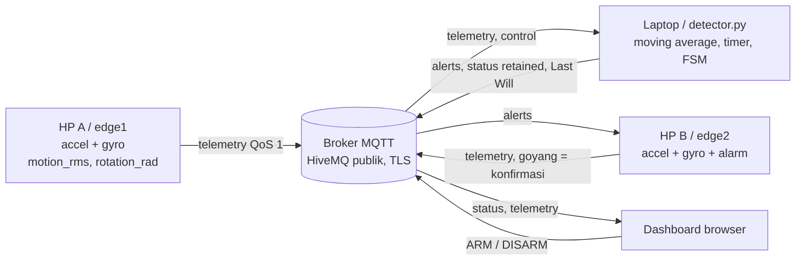
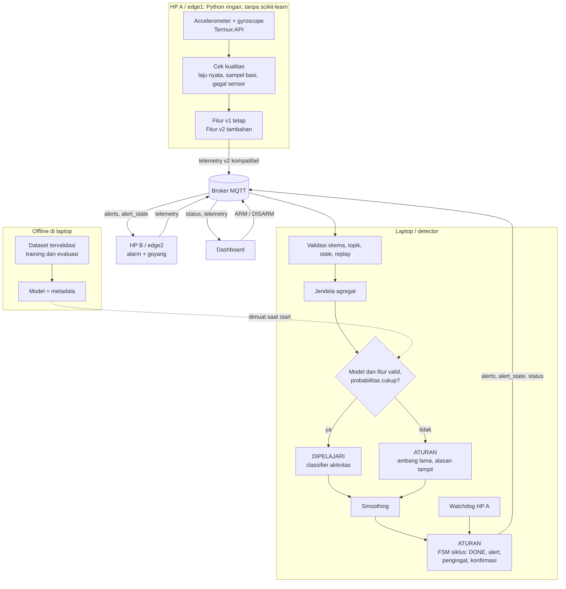
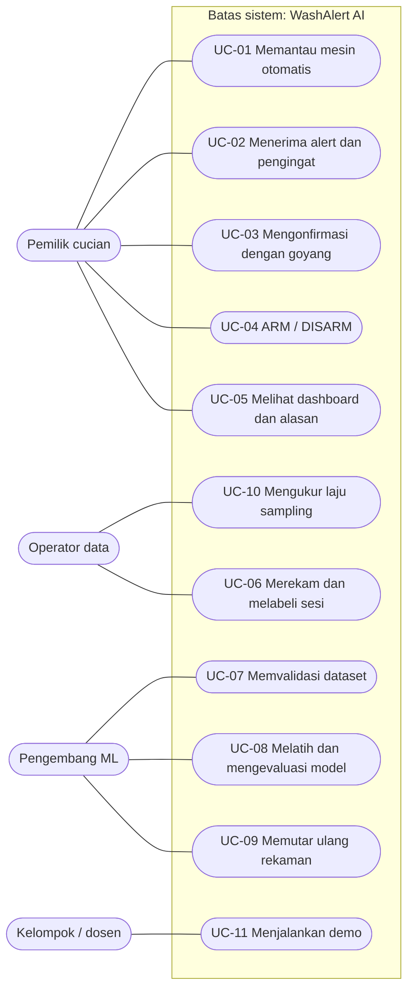
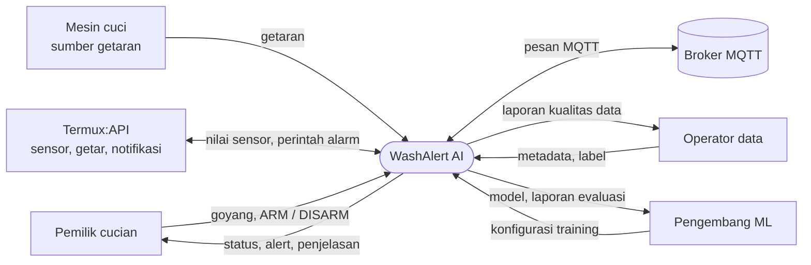
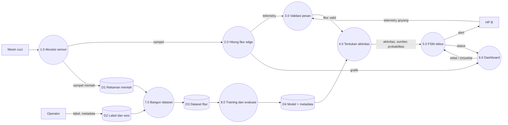
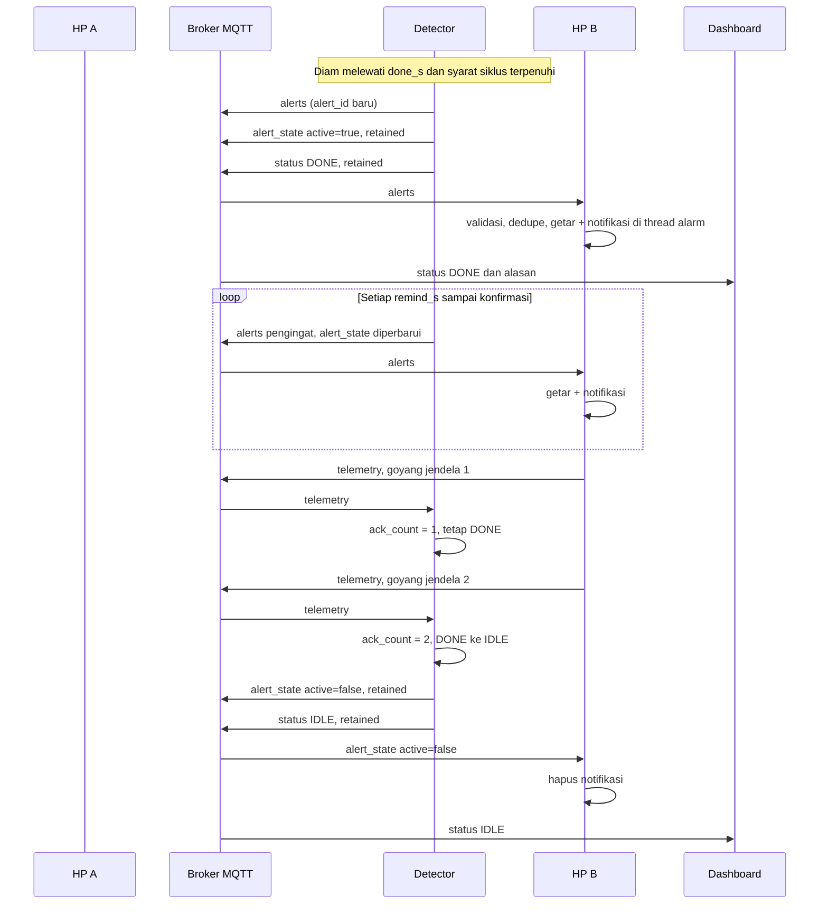
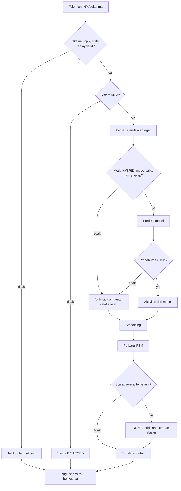
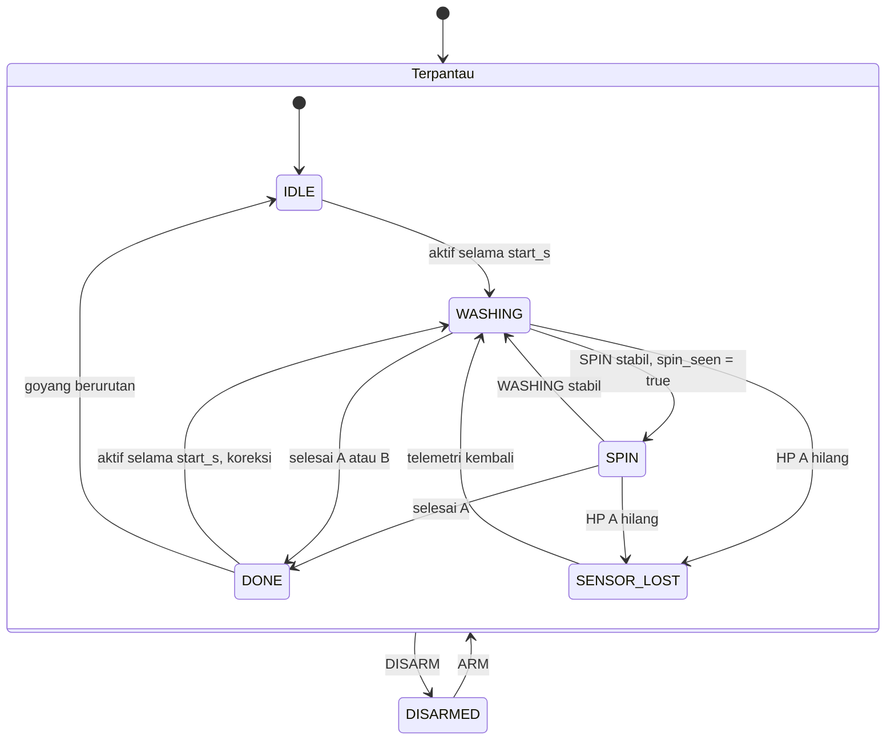
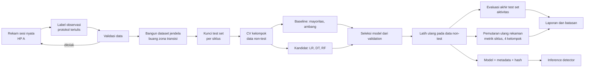

# Software Requirements Specification: WashAlert AI

**Intelligent IoT Laundry Monitoring System**

| Atribut | Nilai |
|---|---|
| Versi | 0.7, memuat CR-003 sampai CR-005, CR-007 sampai CR-012; status diperbarui setelah Phase 8 |
| Baseline | BL-0.7, diusulkan; baseline kerja, belum disetujui formal |
| Tanggal | 4 November 2026 |
| Pemilik | Kelompok 12, Internet of Things |
| Sumber kode | `WashAlert.zip`, folder `cuciberes` |

> **Status penting:** Phase 4 sampai 8 telah mengimplementasikan dan menguji perangkat lunak dengan data sintetis, simulator, dan broker lokal. Dataset nyata belum ada, sehingga tidak ada metrik performa nyata.

## Ringkasan kebutuhan

| Kelompok | Total | Must | Should | Could | Existing and verified | Existing but not verified | Planned | Implemented but not tested | Implemented and tested | Butuh data nyata |
|---|---|---|---|---|---|---|---|---|---|---|
| Fungsional | 87 | 69 | 17 | 1 | 23 | 5 | 2 | 4 | 53 | 9 |
| Non-fungsional | 29 | 18 | 9 | 2 | 2 | 5 | 7 | 2 | 13 | 5 |
| Data dan ML | 27 | 22 | 4 | 1 | 0 | 0 | 1 | 6 | 20 | 8 |
| **Total** | 143 | 109 | 30 | 4 | 25 | 10 | 10 | 12 | 86 | 22 |

Status "Existing and verified" dan "Implemented and tested" berarti perilaku terbukti di perangkat lunak melalui test atau uji audit dengan simulator, mock, atau broker lokal. Status ini tidak berarti telah terbukti pada mesin cuci.

## 1. Pendahuluan

### 1.1 Tujuan

Dokumen ini menetapkan kebutuhan WashAlert AI sebagai acuan desain, implementasi, pengujian, dan demonstrasi.

### 1.2 Ruang lingkup

WashAlert AI mempertahankan sistem tiga node WashAlert dan menambahkan classifier aktivitas terlatih, logika selesai yang lebih andal, alat pengumpulan data, serta fallback.

**Termasuk:** satu mesin cuci, HP A, HP B, detector laptop, dashboard lokal, MQTT, perekaman data, training, evaluasi.

**Tidak termasuk pada rilis ini** (alasan: tidak diperlukan untuk masalah inti, atau belum ada bukti manfaat):

- Multi-mesin dan multi-pemilik.
- Estimasi sisa waktu.
- Riwayat siklus permanen dan akun pengguna.
- Detector di cloud VM.
- Inference di HP dan deep learning.
- Prediksi DONE langsung oleh model.
- Aplikasi Android native.

### 1.3 Pembaca

Anggota kelompok, dosen atau penilai, dan pengembang yang melanjutkan proyek.

### 1.4 Definisi dan singkatan

| Istilah | Arti |
|---|---|
| HP A / edge1 | HP pada mesin cuci |
| HP B / edge2 | HP pemilik |
| Jendela edge | Kumpulan N sampel yang menjadi satu telemetri |
| Jendela agregat | Beberapa jendela edge terakhir, masukan model |
| Aktivitas | Keluaran classifier: IDLE, WASHING, SPIN |
| State | Status FSM: IDLE, WASHING, SPIN, DONE, ditambah status SENSOR_LOST dan DISARMED |
| Siklus | Satu proses dari mesin mulai sampai benar-benar selesai |
| FSM | Finite state machine |
| RTM | Requirements Traceability Matrix |
| CR | Change Request |
| Baseline ambang | Pembanding memakai ambang tulisan manusia. Bukan model ML |

### 1.5 Referensi

1. ISO/IEC/IEEE 29148:2018, *Systems and software engineering — Life cycle processes — Requirements engineering*. Dipakai sebagai acuan prinsip dan struktur. Teks standar tidak saya akses, dan dokumen ini bukan klaim kepatuhan formal. Satu katalog yang saya periksa tidak konsisten mengenai status edisi ini, jadi edisi yang berlaku perlu dikonfirmasi jika dokumen akan diajukan formal.
2. *Praktek Multicommunication 2 Arah dan Multisensor* (D-IOT).
3. *AI for Everyone* (D-AI).
4. Kode WashAlert dan presentasi Kelompok 12.
5. Project Instructions proyek ini (PI).

### 1.6 Konvensi

**Kata normatif.** "Harus" atau "tidak boleh" berarti wajib. "Sebaiknya" berarti dianjurkan. Prioritas memakai Must, Should, dan Could.

**Kode sumber kebutuhan.** Hanya D-IOT dan D-AI yang berasal dari materi dosen.

| Kode | Asal | Sifat |
|---|---|---|
| D-IOT | Materi tugas IoT | Ketentuan atau materi dosen |
| D-AI | Slide AI for Everyone | Konsep dosen, bukan ketentuan tugas |
| C | Kode atau README lama | Perilaku yang ada |
| PI | Project Instructions | Keputusan tim, bukan dokumen dosen |
| A-nn | Temuan audit | Rekomendasi rekayasa berbasis bukti |

**Angka bertanda "diusulkan, perlu validasi"** adalah target awal saya, bukan hasil pengukuran atau ketentuan.

## 2. Deskripsi umum

### 2.1 Perspektif produk

WashAlert AI adalah peningkatan sistem yang ada, bukan produk baru. Topik MQTT, peran node, dan alur alert dipertahankan.

### 2.2 Hasil audit dan arsitektur lama




Bukti audit yang dijalankan pada 4 November 2026 pada kode asli:

| ID bukti | Uji | Hasil | Batasan |
|---|---|---|---|
| 15 test lama | `python -m unittest discover -s tests -t .` | 15 lulus | Unit test |
| AUDIT-E2E | Detector dan dua edge simulator lewat broker lokal | Siklus, alert, dan konfirmasi berhasil | Tanpa TLS, tanpa HP |
| AUDIT-DASH | Dashboard di browser headless | Status, DISARM, dan ARM berjalan | Grafik belum diperiksa visual |
| AUDIT-OUTAGE | Broker dimatikan lalu dihidupkan | Detector pulih, kedua edge crash | Broker lokal |
| AUDIT-DEMO | `scripts.offline_demo` | Selesai dengan satu alert awal dan konfirmasi | Data buatan |
| Screenshot Termux | Arsip kelompok | `hp_pemilik.py` berjalan di HP nyata dan membaca sensor | Satu tangkapan layar, dan alarm tidak terlihat |

Uji AUDIT belum menjadi test otomatis di repository. Kebutuhan terkait mencantumkan test yang akan dibuat.

**Koreksi terhadap laporan audit sebelumnya.** Saya menyatakan belum ada data sensor nyata. Yang lebih tepat: belum ada **dataset** nyata, dan screenshot tersebut membuktikan pembacaan sensor pernah berjalan pada satu HP. Screenshot itu juga masih memakai `PROJECT_ID` bawaan `kelas_iot_demo`.

**Daftar temuan:**

| ID | Temuan | Bukti |
|---|---|---|
| A-01 | Program edge crash saat broker putus (`RuntimeError` dari `wait_for_publish`) | UJI |
| A-02 | Traceback saat broker belum terjangkau saat start | UJI |
| A-03 | `motion_rms` hampir buta terhadap getaran horizontal: amplitudo 1 m/s² menghasilkan 0,031 | UJI |
| A-04 | `rotation_rad` bergantung panjang jendela: ω 0,2 rad/s melewati ambang spin pada jendela 4 detik, tidak pada 1,4 detik | UJI |
| A-05 | Offset RMS 0,15 mencegah DONE; offset ≥ 0,26 memicu WASHING palsu | UJI |
| A-06 | `automatic_connection` tidak dibaca dan dashboard tidak mengirim kredensial | KODE |
| A-07 | `termux-sensor -n 3` menghasilkan 3 sampel, 2 dibuang | UJI (mock) |
| A-08 | Sensor mati setelah pernah terbaca tidak memicu error, nilai lama tetap dikembalikan | UJI (mock) |
| A-09 | Timestamp diambil setelah subprocess; laju nyata tidak dicatat | KODE |
| A-10 | Jeda 130 detik pada mode real menghasilkan DONE dan alert berulang saat mesin lanjut, termasuk setelah spin antara | UJI |
| A-11 | DONE tanpa syarat spin atau durasi minimum: terjadi setelah 1,13 menit | UJI |
| A-12 | Mesin aktif lagi saat DONE tidak terdeteksi | UJI |
| A-13 | Pada mode demo, satu senggolan memicu WASHING lalu DONE pada periode telemetri 4 dan 6 detik | UJI |
| A-14 | Satu jendela rotasi tinggi memindahkan WASHING ke SPIN | UJI |
| A-15 | Selisih jam > 30 detik menolak telemetri tanpa pemberitahuan ke dashboard | UJI |
| A-16 | `boot_id` baru melewati pemeriksaan replay | UJI |
| A-17 | Tidak ada watchdog untuk HP A | KODE |
| A-18 | File joblib dapat menjalankan kode saat dimuat; berlaku jika model dipakai | Risiko desain |
| A-19 | State detector hanya di memori | KODE |
| A-20 | HP B menerima JSON objek apa pun sebagai alert | UJI |
| A-21 | Alert saat HP B offline tidak diterima saat kembali | UJI |
| A-22 | Alarm dijalankan pada callback MQTT dan dapat menahan loop | KODE |
| A-23 | Satu jendela RMS ≥ 3 pada HP B dianggap konfirmasi | UJI |
| A-24 | Tidak ada umpan balik konfirmasi ke HP B | KODE |
| A-25 | ARM selalu menerbitkan IDLE | KODE |
| A-26 | Callback hanya menangani exception parsing tertentu | KODE |
| A-27 | Klien lain pada broker dapat memalsukan alert dan DISARM | UJI |
| A-28 | Peta `last_seq` bertambah per `boot_id` | KODE |
| A-29 | Rekaman baru dapat memuat data pengguna kos; berlaku saat data dikumpulkan | Risiko desain |
| A-30 | Screenshot Termux menunjukkan `hp_pemilik.py` berjalan di HP nyata (LSM6DSOTR), dengan `motion` 0,086 dan `rotation` 0,596 rad pada satu jendela. Jika pola ini terjadi di HP A, nilai itu melewati ambang spin 0,5 | Bukti arsip; dampak HIPOTESIS |

### 2.3 Arsitektur usulan




Keputusan utama, dengan alasan:

- **DONE tidak menjadi kelas model.** Diam karena rendam dan diam karena selesai tidak dapat dibedakan dari sinyal sesaat, dan jumlah contoh selesai hanya satu per siklus.
- **Inference di laptop.** Sesuai peran laptop saat ini dan menjaga HP tetap ringan.
- **Fitur baru dihitung di HP.** Informasi getaran horizontal sudah hilang pada `motion_rms`, sehingga tidak bisa dipulihkan di laptop.
- **HYBRID:** model menentukan aktivitas, aturan menjadi fallback aktivitas, dan FSM selalu membuat keputusan akhir.

| Keputusan | Komponen | Jenis |
|---|---|---|
| Aktivitas per jendela | Classifier | Dipelajari |
| Validasi pesan, fallback, smoothing | Detector | Aturan |
| Mulai siklus, DONE, koreksi | FSM | Aturan, parameter jeda diukur dari data |
| Pengingat, konfirmasi, ARM/DISARM | FSM | Aturan |

### 2.4 Fungsi produk

Memantau getaran, mengenali aktivitas, mendeteksi selesainya siklus, memberi alert dan pengingat, menerima konfirmasi, menampilkan keadaan, mengumpulkan data, melatih model, dan bekerja tanpa model.

### 2.5 Karakteristik pengguna

| Pengguna | Kebutuhan |
|---|---|
| Pemilik cucian | Notifikasi jelas tanpa pengetahuan teknis |
| Operator data | Protokol rekaman dan label tertulis |
| Mahasiswa pengembang | Kode modular, perintah sederhana |
| Dosen | Bukti, batasan, dan demo yang dapat diperiksa |

### 2.6 Lingkungan operasi

| Node | Lingkungan |
|---|---|
| HP A, HP B | Android, Termux dan Termux:API dari F-Droid, Python ≥ 3.10, accelerometer dan gyroscope |
| Laptop | Python ≥ 3.10 untuk detector. Python ≥ 3.12 untuk versi ML tersemat (CR-008). Linux telah dijalankan; Windows disebut README, belum saya verifikasi |
| Dashboard | Browser modern. Pustaka MQTT tersimpan lokal |
| Broker | HiveMQ publik, atau broker berautentikasi |

### 2.7 Batasan desain

- Harus mempertahankan minimal 2 edge, 2 sensor, 2 processing, dan 1 protokol ke cloud (D-IOT).
- Dashboard hanya dibuka dari laptop, sesuai implementasi saat ini.
- Termux:API menentukan laju sensor. Laju maksimum belum diukur.
- Broker publik dapat diakses pihak lain. Materi dosen meminta topik unik dan tidak mengirim data rahasia.
- Kode edge tidak boleh membutuhkan scikit-learn.

### 2.8 Asumsi dan ketergantungan

| ID | Asumsi | Dampak jika salah |
|---|---|---|
| AS-1 | HP A dapat ditempatkan stabil pada mesin | Label dan fitur berubah, posisi perlu diuji |
| AS-2 | Kelompok dapat mengakses minimal satu mesin cuci | Evaluasi nyata tidak dapat dilakukan |
| AS-3 | Laju sampling cukup untuk statistik amplitudo | Panjang jendela dan fitur berubah |
| AS-4 | IDLE, WASHING, dan SPIN dapat dibedakan pengamat | Definisi kelas perlu CR |
| AS-5 | Jam HP dan laptop selisih < 30 detik | Telemetri ditolak, ditangani oleh kebutuhan penolakan terlihat |

### 2.9 Informasi yang masih kurang

| ID | Pertanyaan | Dipakai untuk | Pemilik |
|---|---|---|---|
| Q-1 | Apakah ada ketentuan tertulis dosen untuk upgrade AI? | Kebenaran sumber dan rubrik | Kelompok |
| Q-2 | Kapan deadline? | Lingkup dan target data | Kelompok |
| Q-3 | Berapa mesin dan jenis apa yang dapat diakses? | Klaim generalisasi | Kelompok |
| Q-4 | Merek HP A dan HP B? | Pengukuran sensor | Kelompok |
| Q-5 | Berapa laju nyata, offset diam, dan gyro kosong? | Fitur dan jendela | Pengukuran |
| Q-6 | Berapa lama jeda terpanjang satu siklus? | `done_hold_s` | Pengukuran |
| Q-7 | Apakah repository GitHub sama dengan zip? | Sumber kode | Kelompok |

### 2.10 Pemenuhan ketentuan dosen

| Ketentuan tugas IoT | Pemenuhan |
|---|---|
| 2 edge, 2 sensor | FR-001, FR-015 |
| Minimal 2 jenis processing | FR-008, FR-009, FR-011, FR-012 |
| Algoritma AI atau algoritma lain | FR-044; classifier pada FR-035 |
| 1 protokol ke cloud | FR-015, NFR-010 |
| Dashboard satu jaringan, opsional | FR-070 sampai FR-073 |
| Dokumen dan video | Fase 9; bukan kebutuhan perangkat lunak |

Materi dosen tidak mewajibkan angka akurasi. "95% accuracy" pada slide 45 D-AI adalah contoh kriteria.

## 3. Kebutuhan fungsional

### 3.1 Akuisisi sensor Android

#### FR-001 — Pembacaan accelerometer dan gyroscope

**Pernyataan:** Pada `--source android`, edge harus membaca accelerometer (m/s²) dan gyroscope (rad/s) tiga sumbu melalui Termux:API.

- **Rasional:** Sumber data fisik seluruh sistem.
- **Sumber:** D-IOT ketentuan 2; C `sensors.py`
- **Prioritas:** Must · **Status:** Existing but not verified · **Butuh data nyata**
- **Kriteria penerimaan:** Di HP uji, `--debug-sensors` menampilkan tiga nilai accel dan tiga nilai gyro. HP diam: magnitude accel mendekati 9,8 dan gyro mendekati 0.
- **Verifikasi:** Demo · **Test:** TC-FR-001

#### FR-002 — Deteksi nama sensor

**Pernyataan:** Edge harus menemukan nama sensor secara otomatis dan menerima override `SENSOR_ACCEL` dan `SENSOR_GYRO`.

- **Rasional:** Nama sensor berbeda antar merek HP.
- **Sumber:** C `sensors.py`; presentasi lama (kendala 1)
- **Prioritas:** Must · **Status:** Implemented and tested
- **Kriteria penerimaan:** Daftar sensor tiruan bernama `lsm6dso_acc` dan `BMI160 Gyroscope` terdeteksi. Versi uncalibrated dan linear dilewati. Override diprioritaskan. Tanpa sensor: error berisi daftar sensor.
- **Verifikasi:** Uji (mock), Demo · **Test:** test_detects_vendor_sensor_names_and_skips_uncalibrated, test_env_override_wins, test_missing_sensor_lists_available_names

#### FR-003 — Penandaan sampel basi

**Pernyataan:** Edge harus menandai setiap sampel yang memakai nilai sensor terakhir karena pembacaan kosong, dan menghitungnya per jendela sebagai `stale_count`.

- **Rasional:** Audit: nilai lama saat ini tampil seperti data baru.
- **Sumber:** A-08 (uji mock)
- **Prioritas:** Must · **Status:** Implemented and tested
- **Kriteria penerimaan:** Jendela 5 sampel dengan 2 pembacaan gyro kosong melaporkan `stale_count`=2. Jendela tanpa kekosongan melaporkan 0.
- **Verifikasi:** Uji · **Test:** test_missing_gyro_is_marked_not_zero_filled, test_stale_samples_counted

#### FR-004 — Deteksi sensor gagal

**Pernyataan:** Edge harus melaporkan `sensor_fault=true` jika 20 pembacaan berturut-turut (diusulkan, perlu validasi) tidak menghasilkan nilai baru untuk salah satu sensor.

- **Rasional:** Sensor beku saat ini tidak memicu error.
- **Sumber:** A-08
- **Prioritas:** Must · **Status:** Implemented and tested
- **Kriteria penerimaan:** Mock sensor mati setelah pembacaan pertama: `sensor_fault=true` terkirim, proses tetap hidup. Sensor pulih: nilai kembali false.
- **Verifikasi:** Uji · **Test:** test_sensor_fault_after_repeated_empty_reads_and_recovery, test_sensor_fault_recorded_in_metadata

#### FR-005 — Waktu dan laju nyata

**Pernyataan:** Setiap jendela v2 harus memuat durasi nyata `window_s`, `n_samples`, dan `actual_hz` yang dihitung dari timestamp sampel, bukan dari interval nominal.

- **Rasional:** Laju nominal belum tentu sama dengan laju nyata; presentasi lama mengakui belum diukur.
- **Sumber:** PI §8; A-09
- **Prioritas:** Must · **Status:** Implemented and tested
- **Kriteria penerimaan:** Timestamp tiruan 0; 0,5; 1,0; 1,5; 2,0 menghasilkan `window_s`=2,0, `n_samples`=5, dan `actual_hz`=2,0.
- **Verifikasi:** Uji · **Test:** test_actual_rate_from_timestamps_not_nominal, test_irregular_sampling_uses_real_duration

#### FR-006 — Alat ukur sampling

**Pernyataan:** Sistem harus menyediakan alat yang melaporkan laju sampling nyata, proporsi pembacaan gyro kosong, dan offset saat diam untuk satu HP.

- **Rasional:** Keputusan fitur frekuensi dan panjang jendela bergantung pada angka ini.
- **Sumber:** PI §8; A-09
- **Prioritas:** Must · **Status:** Implemented but not tested · **Butuh data nyata**
- **Kriteria penerimaan:** Dijalankan 2 menit pada HP uji, alat menulis ringkasan dengan median, persentil 5 dan 95 interval, persentase kosong, dan rata-rata `|a|-9.81`.
- **Verifikasi:** Demo, Uji (mock) · **Test:** test_summary_from_timestamps, test_stream_probe_counts_objects, test_measure_tool_reports_rate_and_stream_probe, TC-FR-006-HP

#### FR-007 — Pemanfaatan semua sampel

**Pernyataan:** Pembacaan `termux-sensor -n N` sebaiknya memakai seluruh sampel yang dikembalikan, atau alasan membuangnya didokumentasikan setelah pengukuran.

- **Rasional:** Audit: 2 dari 3 sampel dibuang per panggilan.
- **Sumber:** A-07 (uji mock)
- **Prioritas:** Should · **Status:** Planned · **Butuh data nyata**
- **Kriteria penerimaan:** Output tiruan berisi 3 objek berurutan menghasilkan 3 sampel berurutan, atau keputusan membuang tercatat di dokumen desain beserta hasil ukurnya.
- **Verifikasi:** Uji, Inspeksi · **Test:** TC-FR-007

### 3.2 Pemrosesan accelerometer dan gyroscope

#### FR-008 — Processing A: motion_rms

**Pernyataan:** Edge harus menghitung `motion_rms` = RMS dari `|a|-9.81` per jendela tanpa mengubah maknanya.

- **Rasional:** Ketentuan minimal dua processing; kompatibilitas dengan aturan lama.
- **Sumber:** D-IOT ketentuan 3; C `processing.py`; PI §18.8
- **Prioritas:** Must · **Status:** Existing and verified
- **Kriteria penerimaan:** HP diam ideal memberi nilai sekitar 0. Percepatan tetap 12 m/s² memberi nilai > 2. Jendela < 2 sampel menimbulkan `ValueError`.
- **Verifikasi:** Uji · **Test:** test_stationary_phone, test_movement_increases_features, test_need_multiple_samples

#### FR-009 — Processing B: rotation_rad

**Pernyataan:** Edge harus menghitung `rotation_rad` = integral `|ω|·Δt` per jendela tanpa mengubah maknanya.

- **Rasional:** Ketentuan minimal dua processing; kompatibilitas.
- **Sumber:** D-IOT ketentuan 3; C `processing.py`; PI §18.8
- **Prioritas:** Must · **Status:** Existing and verified
- **Kriteria penerimaan:** Gyro 0,5 rad/s selama 2 detik memberi nilai > 0,9. Gyro nol memberi 0.
- **Verifikasi:** Uji · **Test:** test_stationary_phone, test_movement_increases_features

#### FR-010 — Fitur getaran tanpa offset

**Pernyataan:** Edge harus menghitung `acc_dyn_rms` = akar jumlah varians tiap sumbu per jendela, serta `gyro_rms` dan `gyro_max`.

- **Rasional:** `motion_rms` hampir buta terhadap getaran horizontal dan peka offset; `rotation_rad` bergantung durasi jendela.
- **Sumber:** A-03, A-04, A-05 (uji)
- **Prioritas:** Must · **Status:** Implemented and tested
- **Kriteria penerimaan:** Sinus 1 m/s² horizontal dan vertikal memberi nilai yang selisihnya ≤ 5%. Penambahan offset konstan 0,3 m/s² mengubah nilai ≤ 1%. `gyro_rms` tidak berubah jika durasi jendela digandakan dengan ω tetap.
- **Verifikasi:** Uji · **Test:** test_acc_dyn_rms_sees_horizontal_and_vertical_equally, test_offset_does_not_change_acc_dyn_rms, test_gyro_rms_independent_of_window_length

#### FR-011 — Moving average

**Pernyataan:** Detector harus mempertahankan moving average RMS HP A untuk jalur aturan dan tampilan.

- **Rasional:** Processing C pada sistem lama.
- **Sumber:** C `rules.py`; PI §8
- **Prioritas:** Must · **Status:** Existing and verified
- **Kriteria penerimaan:** Satu lonjakan tidak langsung memindahkan state; nilai `avg_rms` terkirim pada status.
- **Verifikasi:** Uji · **Test:** test_short_bump_does_not_start, test_status_payload_fields

#### FR-012 — Timer durasi

**Pernyataan:** Detector harus melacak durasi aktif, durasi diam, dan total lama kerja.

- **Rasional:** Processing D pada sistem lama.
- **Sumber:** C `rules.py`; PI §8
- **Prioritas:** Must · **Status:** Existing and verified
- **Kriteria penerimaan:** Pada siklus penuh, `run_minutes` > 0.
- **Verifikasi:** Uji · **Test:** test_full_cycle_reaches_done_once

#### FR-013 — Sampel tidak valid

**Pernyataan:** Edge tidak boleh menerbitkan fitur dari sampel berisi NaN atau Infinity, dan harus mengabaikan delta waktu negatif.

- **Rasional:** Data rusak tidak boleh masuk ke model atau FSM.
- **Sumber:** PI §8, §14; A-09
- **Prioritas:** Must · **Status:** Implemented and tested
- **Kriteria penerimaan:** Jendela berisi NaN tidak terbit dan tercatat di log. Timestamp mundur tidak menghasilkan rotasi negatif. Proses tetap berjalan.
- **Verifikasi:** Uji · **Test:** test_nan_and_infinity_rejected, test_backward_timestamp_gives_no_negative_values

#### FR-014 — Fitur frekuensi bersyarat

**Pernyataan:** Fitur frekuensi hanya boleh diaktifkan jika `actual_hz` terukur minimal dua kali frekuensi tertinggi yang dianalisis, dan terbukti menambah macro-F1 pada data validation.

- **Rasional:** Fitur dari sinyal aliased tampak valid tetapi menyesatkan. Laju HP belum diketahui.
- **Sumber:** PI §8; A-09
- **Prioritas:** Could · **Status:** Planned · **Butuh data nyata**
- **Kriteria penerimaan:** Jika syarat laju tidak terpenuhi, fitur tidak ada pada `feature_names` model. Jika aktif, hasil ablation tercantum di laporan.
- **Verifikasi:** Analisis · **Test:** TC-FR-014

### 3.3 Telemetri MQTT

#### FR-015 — Publikasi telemetri

**Pernyataan:** HP A dan HP B harus menerbitkan telemetri JSON ke `washalert/<PROJECT_ID>/edge/<device>/telemetry` dengan QoS 1.

- **Rasional:** Komunikasi ke cloud dan arah naik.
- **Sumber:** D-IOT ketentuan 5; C `edge_runner.py`
- **Prioritas:** Must · **Status:** Existing and verified
- **Kriteria penerimaan:** Lewat broker uji, detector menerima pesan kedua device dengan sequence naik. Pengujian TLS ke HiveMQ dilakukan terpisah.
- **Verifikasi:** Uji, Demo · **Test:** test_edge_starts_before_broker_and_telemetry_is_v2, test_full_cycle_alert_and_ack_unchanged

#### FR-016 — Telemetri v2 kompatibel

**Pernyataan:** Telemetri v2 harus mempertahankan semua field v1 dan menambah field baru sebagai field opsional dengan `schema_version`=2.

- **Rasional:** Detector lama dan baru tetap bisa bekerja selama migrasi.
- **Sumber:** PI §12
- **Prioritas:** Must · **Status:** Implemented and tested
- **Kriteria penerimaan:** Detector baru menerima v1 dan memakai fallback aturan. `Telemetry.from_json` lama menerima v2. Field wajib v1 hilang: ditolak.
- **Verifikasi:** Uji · **Test:** test_v1_payload_still_accepted_and_has_no_extra, test_v2_round_trip_keeps_old_fields, test_detector_behaves_same_for_v1_and_v2

#### FR-017 — Validasi skema

**Pernyataan:** Detector harus menolak telemetri dengan JSON rusak, device tak dikenal, tipe salah, nilai non-finite, atau fitur negatif, tanpa berhenti.

- **Rasional:** Masukan broker publik tidak bisa dipercaya.
- **Sumber:** C `messages.py`, `main.py`; PI §12
- **Prioritas:** Must · **Status:** Implemented and tested
- **Kriteria penerimaan:** Setiap variasi pesan rusak menghasilkan penolakan tercatat dan detector tetap memproses pesan valid berikutnya.
- **Verifikasi:** Uji · **Test:** test_malformed_values_rejected, test_missing_v1_field_rejected, test_invalid_v2_field_rejected

#### FR-018 — Kecocokan topik dan device

**Pernyataan:** Detector harus menolak telemetri jika `device_id` tidak sesuai dengan topik.

- **Rasional:** Mencegah salah identifikasi edge.
- **Sumber:** C `main.py`; PI §14
- **Prioritas:** Must · **Status:** Existing but not verified
- **Kriteria penerimaan:** Payload edge2 pada topik edge1 ditolak dan state tidak berubah.
- **Verifikasi:** Uji · **Test:** TC-FR-018

#### FR-019 — Penolakan pesan basi

**Pernyataan:** Detector harus menolak telemetri yang selisih waktunya lebih dari 30 detik dari jam detector.

- **Rasional:** Pesan lama tidak boleh memicu keputusan.
- **Sumber:** C `rules.py`; PI §10
- **Prioritas:** Must · **Status:** Existing and verified
- **Kriteria penerimaan:** Pesan 31 detik lebih lama berstatus `REJECTED_STALE`.
- **Verifikasi:** Uji · **Test:** test_replay_and_stale_rejected

#### FR-020 — Penolakan replay

**Pernyataan:** Detector harus menolak sequence yang tidak naik untuk pasangan `(device_id, boot_id)` yang sama.

- **Rasional:** Duplikat QoS 1 dan replay sederhana.
- **Sumber:** C `rules.py`; PI §10
- **Prioritas:** Must · **Status:** Existing and verified
- **Kriteria penerimaan:** Pesan sama yang dikirim dua kali berstatus `REJECTED_REPLAY`. Batasan: `boot_id` baru melewati pemeriksaan ini (A-16).
- **Verifikasi:** Uji · **Test:** test_replay_and_stale_rejected

#### FR-021 — Penolakan terlihat

**Pernyataan:** Detector harus menerbitkan jumlah dan alasan penolakan telemetri terbaru pada status.

- **Rasional:** Selisih jam > 30 detik saat ini hanya terlihat di terminal.
- **Sumber:** A-15 (uji)
- **Prioritas:** Should · **Status:** Implemented and tested
- **Kriteria penerimaan:** Telemetri yang semuanya basi membuat status memuat `rejected.stale` > 0 dalam 1 pesan status berikutnya.
- **Verifikasi:** Uji · **Test:** test_status_carries_mode_and_sensor, test_replay_counted_and_status_rate_limited

#### FR-022 — Edge tahan putus koneksi

**Pernyataan:** Program edge tidak boleh berhenti akibat koneksi broker putus dan harus melanjutkan publikasi setelah koneksi pulih.

- **Rasional:** Audit: HP A dan HP B crash dengan `RuntimeError`.
- **Sumber:** A-01 (uji); PI §11
- **Prioritas:** Must · **Status:** Implemented and tested
- **Kriteria penerimaan:** Broker dimatikan 4 detik lalu dihidupkan: kedua proses tetap hidup dan telemetri terbit kembali. Telemetri selama putus boleh hilang dan tidak boleh memicu crash.
- **Verifikasi:** Uji · **Test:** test_edge_survives_three_broker_restarts, test_not_connected_drops_without_exception, test_publish_error_does_not_raise

#### FR-023 — Retry koneksi awal

**Pernyataan:** Node harus mencoba ulang koneksi jika broker belum tersedia saat start dan mencetak status percobaan.

- **Rasional:** Audit: traceback saat broker belum terjangkau.
- **Sumber:** A-02 (uji); PI §11
- **Prioritas:** Should · **Status:** Implemented and tested
- **Kriteria penerimaan:** Broker hidup 10 detik setelah node dimulai: node tersambung tanpa dijalankan ulang.
- **Verifikasi:** Uji · **Test:** test_edge_starts_before_broker_and_telemetry_is_v2, test_detector_starts_before_broker

### 3.4 Pengumpulan dan pelabelan data

#### FR-024 — Perekaman sampel mentah

**Pernyataan:** Alat perekam harus menyimpan sampel accel dan gyro bertimestamp beserta tanda basi ke CSV pada HP A.

- **Rasional:** Data mentah memungkinkan fitur dihitung ulang tanpa merekam ulang.
- **Sumber:** PI §7; D-AI slide 35
- **Prioritas:** Must · **Status:** Implemented and tested · **Butuh data nyata**
- **Kriteria penerimaan:** Rekaman tiruan 60 detik menghasilkan file sesuai skema DML-001 dan jumlah baris sama dengan jumlah pembacaan.
- **Verifikasi:** Uji, Demo · **Test:** test_writes_schema_and_counts, test_record_then_validate_as_real_source_path, TC-FR-024-HP

#### FR-025 — Identitas sesi

**Pernyataan:** Setiap sesi harus memiliki metadata `session_id`, `cycle_id`, `device_id`, `phone_model`, `machine_id`, `machine_type`, `program`, `placement`, `orientation`, `operator`, dan `data_kind`.

- **Rasional:** Split per siklus dan analisis generalisasi membutuhkan identitas ini.
- **Sumber:** PI §7
- **Prioritas:** Must · **Status:** Implemented and tested
- **Kriteria penerimaan:** Perekam menolak mulai jika metadata wajib kosong. `data_kind` hanya `real` atau `synthetic`.
- **Verifikasi:** Uji · **Test:** test_invalid_arguments, test_full_name_in_metadata_rejected

#### FR-026 — Pelabelan observasi

**Pernyataan:** Operator harus dapat mencatat interval label tanpa menyentuh HP A.

- **Rasional:** Menyentuh HP A mengganggu sinyal dan label.
- **Sumber:** PI §7; D-AI slide 33, 38
- **Prioritas:** Must · **Status:** Implemented and tested · **Butuh data nyata**
- **Kriteria penerimaan:** Label dimasukkan dari perangkat lain atau video bertimestamp, dan tersimpan sebagai interval `start_ms`, `end_ms`, `label`, `observer`, dengan selisih jam tercatat.
- **Verifikasi:** Demo, Inspeksi · **Test:** test_interactive_labels_close_previous_interval, test_import_events_from_video, test_offset_from_tap_peak, TC-FR-026-LAPANGAN

#### FR-027 — Pencegahan rekaman tercampur

**Pernyataan:** Alat perekam tidak boleh menimpa sesi yang ada atau menambahkan data ke sesi lain.

- **Rasional:** Mencegah kebocoran dan label salah.
- **Sumber:** PI §7
- **Prioritas:** Must · **Status:** Implemented and tested
- **Kriteria penerimaan:** Memakai `session_id` yang sudah ada menghasilkan penolakan dan file lama tetap identik menurut hash.
- **Verifikasi:** Uji · **Test:** test_refuses_to_overwrite_session, test_labels_not_overwritten

#### FR-028 — Validator dataset

**Pernyataan:** Sistem harus memvalidasi dataset dan memberi laporan kesalahan per file.

- **Rasional:** Data berantakan menghasilkan model buruk.
- **Sumber:** PI §7; D-AI slide 37–39
- **Prioritas:** Must · **Status:** Implemented and tested
- **Kriteria penerimaan:** Validator menolak nilai hilang, label di luar daftar, interval tumpang tindih, timestamp mundur, metadata kosong, dan gap melebihi batas. Exit code bukan nol saat ditolak.
- **Verifikasi:** Uji · **Test:** test_single_bad_row_quarantined_not_imputed, test_out_of_order_rejected_not_sorted, test_unknown_label_rejected, test_cli_exit_codes

#### FR-029 — Ekspor dataset jendela

**Pernyataan:** Sistem harus membangun CSV fitur berlabel dari data mentah dan interval label secara deterministik.

- **Rasional:** Training memakai fitur yang sama dengan inference.
- **Sumber:** PI §7, §8
- **Prioritas:** Must · **Status:** Implemented and tested
- **Kriteria penerimaan:** Dua kali proses pada input sama menghasilkan hash CSV identik. Jendela di zona transisi tidak masuk dataset.
- **Verifikasi:** Uji · **Test:** test_deterministic, test_windows_near_label_change_excluded

#### FR-030 — Pemisahan data sintetis

**Pernyataan:** Data sintetis harus disimpan di `data/synthetic/`, berlabel `data_kind=synthetic`, dan tidak boleh digabung dengan data nyata.

- **Rasional:** Mencegah data buatan dilaporkan sebagai eksperimen.
- **Sumber:** PI §7, §18
- **Prioritas:** Must · **Status:** Implemented and tested
- **Kriteria penerimaan:** Build gabungan real dan synthetic ditolak. Laporan dari data sintetis memuat peringatan pada baris pertama.
- **Verifikasi:** Uji · **Test:** test_marked_and_accepted, test_real_and_synthetic_cannot_mix, test_refuses_other_folders, test_rejected_when_placed_in_real_folder

### 3.5 Pelatihan model

#### FR-031 — Perintah training

**Pernyataan:** Sistem harus menyediakan satu perintah yang memuat dataset tervalidasi, melatih baseline dan kandidat, memilih model, dan menyimpan hasil.

- **Rasional:** Training harus nyata dan dapat diulang.
- **Sumber:** PI §5, §6, §9; D-AI slide 25
- **Prioritas:** Must · **Status:** Implemented and tested
- **Kriteria penerimaan:** Dari dataset sintetis kecil, perintah selesai dengan exit code 0 dan menghasilkan artefak serta laporan. Dataset tidak valid menghasilkan penolakan sebelum training.
- **Verifikasi:** Uji · **Test:** test_baselines_and_candidates_present, test_experiment_recorded, test_mixed_dataset_rejected

#### FR-032 — Perintah evaluasi

**Pernyataan:** Sistem harus menyediakan perintah evaluasi yang menghasilkan metrik aktivitas dan metrik siklus secara terpisah.

- **Rasional:** Akurasi jendela tidak sama dengan keberhasilan notifikasi.
- **Sumber:** PI §9, §15
- **Prioritas:** Must · **Status:** Implemented and tested
- **Kriteria penerimaan:** Laporan memuat metrik DML-017 dan DML-018, jumlah data, dan `data_kind`.
- **Verifikasi:** Uji · **Test:** test_results_and_synthetic_warning, test_second_evaluation_refused_and_access_logged

#### FR-033 — Artefak model

**Pernyataan:** Training harus menyimpan file model dan metadata JSON sesuai DML-022.

- **Rasional:** Model harus dapat diidentifikasi dan diverifikasi.
- **Sumber:** PI §6, §9
- **Prioritas:** Must · **Status:** Implemented and tested
- **Kriteria penerimaan:** Kedua file ada, hash cocok, dan metadata lolos validasi skema.
- **Verifikasi:** Uji · **Test:** test_metadata_complete, test_round_trip_matches_training_path

### 3.6 Inference real-time

#### FR-034 — Pemuatan model aman

**Pernyataan:** Detector harus memverifikasi keberadaan, hash, skema metadata, dan kecocokan fitur sebelum memakai model.

- **Rasional:** Model yang salah tidak boleh memengaruhi keputusan.
- **Sumber:** PI §11; A-18
- **Prioritas:** Must · **Status:** Implemented and tested
- **Kriteria penerimaan:** Model valid dimuat. File hilang, hash salah, atau `feature_names` tidak cocok memicu FR-083 dengan alasan spesifik.
- **Verifikasi:** Uji · **Test:** test_tampered_file_not_deserialized, test_model_missing, test_feature_schema_mismatch, test_corrupt_model_with_matching_hash

#### FR-035 — Prediksi aktivitas

**Pernyataan:** Pada mode HYBRID, detector harus memprediksi IDLE, WASHING, atau SPIN untuk tiap jendela agregat lengkap beserta probabilitas per kelas.

- **Rasional:** Inti pembelajaran terawasi A → B.
- **Sumber:** PI §5; D-AI slide 25
- **Prioritas:** Must · **Status:** Implemented and tested
- **Kriteria penerimaan:** Vektor fitur tiruan tiap kelas menghasilkan label dari daftar kelas model dan probabilitas berjumlah 1 ± 0,001.
- **Verifikasi:** Uji · **Test:** test_model_used_when_confident, test_hybrid_synthetic_model_runs_end_to_end

#### FR-036 — Agregasi jendela

**Pernyataan:** Detector harus membentuk jendela agregat sesuai DML-009 dan tidak memprediksi jika data tidak lengkap.

- **Rasional:** Keputusan dari data kurang tidak dapat dipertanggungjawabkan.
- **Sumber:** PI §8, §11
- **Prioritas:** Must · **Status:** Implemented and tested
- **Kriteria penerimaan:** Jendela kurang dari syarat minimum tidak menghasilkan prediksi dan aktivitas berasal dari fallback aturan dengan alasan `incomplete_window`.
- **Verifikasi:** Uji · **Test:** test_incomplete_window, test_hybrid_synthetic_model_runs_end_to_end

#### FR-037 — Publikasi hasil prediksi

**Pernyataan:** Status harus memuat aktivitas, sumber aktivitas, probabilitas model, mode, versi model, dan waktu klasifikasi jika tersedia.

- **Rasional:** Keputusan harus bisa diamati dan dijelaskan.
- **Sumber:** PI §12, §13
- **Prioritas:** Must · **Status:** Implemented and tested
- **Kriteria penerimaan:** Pada HYBRID field terisi. Pada RULE_ONLY field model tidak muncul, sehingga `test_status_payload_fields` tetap lulus.
- **Verifikasi:** Uji · **Test:** test_status_carries_mode_and_sensor, test_hybrid_synthetic_model_runs_end_to_end

### 3.7 Deteksi hybrid ML dan state machine

#### FR-038 — Mode deteksi

**Pernyataan:** Detector harus mendukung `DETECTION_MODE` bernilai `RULE_ONLY`, `HYBRID`, dan `ML_ONLY`. `ML_ONLY` bersifat eksperimen, dan default tetap `RULE_ONLY`.

- **Rasional:** Prompt Phase 6 meminta ketiga mode dapat dikonfigurasi (CR-009).
- **Sumber:** PI §11, prompt Phase 6 §6
- **Prioritas:** Must · **Status:** Implemented and tested
- **Kriteria penerimaan:** Nilai tidak dikenal menghasilkan penolakan konfigurasi saat start. `ML_ONLY` tanpa model valid melaporkan `effective_mode` `RULE_ONLY` beserta alasannya.
- **Verifikasi:** Uji · **Test:** test_rule_only_default_without_model, test_ml_only_runs_without_window_fallback, test_unknown_mode_refused_at_start, test_ml_only_without_model_reports_rule_only_and_cycle_works

#### FR-039 — Default kompatibel

**Pernyataan:** Tanpa konfigurasi model, detector harus berjalan pada `RULE_ONLY`.

- **Rasional:** Sistem lama tidak boleh rusak.
- **Sumber:** PI §11, §18
- **Prioritas:** Must · **Status:** Implemented and tested
- **Kriteria penerimaan:** Dijalankan dengan `.env` lama, seluruh perilaku test lama tetap sama dan status menyatakan mode `RULE_ONLY`.
- **Verifikasi:** Uji · **Test:** test_default_is_rule_only, test_rule_only_full_cycle, test_constructor_defaults_preserve_old_behaviour

#### FR-040 — Pemisahan aktivitas dan keputusan

**Pernyataan:** Model hanya boleh menghasilkan aktivitas. Keputusan DONE, alert, pengingat, dan konfirmasi harus dibuat oleh FSM.

- **Rasional:** DONE bergantung pada riwayat, bukan sinyal sesaat.
- **Sumber:** PI §5, §10
- **Prioritas:** Must · **Status:** Implemented and tested
- **Kriteria penerimaan:** Urutan aktivitas yang sama dari sumber aturan atau model menghasilkan urutan state yang sama. Tidak ada jalur kode yang menerbitkan alert langsung dari prediksi.
- **Verifikasi:** Uji, Inspeksi · **Test:** test_probability_never_decides_done_directly, test_model_reaches_fsm_only_through_activity_module

#### FR-041 — Probabilitas rendah

**Pernyataan:** Jika probabilitas tertinggi di bawah ambang, aktivitas jendela itu harus berasal dari aturan dan `activity_source` harus bernilai `rule_low_probability`.

- **Rasional:** Prediksi lemah tidak boleh diam-diam memengaruhi FSM.
- **Sumber:** PI §11
- **Prioritas:** Must · **Status:** Implemented and tested
- **Kriteria penerimaan:** Probabilitas 0,40 dengan ambang 0,60 (diusulkan, ditetapkan dari data validation) memakai aturan. Probabilitas 0,80 memakai model.
- **Verifikasi:** Uji · **Test:** test_low_probability_uses_rule

#### FR-042 — Smoothing prediksi

**Pernyataan:** Aktivitas masukan FSM harus berasal dari voting mayoritas N prediksi terakhir, dengan N = 5 (diusulkan, perlu validasi).

- **Rasional:** Mencegah state berkedip karena prediksi noisy.
- **Sumber:** PI §10
- **Prioritas:** Must · **Status:** Implemented and tested
- **Kriteria penerimaan:** Urutan WASHING, SPIN, WASHING, WASHING, WASHING tidak menghasilkan SPIN.
- **Verifikasi:** Uji · **Test:** test_smoothing_rejects_single_flip

#### FR-043 — Toleransi offset

**Pernyataan:** Pada HYBRID dengan fitur v2, offset kalibrasi HP tidak boleh menghalangi tercapainya DONE.

- **Rasional:** Audit: offset RMS 0,15 membuat alert tidak pernah terkirim.
- **Sumber:** A-05 (uji)
- **Prioritas:** Must · **Status:** Implemented but not tested · **Butuh data nyata**
- **Kriteria penerimaan:** Skenario sintetis offset 0,15 dan 0,30 mencapai DONE. Validasi fisik memakai HP uji. Pada `RULE_ONLY`, batasan lama didokumentasikan.
- **Verifikasi:** Uji, Analisis · **Test:** test_offset_does_not_block_done_in_hybrid, TC-FR-043-HP

### 3.8 Deteksi selesainya siklus

#### FR-044 — State siklus

**Pernyataan:** FSM harus mempertahankan state IDLE, WASHING, SPIN, dan DONE.

- **Rasional:** Filosofi dan tampilan sistem lama.
- **Sumber:** D-IOT ketentuan 4; C `rules.py`; PI §10
- **Prioritas:** Must · **Status:** Existing and verified
- **Kriteria penerimaan:** Siklus uji melewati keempat state.
- **Verifikasi:** Uji · **Test:** test_full_cycle_reaches_done_once

#### FR-045 — Senggolan singkat

**Pernyataan:** Getaran singkat tidak boleh memulai WASHING.

- **Rasional:** Mencegah siklus palsu.
- **Sumber:** C `rules.py`; PI §14
- **Prioritas:** Must · **Status:** Existing and verified
- **Kriteria penerimaan:** Satu lonjakan pada periode telemetri 2 detik tetap IDLE.
- **Verifikasi:** Uji · **Test:** test_short_bump_does_not_start

#### FR-046 — Independen dari periode telemetri

**Pernyataan:** Satu senggolan tidak boleh memulai WASHING pada periode telemetri 1 sampai 10 detik.

- **Rasional:** Audit: pada mode demo, periode 4 dan 6 detik memicu WASHING lalu DONE.
- **Sumber:** A-13 (uji)
- **Prioritas:** Must · **Status:** Implemented and tested
- **Kriteria penerimaan:** Satu jendela RMS 2,0 tetap IDLE untuk periode 1, 2, 4, 6, dan 10 detik pada mode demo.
- **Verifikasi:** Uji · **Test:** test_single_bump_ignored_at_any_period, test_single_bump_does_not_start

#### FR-047 — Jeda singkat

**Pernyataan:** Jeda lebih pendek dari batas konfirmasi tidak boleh menghasilkan DONE.

- **Rasional:** Tujuan utama durasi diam.
- **Sumber:** C `rules.py`; PI §14
- **Prioritas:** Must · **Status:** Existing and verified
- **Kriteria penerimaan:** Jeda 4 detik pada `done_s`=8 tidak menghasilkan DONE dan aktivitas berikutnya kembali WASHING.
- **Verifikasi:** Uji · **Test:** test_short_pause_is_not_done

#### FR-048 — Syarat durasi minimum

**Pernyataan:** DONE tidak boleh terjadi sebelum total kerja melewati `min_run_s`.

- **Rasional:** Audit: 64 detik getaran bisa menghasilkan alert.
- **Sumber:** A-11 (uji)
- **Prioritas:** Must · **Status:** Implemented and tested · **Butuh data nyata**
- **Kriteria penerimaan:** Pada mode real dengan `min_run_s` = 600 detik (diusulkan, perlu validasi), getaran 64 detik lalu diam tidak menghasilkan alert selesai.
- **Verifikasi:** Uji · **Test:** test_short_run_never_alerts

#### FR-049 — Batas diam berbasis data

**Pernyataan:** `done_hold_s` mode real harus ditetapkan dari jeda terpanjang siklus nyata pada data pengembangan ditambah margin yang terdokumentasi.

- **Rasional:** Audit: jeda 130 detik menimbulkan alert palsu.
- **Sumber:** A-10 (uji); PI §10
- **Prioritas:** Must · **Status:** Implemented but not tested · **Butuh data nyata**
- **Kriteria penerimaan:** Dokumen memuat tabel jeda per siklus, nilai terpilih, dan dampaknya pada keterlambatan. Skenario jeda di bawah nilai itu tidak menghasilkan DONE.
- **Verifikasi:** Analisis, Uji · **Test:** test_pause_analysis_ignores_idle_outside_cycle, TC-FR-049-LAPANGAN

#### FR-050 — Alasan selesai

**Pernyataan:** Alert selesai harus membedakan `completed_after_spin` dan `stopped_without_spin`, dengan batas diam tanpa spin lebih lama.

- **Rasional:** Program tanpa spin tetap harus memberi tahu, tetapi dengan keyakinan berbeda.
- **Sumber:** A-11
- **Prioritas:** Should · **Status:** Implemented and tested
- **Kriteria penerimaan:** Siklus dengan spin memberi jenis pertama. Siklus tanpa spin memberi jenis kedua hanya setelah batas yang lebih lama.
- **Verifikasi:** Uji · **Test:** test_after_spin_uses_done_s, test_without_spin_waits_longer_and_says_so

#### FR-051 — Koreksi saat mesin aktif lagi

**Pernyataan:** Jika mesin aktif selama `start_s` setelah DONE belum dikonfirmasi, FSM harus kembali ke siklus aktif, menghentikan pengingat, dan menerbitkan koreksi.

- **Rasional:** Audit: alert berulang saat mesin masih bekerja, dan siklus baru tidak terdeteksi.
- **Sumber:** A-10, A-12 (uji)
- **Prioritas:** Must · **Status:** Implemented and tested
- **Kriteria penerimaan:** Skenario DONE lalu aktif 20 menit menghasilkan 1 koreksi dan tidak ada pengingat tambahan setelah koreksi.
- **Verifikasi:** Uji · **Test:** test_correction_after_false_done, test_brief_bump_in_done_is_not_correction, test_correction_clear_precedes_alert

#### FR-052 — Alert sekali per penyelesaian

**Pernyataan:** Satu penyelesaian harus menghasilkan satu alert awal, di luar pengingat terjadwal.

- **Rasional:** Mencegah notifikasi ganda.
- **Sumber:** C `rules.py`; PI §10
- **Prioritas:** Must · **Status:** Existing and verified
- **Kriteria penerimaan:** Satu siklus uji menghasilkan tepat satu alert sebelum interval pengingat.
- **Verifikasi:** Uji · **Test:** test_full_cycle_reaches_done_once

#### FR-053 — Stabilitas SPIN

**Pernyataan:** Pada `RULE_ONLY`, SPIN sebaiknya tidak dipicu oleh satu jendela rotasi tinggi.

- **Rasional:** Audit: state SPIN berkedip dari satu jendela.
- **Sumber:** A-14 (uji)
- **Prioritas:** Should · **Status:** Implemented and tested
- **Kriteria penerimaan:** Satu jendela `rotation_rad`=0,6 saat WASHING tetap WASHING. Spin bertahan minimal 3 jendela menjadi SPIN.
- **Verifikasi:** Uji · **Test:** test_rotation_needs_consecutive_windows, test_rotation_streak_broken_by_stillness

#### FR-054 — Watchdog HP A

**Pernyataan:** Detector harus menerbitkan status `SENSOR_LOST` dan memberi tahu pemilik jika HP A tidak mengirim telemetri valid selama batas waktu saat siklus aktif. Saat DONE, detector harus menandai `sensor.lost=true` dan tetap mengirim pengingat serta menerima konfirmasi.

- **Rasional:** Audit: HP A mati tidak terlihat sebagai masalah.
- **Sumber:** A-17; PI §11
- **Prioritas:** Must · **Status:** Implemented and tested
- **Kriteria penerimaan:** Dengan batas 60 detik (diusulkan), telemetri berhenti saat WASHING menghasilkan `SENSOR_LOST` dan satu alert `sensor_lost`. Telemetri kembali memulihkan pemantauan. Waktu tanpa data tidak dihitung sebagai bukti diam. HP A hilang saat DONE: pengingat tetap terkirim dan goyangan HP B tetap diterima.
- **Verifikasi:** Uji · **Test:** test_sensor_lost_mid_cycle_is_not_done, test_lost_in_done_stays_done_reminds_and_ack_works, test_sensor_lost_published_by_tick

#### FR-055 — Pemulihan state

**Pernyataan:** Detector sebaiknya memulihkan state siklus aktif atau DONE setelah restart.

- **Rasional:** State saat ini hanya di memori.
- **Sumber:** A-19
- **Prioritas:** Should · **Status:** Implemented and tested
- **Kriteria penerimaan:** Restart saat DONE: pengingat tetap berjalan dan status menyatakan state dipulihkan. File rusak: mulai IDLE dengan peringatan.
- **Verifikasi:** Uji · **Test:** test_done_survives_restart_and_reminder_continues, test_corrupt_or_old_state_is_ignored, test_detector_restart_restores_done

### 3.9 Pengiriman alert

#### FR-056 — Publikasi alert

**Pernyataan:** Detector harus menerbitkan alert ke topik `alerts` dengan QoS 1 saat DONE tercapai.

- **Rasional:** Komunikasi turun.
- **Sumber:** C `main.py`; PI §12
- **Prioritas:** Must · **Status:** Existing and verified
- **Kriteria penerimaan:** Lewat broker uji, HP B menerima alert dengan `event`, `run_minutes`, `reason`, dan `detected_at_ms`.
- **Verifikasi:** Uji, Demo · **Test:** test_full_cycle_alert_and_ack_unchanged

#### FR-057 — Pengingat

**Pernyataan:** Detector harus mengulang alert setiap `remind_s` sampai konfirmasi atau DISARM.

- **Rasional:** Tujuan utama produk.
- **Sumber:** C `rules.py`
- **Prioritas:** Must · **Status:** Existing and verified
- **Kriteria penerimaan:** Setelah `remind_s`, keputusan berikutnya memuat alert pengingat.
- **Verifikasi:** Uji · **Test:** test_reminder_then_owner_ack

#### FR-058 — Alarm HP B

**Pernyataan:** HP B harus bergetar dan menampilkan notifikasi saat menerima alert valid.

- **Rasional:** Aktuator pemberitahuan pemilik.
- **Sumber:** C `alarm.py`; presentasi lama
- **Prioritas:** Must · **Status:** Existing but not verified
- **Kriteria penerimaan:** Mock: `termux-vibrate` dan `termux-notification` dipanggil. HP nyata: getar dan notifikasi teramati. Tanpa Termux: pesan tercetak.
- **Verifikasi:** Uji (mock), Demo · **Test:** test_android_vibrates_and_notifies, test_laptop_only_prints, TC-FR-058-HP

#### FR-059 — Validasi alert

**Pernyataan:** HP B harus mengabaikan alert yang tidak memenuhi skema dan alert yang lebih tua dari batas waktu.

- **Rasional:** Audit: JSON apa pun saat ini membunyikan alarm.
- **Sumber:** A-20 (uji); PI §12
- **Prioritas:** Must · **Status:** Implemented and tested
- **Kriteria penerimaan:** JSON tanpa field wajib atau timestamp terlalu lama tidak memicu alarm. Pesan palsu yang lolos skema hanya dapat dicegah dengan broker berautentikasi (NFR-011).
- **Verifikasi:** Uji · **Test:** test_rejects_bad, test_rejects_expired, test_malformed_ignored

#### FR-060 — Alert ID dan dedupe

**Pernyataan:** Alert harus memiliki `alert_id` dan HP B sebaiknya mengabaikan ID yang sudah diproses.

- **Rasional:** QoS 1 dapat mengirim duplikat.
- **Sumber:** PI §10, §14
- **Prioritas:** Should · **Status:** Implemented and tested
- **Kriteria penerimaan:** Alert sama dua kali memicu alarm satu kali. Pengingat memakai ID baru.
- **Verifikasi:** Uji · **Test:** test_dedupes_same_id, test_reminder_with_new_id_rings

#### FR-061 — Alert setelah HP B offline

**Pernyataan:** HP B yang tersambung kembali harus menerima alert aktif dalam 10 detik (diusulkan, perlu validasi).

- **Rasional:** Audit: alert saat offline hilang sampai pengingat berikutnya.
- **Sumber:** A-21 (uji)
- **Prioritas:** Should · **Status:** Implemented and tested
- **Kriteria penerimaan:** HP B offline saat DONE lalu tersambung: `alert_state` retained membunyikan alarm dalam batas waktu. Tanpa alert aktif, atau alert kedaluwarsa: alarm tidak berbunyi.
- **Verifikasi:** Uji · **Test:** test_alert_state_retained_for_late_subscriber, test_retained_state_catches_up_once

#### FR-062 — Alarm tidak menahan MQTT

**Pernyataan:** Pemanggilan alarm tidak boleh menahan penerimaan pesan MQTT HP B.

- **Rasional:** Perintah Termux dapat berjalan sampai timeout 10 detik.
- **Sumber:** A-22
- **Prioritas:** Should · **Status:** Implemented and tested
- **Kriteria penerimaan:** Perintah alarm tiruan 10 detik tidak menunda keepalive dan penerbitan telemetri.
- **Verifikasi:** Uji · **Test:** test_slow_alarm_does_not_block_mqtt_thread, test_alarm_failure_does_not_escape

### 3.10 Konfirmasi pemilik

#### FR-063 — Konfirmasi goyang

**Pernyataan:** Goyangan HP B saat DONE harus mengembalikan FSM ke IDLE.

- **Rasional:** Komunikasi dua arah sistem lama.
- **Sumber:** C `rules.py`; presentasi lama
- **Prioritas:** Must · **Status:** Existing and verified
- **Kriteria penerimaan:** Setelah alert, telemetri goyang menghasilkan IDLE.
- **Verifikasi:** Uji · **Test:** test_reminder_then_owner_ack

#### FR-064 — Goyangan di luar DONE diabaikan

**Pernyataan:** Goyangan HP B saat siklus aktif tidak boleh mengubah state.

- **Rasional:** Mencegah konfirmasi prematur.
- **Sumber:** C `rules.py`
- **Prioritas:** Must · **Status:** Existing and verified
- **Kriteria penerimaan:** Saat WASHING, goyangan tidak mengubah state dan status tidak diterbitkan.
- **Verifikasi:** Uji · **Test:** test_owner_shake_ignored_while_washing

#### FR-065 — Konfirmasi tahan guncangan

**Pernyataan:** Konfirmasi harus membutuhkan minimal 2 jendela goyang berurutan setelah alert terkirim (diusulkan, perlu validasi).

- **Rasional:** Audit: satu guncangan menghentikan semua pengingat.
- **Sumber:** A-23 (uji)
- **Prioritas:** Must · **Status:** Implemented and tested
- **Kriteria penerimaan:** Satu jendela RMS 3,1 tetap DONE. Dua jendela berurutan menjadi IDLE. Dua jendela terpisah oleh jendela tenang tetap DONE. Nilai bawaan `Config` lama tetap 1 jendela, sehingga test lama tidak berubah; `from_env` memakai 2.
- **Verifikasi:** Uji · **Test:** test_single_shake_not_enough, test_shake_streak_broken, test_two_shakes_clear_alert_and_new_cycle_can_start

#### FR-066 — Umpan balik konfirmasi

**Pernyataan:** Detector sebaiknya memperbarui topik retained `alert_state` agar HP B menghapus notifikasi setelah konfirmasi.

- **Rasional:** Pemilik perlu tahu konfirmasinya diterima.
- **Sumber:** A-24; PI §12
- **Prioritas:** Should · **Status:** Implemented and tested
- **Kriteria penerimaan:** Setelah konfirmasi, `alert_state.active=false` terbit dan HP B menjalankan penghapusan notifikasi `washalert`. HP B yang offline menerima keadaan terakhir saat tersambung. HP B lama tidak berlangganan topik ini, sehingga tidak berbunyi.
- **Verifikasi:** Uji (mock), Demo · **Test:** test_ack_clears_state, test_inactive_clears_only_after_active

### 3.11 ARM dan DISARM

#### FR-067 — Perintah ARM dan DISARM

**Pernyataan:** Detector harus menerima `ARM` dan `DISARM` dari topik `control`. DISARM harus mereset siklus dan menghentikan alert.

- **Rasional:** Kontrol dua arah sistem lama.
- **Sumber:** C `main.py`, `rules.py`; D-IOT contoh dashboard
- **Prioritas:** Must · **Status:** Existing and verified
- **Kriteria penerimaan:** DISARM: state IDLE dan status DISARMED. ARM: pemantauan aktif. Lewat dashboard terbukti pada uji browser.
- **Verifikasi:** Uji · **Test:** test_disarm_resets, AUDIT-DASH

#### FR-068 — Kontrol dari CLI dan penolakan perintah

**Pernyataan:** `send_control.py` harus mengirim ARM atau DISARM, dan detector harus mengabaikan perintah lain.

- **Rasional:** Alat kontrol sistem lama.
- **Sumber:** C `send_control.py`, `main.py`
- **Prioritas:** Should · **Status:** Existing but not verified
- **Kriteria penerimaan:** Perintah sah diterima. String lain tercatat dan state tidak berubah.
- **Verifikasi:** Uji · **Test:** TC-FR-068

#### FR-069 — Status ARM akurat

**Pernyataan:** Respons ARM harus melaporkan state sebenarnya, bukan selalu IDLE.

- **Rasional:** Audit: ARM saat WASHING sempat menampilkan IDLE.
- **Sumber:** A-25
- **Prioritas:** Should · **Status:** Implemented and tested
- **Kriteria penerimaan:** ARM saat WASHING menerbitkan status WASHING.
- **Verifikasi:** Uji · **Test:** test_arm_reports_true_state, test_reconnect_reports_true_state

### 3.12 Dashboard

#### FR-070 — Status utama

**Pernyataan:** Dashboard harus menampilkan status, alasan, tahap siklus, lama kerja, dan RMS rata-rata secara real-time.

- **Rasional:** Fitur sistem lama.
- **Sumber:** C `index.html`; D-IOT ketentuan 6
- **Prioritas:** Must · **Status:** Existing and verified
- **Kriteria penerimaan:** Lewat broker WebSocket uji, status berubah mengikuti ONLINE, IDLE, WASHING, SPIN, DONE tanpa error JavaScript.
- **Verifikasi:** Uji · **Test:** test_03_valid_telemetry_and_05_chart_updates, test_16_arm_and_17_disarm_confirmed_by_detector, test_timeline_shows_recorded_path_only_and_idle_is_not_done

#### FR-071 — Grafik getaran

**Pernyataan:** Dashboard harus menampilkan grafik `motion_rms` HP A dan HP B.

- **Rasional:** Fitur sistem lama.
- **Sumber:** C `index.html`
- **Prioritas:** Must · **Status:** Existing and verified
- **Kriteria penerimaan:** Setelah telemetri kedua device, kanvas memuat dua garis.
- **Verifikasi:** Uji, Inspeksi · **Test:** test_03_valid_telemetry_and_05_chart_updates, test_chart_breaks_line_across_gap_and_marks_it

#### FR-072 — Koneksi dan kontrol

**Pernyataan:** Dashboard harus menampilkan status koneksi dan tombol ARM/DISARM.

- **Rasional:** Fitur sistem lama.
- **Sumber:** C `index.html`
- **Prioritas:** Must · **Status:** Existing and verified
- **Kriteria penerimaan:** Status koneksi berubah saat tersambung dan terputus. Tombol mengubah status detector.
- **Verifikasi:** Uji · **Test:** test_11_mqtt_disconnected_and_12_reconnected, test_16_arm_and_17_disarm_confirmed_by_detector, test_18_command_timeout_does_not_change_status, test_18b_command_fails_when_disconnected

#### FR-073 — Konfigurasi tanpa kredensial

**Pernyataan:** `/config.json` tidak boleh memuat password broker.

- **Rasional:** Mencegah kebocoran.
- **Sumber:** C `dashboard_server.py`
- **Prioritas:** Must · **Status:** Existing and verified
- **Kriteria penerimaan:** Nilai `MQTT_PASSWORD` tiruan tidak ada pada respons.
- **Verifikasi:** Uji · **Test:** test_local_http_server_and_no_credentials, test_private_broker_does_not_expose_password

#### FR-074 — Panel model

**Pernyataan:** Dashboard harus menampilkan aktivitas, sumber aktivitas, probabilitas model, mode, versi model, dan `data_kind`.

- **Rasional:** Mode tidak boleh berubah tanpa terlihat.
- **Sumber:** PI §11, §13
- **Prioritas:** Must · **Status:** Implemented and tested
- **Kriteria penerimaan:** Pada RULE_ONLY, panel menyatakan model tidak aktif. Fallback menampilkan alasannya. Model sintetis menampilkan peringatan.
- **Verifikasi:** Uji · **Test:** test_06_ml_prediction_rendered_without_confidence_label, test_07_unknown_model_status, test_08_rule_only, test_09_hybrid_fallback_is_visible, test_10_synthetic_and_simulation_markers

#### FR-075 — Istilah probabilitas

**Pernyataan:** Dashboard harus memakai istilah "probabilitas model", kecuali kalibrasi telah diuji dan didokumentasikan.

- **Rasional:** Probabilitas belum tentu terkalibrasi.
- **Sumber:** PI §13
- **Prioritas:** Must · **Status:** Implemented and tested
- **Kriteria penerimaan:** Tidak ada label "confidence" pada dashboard tanpa bukti kalibrasi.
- **Verifikasi:** Inspeksi · **Test:** test_06_ml_prediction_rendered_without_confidence_label

#### FR-076 — Kualitas sensor

**Pernyataan:** Dashboard harus menampilkan laju nyata, `stale_count`, dan status gagal sensor HP A.

- **Rasional:** Masalah sensor harus terlihat saat demo.
- **Sumber:** PI §13; A-08
- **Prioritas:** Should · **Status:** Implemented and tested
- **Kriteria penerimaan:** `sensor_fault=true` dan telemetri v1 masing-masing menampilkan keadaan yang berbeda dan tidak menampilkan nilai kosong sebagai 0.
- **Verifikasi:** Uji · **Test:** test_sensor_v1_and_fault_differ, test_13_stale_then_offline_sensor

#### FR-077 — Penjelasan dan riwayat

**Pernyataan:** Dashboard sebaiknya menampilkan penjelasan alert, timeline aktivitas, dan riwayat kejadian selama halaman terbuka.

- **Rasional:** Membantu demo dan pemahaman keputusan.
- **Sumber:** PI §13
- **Prioritas:** Should · **Status:** Implemented and tested
- **Kriteria penerimaan:** Saat DONE, penjelasan memuat lama diam, ada atau tidaknya spin, dan mode. Timeline memuat setiap transisi.
- **Verifikasi:** Uji · **Test:** test_14_alert_received_and_15_acknowledged, test_timeline_shows_recorded_path_only_and_idle_is_not_done, test_history_is_bounded

#### FR-078 — Tanpa metrik rekaan

**Pernyataan:** Dashboard tidak boleh menampilkan akurasi atau metrik yang tidak berasal dari artefak evaluasi.

- **Rasional:** Integritas akademik.
- **Sumber:** PI §13, §18
- **Prioritas:** Must · **Status:** Implemented and tested
- **Kriteria penerimaan:** Inspeksi kode tidak menemukan metrik tertulis tetap. Tanpa laporan evaluasi, area metrik kosong atau tidak tampil.
- **Verifikasi:** Inspeksi · **Test:** test_no_secret_or_inline_handlers_or_fixed_metrics_in_source

### 3.13 Simulasi offline

#### FR-079 — Simulator sensor

**Pernyataan:** `--source simulator` harus menghasilkan `SensorSample` dengan skenario `still`, `washer`, dan `ack`.

- **Rasional:** Pengembangan tanpa HP. Bukan pengganti edge fisik.
- **Sumber:** C `sensors.py`, README
- **Prioritas:** Must · **Status:** Existing and verified
- **Kriteria penerimaan:** Satu siklus simulator mencapai DONE dan konfirmasi lewat broker uji.
- **Verifikasi:** Uji · **Test:** test_full_cycle_alert_and_ack_unchanged, test_simulator_samples_are_fresh

#### FR-080 — Demo offline

**Pernyataan:** `scripts/offline_demo.py` harus menjalankan processing dan FSM tanpa jaringan.

- **Rasional:** Alat belajar sistem lama.
- **Sumber:** C `offline_demo.py`
- **Prioritas:** Should · **Status:** Existing and verified
- **Kriteria penerimaan:** Demo selesai dengan exit code 0 dan menampilkan satu alert awal dan konfirmasi.
- **Verifikasi:** Uji · **Test:** test_offline_demo_still_runs

#### FR-081 — Pemutaran ulang rekaman

**Pernyataan:** Sistem harus memutar rekaman melalui jalur fitur, aktivitas, dan FSM dengan waktu terkendali, tanpa broker.

- **Rasional:** Pembanding yang adil pada data sama dan cepat.
- **Sumber:** PI §15
- **Prioritas:** Must · **Status:** Implemented and tested
- **Kriteria penerimaan:** Rekaman sama menghasilkan urutan keputusan identik pada dua kali pemutaran. Waktu berasal dari rekaman, bukan jam sistem.
- **Verifikasi:** Uji · **Test:** test_replay_deterministic, test_arms_replay_runs_through_production_rules

#### FR-082 — Skenario regresi

**Pernyataan:** Test suite harus memuat skenario sintetis untuk seluruh kelemahan yang ditemukan audit.

- **Rasional:** Mencegah bug lama kembali.
- **Sumber:** PI §14; A-01 sampai A-30
- **Prioritas:** Must · **Status:** Implemented but not tested
- **Kriteria penerimaan:** Setiap temuan audit dengan label UJI memiliki test yang gagal pada kode lama atau alasan tertulis jika tidak dapat direproduksi.
- **Verifikasi:** Uji, Inspeksi · **Test:** test_rules_has_no_mqtt_dependency, test_noisy_flips_do_not_finish, TC-FR-082-AUDIT

### 3.14 Penanganan galat dan fallback

#### FR-083 — Fallback model

**Pernyataan:** Kegagalan muat model, dependensi hilang, atau model rusak harus menghasilkan aktivitas dari aturan, tanpa menghentikan detector.

- **Rasional:** Sistem tetap berguna tanpa ML.
- **Sumber:** PI §11
- **Prioritas:** Must · **Status:** Implemented and tested
- **Kriteria penerimaan:** Setiap kondisi menghasilkan mode efektif `RULE_ONLY`, `fallback_reason` terisi, dan siklus uji tetap menghasilkan alert.
- **Verifikasi:** Uji · **Test:** test_hybrid_missing_model_falls_back_and_cycle_still_works, test_corrupted_model_falls_back, test_missing_dependency_falls_back, test_model_failure_disables_and_status_can_say_so, test_runtime_model_failure_visible_in_status

#### FR-084 — Fitur tidak valid saat inference

**Pernyataan:** Fitur hilang, NaN, atau telemetri v1 harus membuat jendela itu memakai aturan.

- **Rasional:** Model tidak boleh menerima masukan rusak.
- **Sumber:** PI §11, §14
- **Prioritas:** Must · **Status:** Implemented and tested
- **Kriteria penerimaan:** Tiap variasi tidak menimbulkan exception dan status memuat alasan.
- **Verifikasi:** Uji · **Test:** test_v1_telemetry_falls_back_visibly, test_out_of_range_uses_rule, test_sensor_fault_cannot_cause_false_done

#### FR-085 — Kegagalan callback

**Pernyataan:** Exception tak terduga saat memproses satu pesan tidak boleh menghentikan loop detector.

- **Rasional:** Satu pesan tidak boleh mematikan layanan.
- **Sumber:** A-26; PI §11
- **Prioritas:** Should · **Status:** Implemented and tested
- **Kriteria penerimaan:** Exception tiruan pada satu pesan tercatat, dan pesan berikutnya diproses.
- **Verifikasi:** Uji · **Test:** test_exception_in_handler_does_not_propagate, test_bad_payload_counted_not_fatal

#### FR-086 — Detector tersambung kembali

**Pernyataan:** Detector harus berlangganan ulang setelah koneksi broker pulih.

- **Rasional:** Keandalan sistem lama.
- **Sumber:** C `main.py`
- **Prioritas:** Must · **Status:** Existing and verified
- **Kriteria penerimaan:** Broker mati lalu hidup: log menunjukkan subscribe ulang.
- **Verifikasi:** Uji · **Test:** test_detector_resubscribes_after_broker_restart

#### FR-087 — Status offline

**Pernyataan:** Broker harus menerbitkan status OFFLINE retained melalui Last Will jika detector putus tidak normal.

- **Rasional:** Dashboard perlu tahu detector hilang.
- **Sumber:** C `main.py`, `mqtt_connection.py`
- **Prioritas:** Should · **Status:** Existing but not verified
- **Kriteria penerimaan:** Detector dimatikan paksa: dashboard menampilkan OFFLINE setelah keepalive berakhir.
- **Verifikasi:** Uji · **Test:** TC-FR-087


## 4. Kebutuhan non-fungsional

Semua target numerik berstatus diusulkan kecuali disebut lain.

### 4.1 Performa

#### NFR-001 — Latensi inference

**Pernyataan:** Waktu satu prediksi harus ≤ 100 ms pada persentil 95 di laptop uji (diusulkan, perlu validasi).

- **Rasional:** Prediksi tidak boleh menunda telemetri.
- **Sumber:** PI §6
- **Prioritas:** Should · **Status:** Implemented and tested
- **Kriteria penerimaan:** Pengukuran 1.000 prediksi mencatat persentil 50 dan 95.
- **Verifikasi:** Uji · **Test:** test_latency_measured, test_too_slow_model_excluded

#### NFR-002 — Latensi status

**Pernyataan:** Selisih telemetri diterima sampai status terbit harus ≤ 1 detik pada persentil 95 dengan broker lokal (diusulkan, perlu validasi). Hasil HiveMQ diukur dan dilaporkan tanpa target.

- **Rasional:** Dashboard harus terasa real-time.
- **Sumber:** PI §15; D-IOT
- **Prioritas:** Should · **Status:** Implemented and tested
- **Kriteria penerimaan:** Laporan memuat ukuran sampel dan nilai untuk tiap broker.
- **Verifikasi:** Uji · **Test:** test_rule_only_full_cycle, TC-NFR-002 terukur pada reports/e2e/phase7

#### NFR-003 — Latensi notifikasi

**Pernyataan:** Waktu dari keputusan DONE sampai alarm HP B harus ≤ 10 detik pada minimal 9 dari 10 percobaan di jaringan uji (diusulkan, perlu validasi).

- **Rasional:** Inti manfaat produk.
- **Sumber:** PI §15
- **Prioritas:** Should · **Status:** Planned · **Butuh data nyata**
- **Kriteria penerimaan:** Timestamp log detector dan HP B disinkronkan atau selisih jam dicatat.
- **Verifikasi:** Demo · **Test:** TC-NFR-003

#### NFR-004 — Keterlambatan deteksi selesai

**Pernyataan:** Selisih berhenti sebenarnya sampai alert harus ≤ `done_hold_s` + 60 detik pada siklus uji (diusulkan, perlu validasi).

- **Rasional:** Menyeimbangkan kecepatan dan alert palsu.
- **Sumber:** PI §9, §15
- **Prioritas:** Must · **Status:** Planned · **Butuh data nyata**
- **Kriteria penerimaan:** Dihitung per siklus uji dari label observasi.
- **Verifikasi:** Analisis · **Test:** TC-NFR-004

### 4.2 Keandalan

#### NFR-005 — Pemulihan koneksi

**Pernyataan:** Edge harus kembali menerbitkan telemetri dalam 30 detik setelah broker pulih, pada 3 dari 3 restart broker (diusulkan, perlu validasi).

- **Rasional:** Temuan crash pada audit.
- **Sumber:** A-01; PI §11
- **Prioritas:** Must · **Status:** Implemented and tested
- **Kriteria penerimaan:** Uji otomatis dengan broker lokal.
- **Verifikasi:** Uji · **Test:** test_edge_survives_three_broker_restarts

#### NFR-006 — Uji ketahanan

**Pernyataan:** Sistem dengan simulator harus berjalan 60 menit tanpa crash proses (diusulkan, perlu validasi).

- **Rasional:** Siklus nyata berlangsung lama.
- **Sumber:** PI §14
- **Prioritas:** Should · **Status:** Implemented and tested
- **Kriteria penerimaan:** Tiga proses tetap hidup dan sequence terus naik.
- **Verifikasi:** Uji · **Test:** TC-NFR-006 pada reports/soak

#### NFR-007 — Alert palsu

**Pernyataan:** Jumlah alert selesai palsu pada siklus uji held-out harus 0 (diusulkan, perlu validasi).

- **Rasional:** Masalah utama sistem lama.
- **Sumber:** PI §9, §15; A-10
- **Prioritas:** Must · **Status:** Planned · **Butuh data nyata**
- **Kriteria penerimaan:** Dilaporkan sebagai hitungan per siklus. Jumlah siklus uji selalu dicantumkan.
- **Verifikasi:** Analisis · **Test:** TC-NFR-007

#### NFR-008 — Alert terlewat

**Pernyataan:** Jumlah penyelesaian yang tidak menghasilkan alert pada siklus uji held-out harus 0 (diusulkan, perlu validasi).

- **Rasional:** Masalah utama produk.
- **Sumber:** PI §9, §15
- **Prioritas:** Must · **Status:** Planned · **Butuh data nyata**
- **Kriteria penerimaan:** Dilaporkan sebagai hitungan per siklus.
- **Verifikasi:** Analisis · **Test:** TC-NFR-008

### 4.3 Keamanan

#### NFR-009 — Kerahasiaan kredensial

**Pernyataan:** Password, token, dan `.env` tidak boleh ada di repository, payload MQTT, atau `/config.json`.

- **Rasional:** Aturan pengembangan.
- **Sumber:** PI §12, §18
- **Prioritas:** Must · **Status:** Existing and verified
- **Kriteria penerimaan:** Pemindaian repository dan test dashboard tidak menemukan rahasia.
- **Verifikasi:** Inspeksi, Uji · **Test:** test_local_http_server_and_no_credentials, test_no_private_paths_or_credentials

#### NFR-010 — TLS default

**Pernyataan:** Koneksi Python ke broker harus memakai TLS secara default. Non-TLS hanya dengan `ALLOW_INSECURE_LOCAL=true`.

- **Rasional:** Lindungi data transit.
- **Sumber:** D-IOT tutorial; C `mqtt_connection.py`
- **Prioritas:** Must · **Status:** Existing but not verified
- **Kriteria penerimaan:** Tanpa flag dan `MQTT_TLS=false`, koneksi ditolak.
- **Verifikasi:** Uji · **Test:** TC-NFR-010

#### NFR-011 — Broker berautentikasi

**Pernyataan:** Sistem sebaiknya mendukung broker dengan username, password, dan ACL melalui konfigurasi, termasuk dashboard dengan akun terbatas.

- **Rasional:** Audit: pihak lain dapat memalsukan alert dan DISARM pada broker publik.
- **Sumber:** A-27 (uji), A-06; D-IOT tabel broker
- **Prioritas:** Should · **Status:** Implemented but not tested
- **Kriteria penerimaan:** Dengan broker uji berautentikasi, klien tanpa kredensial ditolak dan node sah berfungsi. Password tidak tertulis di repository.
- **Verifikasi:** Uji · **Test:** test_credentials_form_stays_in_memory, test_private_broker_does_not_expose_password, TC-NFR-011-BROKER

#### NFR-012 — Data minimal

**Pernyataan:** Payload MQTT tidak boleh memuat identitas pribadi. `operator` dan metadata rekaman tidak boleh diterbitkan.

- **Rasional:** Broker publik dipakai bersama.
- **Sumber:** D-IOT slide broker; PI §12
- **Prioritas:** Must · **Status:** Implemented and tested
- **Kriteria penerimaan:** Inspeksi skema pesan.
- **Verifikasi:** Inspeksi · **Test:** test_payloads_hold_no_personal_fields

#### NFR-013 — Pemuatan model aman

**Pernyataan:** Detector hanya boleh memuat model dari folder terkonfigurasi setelah hash cocok.

- **Rasional:** File joblib dapat menjalankan kode saat dimuat.
- **Sumber:** A-18
- **Prioritas:** Must · **Status:** Implemented and tested
- **Kriteria penerimaan:** File dengan hash tidak cocok tidak di-deserialize.
- **Verifikasi:** Uji · **Test:** test_tampered_file_not_deserialized, test_model_missing, test_feature_schema_mismatch, test_corrupt_model_with_matching_hash

### 4.4 Ketersediaan

#### NFR-014 — Fungsi inti tanpa ML

**Pernyataan:** Pemantauan, alert, konfirmasi, dan dashboard harus berfungsi tanpa scikit-learn dan tanpa file model.

- **Rasional:** Persyaratan fallback.
- **Sumber:** PI §11
- **Prioritas:** Must · **Status:** Implemented and tested
- **Kriteria penerimaan:** Test dijalankan pada environment tanpa scikit-learn.
- **Verifikasi:** Uji · **Test:** test_core_runs_without_ml_or_mqtt_packages, test_rule_only_full_cycle

#### NFR-015 — State saat broker putus

**Pernyataan:** Detector harus mempertahankan state siklus di memori selama broker putus.

- **Rasional:** Putus koneksi tidak boleh menghapus siklus.
- **Sumber:** PI §11
- **Prioritas:** Must · **Status:** Implemented and tested
- **Kriteria penerimaan:** WASHING sebelum broker putus tetap WASHING setelah pulih bila telemetri kembali sebelum batas watchdog.
- **Verifikasi:** Uji · **Test:** test_cycle_state_survives_broker_restart

### 4.5 Maintainability

#### NFR-016 — Inti tanpa MQTT

**Pernyataan:** `rules.py` dan modul aktivitas tidak boleh mengimpor library MQTT.

- **Rasional:** Mudah diuji dan mempertahankan struktur lama.
- **Sumber:** C `rules.py`
- **Prioritas:** Must · **Status:** Existing but not verified
- **Kriteria penerimaan:** Pemeriksaan impor otomatis.
- **Verifikasi:** Uji, Inspeksi · **Test:** test_rules_has_no_mqtt_dependency, TC-NFR-016

#### NFR-017 — Regresi test lama

**Pernyataan:** 15 test lama harus tetap lulus. Perubahan test lama hanya melalui Change Request.

- **Rasional:** Perubahan tidak boleh merusak sistem lama.
- **Sumber:** PI §18
- **Prioritas:** Must · **Status:** Existing and verified
- **Kriteria penerimaan:** `python -m unittest discover -s tests -t .` lulus pada setiap perubahan.
- **Verifikasi:** Uji · **Test:** 15 test lama

#### NFR-018 — Definisi fitur tunggal

**Pernyataan:** Fitur training dan inference harus berasal dari satu modul.

- **Rasional:** Mencegah training-serving skew.
- **Sumber:** PI §8
- **Prioritas:** Must · **Status:** Implemented and tested
- **Kriteria penerimaan:** Test membandingkan fitur dari jalur training dan inference pada input sama.
- **Verifikasi:** Uji · **Test:** test_dataset_and_runtime_paths_match

#### NFR-019 — Keterlacakan test

**Pernyataan:** Setiap test baru harus menyebut ID kebutuhan.

- **Rasional:** Jejak kebutuhan sampai demo.
- **Sumber:** PI §22
- **Prioritas:** Should · **Status:** Planned
- **Kriteria penerimaan:** Skrip memeriksa semua ID dengan status implemented memiliki test.
- **Verifikasi:** Inspeksi · **Test:** TC-NFR-019

### 4.6 Usability

#### NFR-020 — Pemahaman dashboard

**Pernyataan:** Pengguna baru harus dapat menyebut status, mode, dan alasan alert dari dashboard dalam 30 detik pada 3 dari 3 percobaan (diusulkan, perlu validasi).

- **Rasional:** Demo di depan dosen.
- **Sumber:** PI §13
- **Prioritas:** Could · **Status:** Planned
- **Kriteria penerimaan:** Uji singkat dengan anggota di luar pembuat dashboard.
- **Verifikasi:** Demo · **Test:** TC-NFR-020

#### NFR-021 — Lebar layar

**Pernyataan:** Dashboard harus dapat dipakai pada lebar 360 piksel tanpa scroll horizontal.

- **Rasional:** Dashboard dapat dilihat dari layar kecil.
- **Sumber:** PI §13
- **Prioritas:** Should · **Status:** Implemented and tested
- **Kriteria penerimaan:** Pemeriksaan browser pada lebar 360 piksel.
- **Verifikasi:** Uji · **Test:** test_20_responsive_no_horizontal_scroll

#### NFR-022 — Panduan penyiapan

**Pernyataan:** Anggota kelompok yang belum menyiapkan sistem harus dapat menjalankan demo simulator dari README dalam 30 menit (diusulkan, perlu validasi).

- **Rasional:** Demo harus dapat diulang.
- **Sumber:** PI §16
- **Prioritas:** Should · **Status:** Implemented but not tested
- **Kriteria penerimaan:** Uji oleh satu anggota dengan pencatatan kendala.
- **Verifikasi:** Demo · **Test:** test_readme_modules_and_files_exist, TC-NFR-022-KELOMPOK

### 4.7 Portabilitas

#### NFR-023 — Kebutuhan edge ringan

**Pernyataan:** Kode edge harus berjalan dengan Python ≥ 3.10, `paho-mqtt`, `python-dotenv`, dan Termux:API, tanpa scikit-learn dan NumPy.

- **Rasional:** Kemudahan pemasangan di HP.
- **Sumber:** D-IOT tutorial; C `requirements.txt`
- **Prioritas:** Must · **Status:** Existing but not verified · **Butuh data nyata**
- **Kriteria penerimaan:** Pemeriksaan impor jalur edge. Uji jalan pada minimal satu HP.
- **Verifikasi:** Uji, Demo · **Test:** test_edge_still_has_no_ml_dependency, test_recorder_does_not_need_mqtt_or_numpy, TC-NFR-023-HP

#### NFR-024 — Sistem operasi laptop

**Pernyataan:** Detector harus berjalan pada Windows dan Linux.

- **Rasional:** README mendukung keduanya.
- **Sumber:** C README
- **Prioritas:** Should · **Status:** Existing but not verified
- **Kriteria penerimaan:** Test berjalan di kedua OS. Saat ini hanya Linux yang telah saya jalankan.
- **Verifikasi:** Uji · **Test:** TC-NFR-024

### 4.8 Skalabilitas

#### NFR-025 — Lingkup kapasitas

**Pernyataan:** Rilis ini harus mendukung 1 mesin, 1 HP A, 1 HP B, dan 1 detector per `PROJECT_ID`.

- **Rasional:** Multi-mesin belum diperlukan dan akan menambah kompleksitas.
- **Sumber:** Presentasi lama (pengembangan masa depan)
- **Prioritas:** Must · **Status:** Existing but not verified
- **Kriteria penerimaan:** Dokumen menyatakan batas ini. Topik tidak diubah sehingga pengembangan nanti tetap mungkin.
- **Verifikasi:** Inspeksi · **Test:** TC-NFR-025

#### NFR-026 — Memori terbatas

**Pernyataan:** Pelacakan replay harus dibatasi agar tidak tumbuh tanpa batas saat `boot_id` terus berganti.

- **Rasional:** `last_seq` saat ini bertambah setiap boot.
- **Sumber:** A-28
- **Prioritas:** Could · **Status:** Planned
- **Kriteria penerimaan:** Setelah 1.000 `boot_id` tiruan, ukuran peta tidak melebihi batas konfigurasi.
- **Verifikasi:** Uji · **Test:** TC-NFR-026

### 4.9 Reproduktibilitas

#### NFR-027 — Training berulang

**Pernyataan:** Training ulang dengan dataset, seed, dan environment sama harus menghasilkan metrik identik.

- **Rasional:** Hasil harus dapat dipertanggungjawabkan.
- **Sumber:** PI §9
- **Prioritas:** Must · **Status:** Implemented and tested
- **Kriteria penerimaan:** Dua kali training memberi laporan metrik identik.
- **Verifikasi:** Uji · **Test:** test_reproducible_with_same_seed

#### NFR-028 — Dependensi tercatat

**Pernyataan:** Versi dependensi training harus disematkan pada `requirements-ml.txt` dan tersimpan dalam metadata.

- **Rasional:** Model joblib peka versi.
- **Sumber:** PI §9
- **Prioritas:** Must · **Status:** Implemented and tested
- **Kriteria penerimaan:** Metadata memuat versi Python, scikit-learn, dan NumPy.
- **Verifikasi:** Inspeksi · **Test:** test_metadata_complete, test_dependency_mismatch

#### NFR-029 — Label bukti pada hasil

**Pernyataan:** Setiap hasil yang dilaporkan harus berlabel real, synthetic, simulator, atau mock.

- **Rasional:** Hasil simulasi tidak boleh tampak sebagai hasil fisik.
- **Sumber:** PI §14, §18
- **Prioritas:** Must · **Status:** Implemented and tested
- **Kriteria penerimaan:** Inspeksi laporan dan slide.
- **Verifikasi:** Inspeksi · **Test:** test_synthetic_marked_in_name_and_metadata, test_synthetic_never_claims_validation


## 5. Antarmuka eksternal

### 5.1 HP A

| Aspek | Spesifikasi |
|---|---|
| Masukan | `termux-sensor`, `.env` |
| Keluaran | Telemetri v1 dan v2 |
| Perintah | `python hp_mesin.py [--source simulator] [--debug-sensors]` tetap didukung |

### 5.2 HP B

| Aspek | Spesifikasi |
|---|---|
| Masukan | Sensor, topik `alerts` dan `alert_state` |
| Keluaran | Telemetri, getar, notifikasi |
| Perintah | `python hp_pemilik.py` tetap didukung |

### 5.3 Detector laptop

| Aspek | Spesifikasi |
|---|---|
| Perintah | `python detector.py` tetap didukung |
| Konfigurasi baru | `DETECTION_MODE`, `MODEL_PATH`, parameter FSM baru |
| Tanpa konfigurasi baru | `RULE_ONLY` |

### 5.4 Dashboard

HTTP lokal di `127.0.0.1:<DASHBOARD_PORT>`, `/config.json` tanpa password, dan MQTT WebSocket.

### 5.5 Broker dan topik

Prefix: `washalert/<PROJECT_ID>/`

| Topik | Arah | QoS | Retained | Status |
|---|---|---|---|---|
| `edge/<device>/telemetry` | HP ke detector, dashboard | 1 | Tidak | Ada, diperluas |
| `alerts` | Detector ke HP B | 1 | Tidak | Ada, diperluas |
| `status` | Detector ke dashboard | 1 | Ya | Ada, diperluas |
| `control` | Dashboard, CLI ke detector | 1 | Tidak | Ada, tetap |
| `alert_state` | Detector ke HP B | 1 | Ya | Baru |

Topik `alert_state` terpisah supaya pembaruan keadaan tidak membunyikan alarm HP B versi lama. Karena retained, HP B yang baru tersambung langsung menerima keadaan terakhir.

### 5.6 Sensor

Accelerometer tiga sumbu dalam m/s², gyroscope tiga sumbu dalam rad/s, melalui JSON `termux-sensor` dengan field `values`.

### 5.7 Format pesan

Telemetri v2. Nilai berikut hanya contoh format, bukan data pengukuran:

```json
{
  "device_id": "edge1", "boot_id": "hex", "sequence": 42, "sent_at_ms": 1790000000000,
  "motion_rms": 0.0, "rotation_rad": 0.0,
  "schema_version": 2, "window_s": 0.0, "n_samples": 5, "actual_hz": 0.0,
  "stale_count": 0, "sensor_fault": false,
  "acc_dyn_rms": 0.0, "acc_mag_ptp": 0.0, "gyro_rms": 0.0, "gyro_max": 0.0
}
```

Status. Field lama tetap, dan field berikut opsional:

```json
{
  "status": "WASHING", "reason": "teks", "armed": true, "run_minutes": 0.0, "avg_rms": 0.0,
  "device_id": "edge1", "sequence": 42, "at_ms": 1790000000000,
  "detection_mode": "HYBRID", "effective_mode": "HYBRID",
  "activity": "WASHING", "activity_source": "model",
  "model_probability": 0.0, "model_version": "teks", "model_data_kind": "real",
  "fallback_reason": null, "sensor": {"actual_hz": 0.0, "stale_count": 0, "fault": false},
  "rejected": {"stale": 0, "replay": 0, "schema": 0}
}
```

Alert. Empat field lama tetap:

```json
{
  "event": "laundry_done", "run_minutes": 0.0, "reason": "teks", "detected_at_ms": 1790000000000,
  "alert_id": "hex", "kind": "completed_after_spin", "is_reminder": false
}
```

Nilai `kind`: `completed_after_spin`, `stopped_without_spin`, `correction`, `sensor_lost`.

Keadaan alert: `{"active": true, "alert_id": "hex", "kind": "completed_after_spin", "reason": "teks", "run_minutes": 0.0, "updated_at_ms": 1790000000000, "valid_for_s": 660}`. Setelah konfirmasi atau DISARM: `{"active": false, "alert_id": "hex", "updated_at_ms": 1790000000000}`.

Kontrol: teks `ARM` atau `DISARM`, tidak berubah.

## 6. Kebutuhan data dan machine learning

### 6.1 Rumusan pembelajaran dan skema

**Input A:** statistik fitur jendela agregat. **Output B:** IDLE, WASHING, atau SPIN. Rumusan ini mengikuti pemetaan A → B pada materi dosen, dan tabel fitur serta label merupakan dataset khusus proyek.

**Tabel 6.1: sampel mentah**

| Kolom | Tipe | Satuan |
|---|---|---|
| `session_id` | teks | - |
| `seq` | bilangan bulat | - |
| `t_mono_s` | desimal | detik |
| `t_epoch_ms` | bilangan bulat | ms |
| `ax`, `ay`, `az` | desimal | m/s² |
| `gx`, `gy`, `gz` | desimal | rad/s |
| `accel_fresh`, `gyro_fresh` | 0 atau 1 | - |

**Tabel 6.2: metadata sesi**

| Kolom | Keterangan |
|---|---|
| `session_id`, `cycle_id` | Unik. `cycle_id` kosong untuk sesi non-siklus |
| `data_kind` | `real` atau `synthetic` |
| `device_id`, `phone_model` | Identitas perangkat |
| `machine_id`, `machine_type`, `program` | Identitas mesin dan program |
| `placement`, `orientation` | Posisi HP dan arah |
| `operator` | Kode anggota, bukan nama lengkap |
| `clock_offset_ms`, `notes` | Selisih jam label dan catatan gangguan |

**Tabel 6.3: interval label**

| Kolom | Keterangan |
|---|---|
| `session_id` | Rujukan sesi |
| `start_ms`, `end_ms` | Waktu epoch, tidak boleh tumpang tindih |
| `label` | IDLE, WASHING, SPIN, UNCERTAIN |
| `observer`, `method` | Kode pengamat; langsung atau video |

**Tabel 6.4: definisi label**

| Label | Definisi observasi | Yang harus dihindari |
|---|---|---|
| IDLE | Motor dan tabung tidak bergerak, termasuk sebelum mulai, jeda, dan setelah selesai | Mengisi IDLE untuk bagian yang tidak diamati |
| WASHING | Tabung atau pulsator bergerak untuk mencuci atau membilas, tanpa putaran peras | Menyamakan dengan seluruh waktu siklus |
| SPIN | Tabung berputar cepat untuk memeras | Menebak dari timer mesin tanpa melihat atau mendengar |
| UNCERTAIN | Pengamat ragu atau tidak melihat | Membuangnya dari file label |

Mengisi air tidak memiliki kelas sendiri. Selama pengisian tanpa gerakan tabung, label yang dipakai adalah IDLE, dan nama fase dicatat di `notes`.

**Tabel 6.5: fitur jendela edge.** Status kandidat berarti pemakaiannya ditentukan dari data validation.

| Fitur | Definisi | Satuan | Sumber |
|---|---|---|---|
| `motion_rms` | RMS dari `|a|-9.81` | m/s² | v1, tetap |
| `rotation_rad` | Σ `|ω|·Δt` | rad | v1, tetap |
| `window_s` | Timestamp sampel terakhir dikurangi pertama | detik | baru |
| `n_samples` | Jumlah sampel | - | baru |
| `actual_hz` | `(n_samples-1)/window_s` | Hz | baru |
| `stale_count` | Jumlah sampel memakai nilai lama | - | baru |
| `acc_dyn_rms` | √(var(ax)+var(ay)+var(az)) | m/s² | baru, kandidat |
| `acc_mag_ptp` | maks `|a|` dikurangi min `|a|` | m/s² | baru, kandidat |
| `gyro_rms` | √(rata-rata `|ω|²`) | rad/s | baru, kandidat |
| `gyro_max` | maks `|ω|` | rad/s | baru, kandidat |

Saat `n_samples` kecil, varians per jendela noisy, sehingga model memakai statistik jendela agregat (DML-009).

### 6.2 Daftar kebutuhan data dan ML

### 6.2.1 Dataset dan label

#### DML-001 — Skema data mentah

**Pernyataan:** File sampel mentah harus memuat kolom pada Tabel 6.1.

- **Rasional:** Data mentah adalah sumber kebenaran.
- **Sumber:** PI §7
- **Prioritas:** Must · **Status:** Implemented and tested
- **Kriteria penerimaan:** Validator menolak kolom hilang atau tipe salah.
- **Verifikasi:** Uji · **Test:** test_writes_schema_and_counts, test_wrong_columns_rejected

#### DML-002 — Skema sesi dan label

**Pernyataan:** Metadata sesi dan interval label harus memuat kolom pada Tabel 6.2 dan 6.3.

- **Rasional:** Identitas dan ground truth.
- **Sumber:** PI §7
- **Prioritas:** Must · **Status:** Implemented and tested
- **Kriteria penerimaan:** Validator menolak metadata atau label yang tidak lengkap.
- **Verifikasi:** Uji · **Test:** test_missing_files_rejected, test_corrupt_meta_rejected

#### DML-003 — Definisi kelas

**Pernyataan:** Kelas harus dibatasi pada IDLE, WASHING, dan SPIN dengan definisi observasi pada Tabel 6.4.

- **Rasional:** Label ambigu merusak model.
- **Sumber:** PI §5; D-AI slide 45
- **Prioritas:** Must · **Status:** Implemented and tested
- **Kriteria penerimaan:** Dokumen protokol memuat definisi. Validator menolak label lain, kecuali DML-005 diaktifkan melalui CR.
- **Verifikasi:** Inspeksi, Uji · **Test:** test_done_is_not_a_sensor_label, test_unknown_label_rejected

#### DML-004 — Zona transisi dan label ragu

**Pernyataan:** Jendela dalam ±10 detik dari perubahan fase (diusulkan, perlu validasi) dan interval `UNCERTAIN` harus dikeluarkan dari training dan evaluasi per jendela.

- **Rasional:** Batas fase sulit diamati dan dapat salah label.
- **Sumber:** PI §7; D-AI slide 38, 45
- **Prioritas:** Must · **Status:** Implemented and tested
- **Kriteria penerimaan:** Jendela di zona tersebut tidak ada pada dataset. Jumlah yang dibuang tercatat.
- **Verifikasi:** Uji · **Test:** test_windows_near_label_change_excluded, test_uncertain_never_reaches_training

#### DML-005 — Kelas tambahan bersyarat

**Pernyataan:** Kelas PAUSE hanya boleh ditambahkan jika definisi jelas, tersedia minimal pada 3 siklus (diusulkan), dan sinyalnya terbukti dapat dibedakan.

- **Rasional:** Getaran saat jeda dapat sama dengan IDLE.
- **Sumber:** PI §5
- **Prioritas:** Could · **Status:** Planned · **Butuh data nyata**
- **Kriteria penerimaan:** Diaktifkan hanya lewat Change Request dan laporan analisis.
- **Verifikasi:** Analisis · **Test:** TC-DML-005

#### DML-006 — Protokol pelabelan

**Pernyataan:** Pelabelan harus memakai observasi langsung atau video, satu pengamat utama, dan pemeriksaan ulang sampel oleh anggota kedua.

- **Rasional:** Ground truth harus dapat dipertanggungjawabkan.
- **Sumber:** PI §7; D-AI slide 33, 38
- **Prioritas:** Must · **Status:** Implemented but not tested · **Butuh data nyata**
- **Kriteria penerimaan:** Pemeriksaan ulang minimal 1 siklus. Kesepakatan dan perbaikan dicatat.
- **Verifikasi:** Inspeksi · **Test:** TC-DML-006-LAPANGAN

#### DML-007 — Validasi kualitas data

**Pernyataan:** Build dataset harus melaporkan laju nyata, gap, jumlah sampel basi, nilai hilang, dan jendela yang dibuang per sesi.

- **Rasional:** Masalah sampling harus terlihat sebelum training.
- **Sumber:** PI §7, §8
- **Prioritas:** Must · **Status:** Implemented and tested
- **Kriteria penerimaan:** Laporan dibuat pada setiap build. Jendela dengan gyro basi melebihi batas diberi tanda dan dikeluarkan.
- **Verifikasi:** Uji · **Test:** test_stale_windows_excluded, test_gap_drops_affected_edge_window, test_builds_labeled_windows_and_reports

### 6.2.2 Fitur

#### DML-008 — Daftar fitur

**Pernyataan:** Fitur per jendela edge harus mengikuti Tabel 6.5 dengan satuan yang tertulis.

- **Rasional:** Definisi harus jelas dan deterministik.
- **Sumber:** PI §5, §8
- **Prioritas:** Must · **Status:** Implemented and tested
- **Kriteria penerimaan:** Test nilai numerik tiap fitur pada sinyal yang diketahui hasilnya.
- **Verifikasi:** Uji · **Test:** test_acc_dyn_rms_sees_horizontal_and_vertical_equally, test_statistics_correct, test_feature_order_fixed

#### DML-009 — Jendela agregat

**Pernyataan:** Fitur model harus berupa statistik rata-rata, SD, dan maksimum dalam 30 detik terakhir (diusulkan), dihitung setiap telemetri HP A, dengan minimal 3 jendela edge dan total cakupan ≥ 20 detik (diusulkan).

- **Rasional:** Jendela edge pendek dan noisy. Laju nyata belum diketahui.
- **Sumber:** PI §8
- **Prioritas:** Must · **Status:** Implemented but not tested · **Butuh data nyata**
- **Kriteria penerimaan:** Parameter tersimpan di metadata. Nilai final ditetapkan setelah FR-006.
- **Verifikasi:** Uji, Analisis · **Test:** test_boundary_window_excluded_exactly_at_limit, test_not_ready_when_coverage_too_short, test_uses_only_past_windows, TC-DML-009-G1

#### DML-010 — Urutan fitur

**Pernyataan:** Inference harus memakai `feature_names` dari metadata dan memvalidasi kesesuaiannya.

- **Rasional:** Urutan salah menghasilkan prediksi salah tanpa error.
- **Sumber:** PI §8
- **Prioritas:** Must · **Status:** Implemented and tested
- **Kriteria penerimaan:** Fitur tertukar atau kurang ditolak sebelum prediksi.
- **Verifikasi:** Uji · **Test:** test_feature_order_is_taken_from_metadata, test_feature_schema_mismatch

### 6.2.3 Pembagian data

#### DML-011 — Split per siklus

**Pernyataan:** Train, validation, dan test harus dipisahkan berdasarkan `cycle_id` atau `session_id`, bukan per baris.

- **Rasional:** Jendela berdekatan sangat mirip dan menyebabkan kebocoran.
- **Sumber:** PI §9; D-AI slide 45
- **Prioritas:** Must · **Status:** Implemented and tested
- **Kriteria penerimaan:** Tes memastikan tidak ada ID yang muncul pada dua bagian.
- **Verifikasi:** Uji · **Test:** test_no_group_in_two_parts, test_row_level_split_would_be_detected

#### DML-012 — Kunci test set

**Pernyataan:** Minimal 2 siklus (diusulkan) harus dicatat sebagai test sebelum model selection, dan dipakai sekali untuk evaluasi akhir.

- **Rasional:** Tuning pada test membuat hasil tidak jujur.
- **Sumber:** PI §9
- **Prioritas:** Must · **Status:** Implemented and tested · **Butuh data nyata**
- **Kriteria penerimaan:** Manifest dengan hash di-commit sebelum training final. Evaluasi ulang dicatat di laporan.
- **Verifikasi:** Inspeksi · **Test:** test_locked_split_not_overwritten, test_verify_detects_changed_dataset, TC-DML-012-LAPANGAN

#### DML-013 — Cross-validation kelompok

**Pernyataan:** Pada data kecil, seleksi model harus memakai leave-one-cycle-out atau GroupKFold pada data non-test.

- **Rasional:** Satu validation split terlalu bergantung pada satu siklus.
- **Sumber:** PI §9
- **Prioritas:** Should · **Status:** Implemented and tested
- **Kriteria penerimaan:** Laporan memuat rata-rata dan rentang skor per fold.
- **Verifikasi:** Uji · **Test:** test_folds_are_group_aware, test_cv_folds_leave_one_cycle_out_exclude_test, test_too_few_groups_refused

#### DML-014 — Kecukupan data

**Pernyataan:** Target minimum adalah 8 siklus nyata yang diamati (diusulkan). Jika tidak tercapai, batasan harus dinyatakan dan klaim diperlemah.

- **Rasional:** Mengikuti keterbatasan waktu dan peringatan keterbatasan data.
- **Sumber:** PI §9; D-AI slide 45
- **Prioritas:** Must · **Status:** Implemented and tested · **Butuh data nyata**
- **Kriteria penerimaan:** Laporan menyatakan jumlah siklus, program, mesin, dan HP.
- **Verifikasi:** Inspeksi · **Test:** test_few_cycles_warn, test_synthetic_never_marked_evaluation_ready, test_real_data_with_enough_cycles_can_be_ready

### 6.2.4 Model dan evaluasi

#### DML-015 — Baseline

**Pernyataan:** Training harus menyertakan baseline kelas mayoritas dan baseline ambang. Baseline ambang tidak boleh disebut model ML.

- **Rasional:** Model harus diukur terhadap sistem lama.
- **Sumber:** PI §6, §15
- **Prioritas:** Must · **Status:** Implemented and tested
- **Kriteria penerimaan:** Kedua baseline ada pada semua laporan.
- **Verifikasi:** Uji · **Test:** test_baselines_and_candidates_present, test_threshold_baseline_is_not_labelled_as_ml, test_rule_mapping

#### DML-016 — Kandidat dan seleksi

**Pernyataan:** Training harus membandingkan Logistic Regression, Decision Tree, dan Random Forest pada split sama. SVM opsional. Pilih dari validation dan pilih yang lebih sederhana jika skor tidak berbeda secara berarti.

- **Rasional:** Tidak memilih Random Forest secara otomatis.
- **Sumber:** PI §6; D-AI slide 46 (scikit-learn terdaftar)
- **Prioritas:** Must · **Status:** Implemented and tested
- **Kriteria penerimaan:** Laporan memuat skor, hyperparameter, ukuran model, latensi, dan alasan pilihan. Deep learning tidak dipakai.
- **Verifikasi:** Uji, Inspeksi · **Test:** test_clear_winner_selected, test_simpler_model_wins_tie, test_too_slow_model_excluded, test_baseline_never_selected

#### DML-017 — Metrik aktivitas

**Pernyataan:** Laporan harus memuat accuracy, precision, recall, dan F1 per kelas, macro-F1, dan confusion matrix.

- **Rasional:** Accuracy saja menyesatkan pada kelas tidak seimbang.
- **Sumber:** PI §9
- **Prioritas:** Must · **Status:** Implemented and tested
- **Kriteria penerimaan:** Metrik diuji terhadap contoh yang hasilnya dihitung manual.
- **Verifikasi:** Uji · **Test:** test_values_calculated_by_hand, test_majority_shows_why_accuracy_is_not_enough

#### DML-018 — Metrik siklus

**Pernyataan:** Laporan harus memuat alert benar, alert palsu, alert terlewat, dan keterlambatan per siklus.

- **Rasional:** Metrik yang relevan bagi pengguna.
- **Sumber:** PI §9, §15
- **Prioritas:** Must · **Status:** Implemented but not tested
- **Kriteria penerimaan:** Metrik dari pemutaran ulang FR-081. Hasil disajikan sebagai hitungan.
- **Verifikasi:** Uji · **Test:** test_completion_metrics, test_arms_replay_runs_through_production_rules, TC-DML-018-LAPANGAN

#### DML-019 — Ketidakseimbangan kelas

**Pernyataan:** Distribusi kelas harus dilaporkan dan penanganannya didokumentasikan, misalnya `class_weight`.

- **Rasional:** IDLE dan WASHING kemungkinan mendominasi SPIN.
- **Sumber:** PI §9
- **Prioritas:** Must · **Status:** Implemented and tested
- **Kriteria penerimaan:** Laporan memuat jumlah per kelas pada tiap split.
- **Verifikasi:** Inspeksi · **Test:** test_majority_shows_why_accuracy_is_not_enough, test_results_and_synthetic_warning

#### DML-020 — Perbandingan empat kelompok

**Pernyataan:** Evaluasi harus membandingkan ambang+FSM lama, ambang+FSM baru, model+FSM baru, dan HYBRID pada rekaman yang sama.

- **Rasional:** Memisahkan manfaat logika dari manfaat ML.
- **Sumber:** PI §15
- **Prioritas:** Must · **Status:** Implemented but not tested · **Butuh data nyata**
- **Kriteria penerimaan:** Tabel memuat keempat kelompok dan hasil negatif tidak disembunyikan.
- **Verifikasi:** Analisis · **Test:** test_legacy_rules_is_frozen_copy, test_arms_replay_runs_through_production_rules, TC-DML-020-LAPANGAN

#### DML-021 — Generalisasi bersyarat

**Pernyataan:** Jika data mesin atau posisi berbeda tersedia, evaluasi leave-one-machine-out atau posisi baru harus dilakukan. Jika tidak, klaim generalisasi tidak boleh dibuat.

- **Rasional:** Satu mesin tidak mewakili semua mesin.
- **Sumber:** PI §9
- **Prioritas:** Should · **Status:** Implemented but not tested · **Butuh data nyata**
- **Kriteria penerimaan:** Laporan menampilkan hasil, atau pernyataan eksplisit bahwa tidak diuji.
- **Verifikasi:** Analisis · **Test:** test_holdout_machine_only_in_test, TC-DML-021-LAPANGAN

### 6.2.5 Artefak dan inference

#### DML-022 — Metadata model

**Pernyataan:** Artefak harus memuat `model_name`, `model_version`, `created_at`, `algorithm`, `hyperparameters`, `feature_names`, `feature_schema_version`, `classes`, parameter jendela, ambang probabilitas, `dataset_manifest_hash`, `data_kind`, `seed`, versi dependensi, dan `sha256`.

- **Rasional:** Identitas dan reproduktibilitas.
- **Sumber:** PI §9
- **Prioritas:** Must · **Status:** Implemented and tested
- **Kriteria penerimaan:** Validator menolak metadata tak lengkap.
- **Verifikasi:** Uji · **Test:** test_metadata_complete

#### DML-023 — Versioning

**Pernyataan:** `model_version` harus unik dan perubahan definisi fitur harus menaikkan `feature_schema_version`.

- **Rasional:** Mencegah model lama dipakai pada fitur baru.
- **Sumber:** PI §9
- **Prioritas:** Must · **Status:** Implemented and tested
- **Kriteria penerimaan:** Skema berbeda memicu fallback.
- **Verifikasi:** Uji · **Test:** test_reproducible_with_same_seed, test_feature_schema_mismatch

#### DML-024 — Ambang probabilitas

**Pernyataan:** Ambang probabilitas rendah harus dipilih dari data validation dan tersimpan di metadata.

- **Rasional:** Tidak ditebak dan tidak disetel pada test.
- **Sumber:** PI §11
- **Prioritas:** Should · **Status:** Implemented but not tested · **Butuh data nyata**
- **Kriteria penerimaan:** Laporan memuat kurva cakupan dan ketepatan pada validation.
- **Verifikasi:** Analisis · **Test:** test_threshold_rule, test_low_probability_flag, TC-DML-024-LAPANGAN

#### DML-025 — Kalibrasi

**Pernyataan:** Probabilitas tidak boleh disebut confidence terkalibrasi tanpa evaluasi kalibrasi pada data held-out.

- **Rasional:** Probabilitas Random Forest belum tentu terkalibrasi.
- **Sumber:** PI §13
- **Prioritas:** Must · **Status:** Implemented and tested
- **Kriteria penerimaan:** Laporan menyatakan status kalibrasi.
- **Verifikasi:** Inspeksi · **Test:** test_calibration_error, test_metadata_complete

#### DML-026 — Pernyataan batasan

**Pernyataan:** Laporan model harus menyatakan mesin, HP, posisi, program, dan kondisi yang tidak diuji.

- **Rasional:** Mencegah klaim berlebihan.
- **Sumber:** PI §9; D-AI slide 45
- **Prioritas:** Must · **Status:** Implemented and tested
- **Kriteria penerimaan:** Bagian batasan ada pada setiap laporan.
- **Verifikasi:** Inspeksi · **Test:** test_results_and_synthetic_warning, test_synthetic_never_claims_validation

#### DML-027 — Penyimpanan data pribadi

**Pernyataan:** Dataset yang di-commit tidak boleh memuat nama lengkap atau video.

- **Rasional:** Rekaman dapat memuat data pengguna kos.
- **Sumber:** A-29
- **Prioritas:** Should · **Status:** Implemented and tested
- **Kriteria penerimaan:** Kolom `operator` berupa kode anggota. Video tidak masuk repository.
- **Verifikasi:** Inspeksi · **Test:** test_full_name_in_metadata_rejected


## 7. Model sistem

Sumber `.mmd` dan hasil render `.svg` tersedia di `docs/system_diagrams/`. Semua diagram telah dirender dengan Mermaid CLI.

### 7.1 Use case




Mermaid tidak memiliki notasi use case UML khusus, sehingga diagram ini memakai flowchart.

| ID | Use case | Aktor utama | Kebutuhan utama |
|---|---|---|---|
| UC-01 | Memantau mesin | Pemilik | FR-035, FR-044 |
| UC-02 | Menerima alert dan pengingat | Pemilik | FR-056, FR-057, FR-058 |
| UC-03 | Mengonfirmasi | Pemilik | FR-063, FR-065 |
| UC-04 | ARM dan DISARM | Pemilik | FR-067 |
| UC-05 | Melihat dashboard | Pemilik, Dosen | FR-070, FR-074 |
| UC-06 | Merekam dan melabeli | Operator | FR-024, FR-026 |
| UC-07 | Memvalidasi dataset | Pengembang | FR-028 |
| UC-08 | Melatih dan mengevaluasi | Pengembang | FR-031, FR-032 |
| UC-09 | Memutar ulang rekaman | Pengembang | FR-081 |
| UC-10 | Mengukur sampling | Operator | FR-006 |
| UC-11 | Menjalankan demo | Kelompok, Dosen | FR-079, FR-080 |

### 7.2 Konteks sistem




### 7.3 Data flow diagram




### 7.4 Sequence: alert dan konfirmasi




### 7.5 Activity: pemrosesan telemetri




### 7.6 State machine




| Syarat | Isi |
|---|---|
| Selesai A | Dari WASHING atau SPIN: aktivitas IDLE selama `done_hold_s`, `min_run_s` terpenuhi, dan `spin_seen=true`. Alert `completed_after_spin` |
| Selesai B | Dari WASHING: aktivitas IDLE melewati batas tanpa spin yang lebih lama, `min_run_s` terpenuhi, dan `spin_seen=false`. Alert `stopped_without_spin` |
| `spin_seen` | Flag per siklus, bukan state. Aktivitas setelah spin dapat kembali melewati WASHING sebelum IDLE |
| HP A hilang saat DONE | Tetap DONE, pengingat berlanjut, `sensor.lost=true` |
| Jeda | IDLE di bawah batas tetap berada pada state aktif |
| Pengingat | Setiap `remind_s` selama DONE |

### 7.7 Pipeline ML




## 8. Kriteria penerimaan sistem

Setiap kebutuhan memiliki kriteria sendiri di bagian 3, 4, dan 6. Tabel ini merangkum skenario utama. Skenario sintetis membuktikan logika perangkat lunak, bukan akurasi di dunia nyata.

| ID | Jenis | Skenario | Kebutuhan | Kondisi awal | Aksi | Hasil yang diharapkan |
|---|---|---|---|---|---|---|
| AC-01 | Positif | Prediksi dan siklus normal | FR-040 | HYBRID dengan model valid, siklus uji berisi WASHING, SPIN, lalu diam | Telemetri diputar ulang | State melewati WASHING, SPIN, DONE. Satu alert awal. Status memuat mode dan probabilitas |
| AC-02 | Negatif | Jeda rendam | FR-049 | `done_hold_s` telah ditetapkan | Jeda lebih pendek dari batas lalu mesin lanjut | Tidak ada DONE dan tidak ada alert |
| AC-03 | Negatif | Spin antara | FR-049 | Siklus dengan spin bilas | Jeda setelah spin di bawah batas | Tidak ada alert |
| AC-04 | Negatif | Durasi terlalu singkat | FR-048 | Mode real | Getar 64 detik lalu diam | Tidak ada alert selesai |
| AC-05 | Negatif | Senggolan pada telemetri lambat | FR-046 | Mode demo, periode 6 detik | Satu jendela RMS 2,0 | Tetap IDLE |
| AC-06 | Kegagalan | Mesin aktif lagi setelah alert | FR-051 | DONE belum dikonfirmasi | Aktivitas WASHING melewati `start_s` | Satu koreksi, kembali ke siklus aktif, pengingat berhenti |
| AC-07 | Positif | Siklus baru setelah konfirmasi | FR-063 | Status IDLE setelah konfirmasi | Getaran stabil kembali | Siklus baru dimulai, `run_minutes` dihitung dari awal, alert berikutnya terkirim |
| AC-08 | Positif | Konfirmasi sah | FR-065 | DONE, alert sudah terkirim | Dua jendela goyang berurutan | IDLE, pengingat berhenti, event terbit |
| AC-09 | Negatif | Guncangan tak sengaja | FR-065 | DONE | Satu jendela RMS 3,1 | Tetap DONE, pengingat berlanjut |
| AC-10 | Negatif | Goyang saat mencuci | FR-064 | WASHING | HP B digoyang | State tidak berubah |
| AC-11 | Kegagalan | Broker putus di edge | FR-022 | Edge menerbitkan telemetri | Broker mati 4 detik lalu hidup | Proses tetap hidup, publikasi berlanjut |
| AC-12 | Kegagalan | Broker belum tersedia | FR-023 | Broker mati saat node dimulai | Broker hidup 10 detik kemudian | Node tersambung tanpa restart |
| AC-13 | Kegagalan | HP A hilang | FR-054 | WASHING | Telemetri berhenti melewati batas | `SENSOR_LOST`, satu alert, tidak dianggap diam |
| AC-14 | Kegagalan | Sensor beku | FR-004 | Edge berjalan | Sensor tidak memberi nilai baru 20 kali | `sensor_fault=true`, tampil di dashboard, proses hidup |
| AC-15 | Kegagalan | File model hilang | FR-083 | `DETECTION_MODE=HYBRID` | Detector dimulai | Mode efektif `RULE_ONLY`, alasan tampil, siklus uji tetap menghasilkan alert |
| AC-16 | Kegagalan | Hash model salah | FR-034 | File model diubah | Detector dimulai | File tidak di-deserialize, fallback aktif |
| AC-17 | Kegagalan | scikit-learn tidak terpasang | NFR-014 | Environment tanpa scikit-learn | Detector dan test dijalankan | Detector berjalan dalam `RULE_ONLY` |
| AC-18 | Negatif | Fitur tidak lengkap | FR-084 | HYBRID | Telemetri v1 atau berisi nilai hilang | Jendela memakai aturan, alasan tampil, tidak ada exception |
| AC-19 | Negatif | Probabilitas rendah | FR-041 | Ambang 0,60 | Probabilitas tertinggi 0,40 | `activity_source=rule_low_probability` |
| AC-20 | Negatif | Prediksi noisy | FR-042 | N = 5 | Satu prediksi SPIN di antara WASHING | Aktivitas FSM tetap WASHING |
| AC-21 | Negatif | Pesan rusak | FR-017 | Detector berjalan | JSON rusak atau device tak dikenal | Pesan ditolak, detector tetap berjalan |
| AC-22 | Negatif | Alert tidak sah | FR-059 | HP B berjalan | JSON tanpa field wajib | Alarm tidak berbunyi |
| AC-23 | Positif | ARM dan DISARM | FR-067 | Dashboard tersambung | DISARM lalu ARM | DISARMED, lalu pemantauan aktif |
| AC-24 | Negatif | Rekaman tercampur | FR-027 | Sesi sudah ada | Rekam dengan ID sama | Ditolak, hash file lama tetap |
| AC-25 | Negatif | Data sintetis digabung | FR-030 | Dataset nyata dan sintetis | Build gabungan | Ditolak |
| AC-26 | Negatif | Kebocoran split | DML-011 | Dataset berisi beberapa siklus | Split dibuat | Tidak ada `cycle_id` di dua bagian |
| AC-27 | Positif | Training berulang | NFR-027 | Dataset, seed, dan environment sama | Training dua kali | Metrik identik |
| AC-28 | Negatif | Model sintetis | FR-074 | Metadata `data_kind=synthetic` | Dashboard dibuka | Peringatan tampil, tanpa klaim performa |

**Gerbang penerimaan rilis yang diusulkan:**

1. Semua kebutuhan Must berstatus Implemented and tested, kecuali yang disetujui ditunda melalui CR.
2. Test lama dan baru lulus.
3. Siklus nyata dievaluasi dan dilaporkan apa adanya, termasuk jika model tidak unggul.
4. Demo langsung lewat broker cloud berhasil pada HP nyata.

## 9. Requirements Traceability Matrix

Matriks lengkap ada di `docs/requirements_traceability_matrix.md`. Kolomnya: ID, Sumber, Prioritas, Komponen, Verifikasi, Test, dan Status.

## 10. Risiko dan batasan

| ID | Risiko | Dampak | Kemungkinan | Mitigasi | Terkait |
|---|---|---|---|---|---|
| R-01 | Dataset nyata terbatas | Tinggi | Tinggi | Target minimum, CV kelompok, pelaporan hitungan | DML-014 |
| R-02 | Model tidak umum ke mesin lain | Tinggi | Tinggi | Tidak mengklaim generalisasi tanpa uji | DML-021 |
| R-03 | Perbedaan HP | Sedang | Tinggi | Alat ukur per HP, fitur tanpa offset | FR-006 |
| R-04 | MQTT putus | Tinggi | Sedang | Reconnect, watchdog | FR-022, FR-054 |
| R-05 | Posisi HP berubah | Sedang | Sedang | Metadata, uji posisi | FR-025 |
| R-06 | Alert palsu pada jeda panjang | Tinggi | Sedang | Batas diam dari data, koreksi | FR-049 |
| R-07 | `done_hold_s` panjang memperlambat alert | Sedang | Tinggi | Laporkan trade-off | NFR-004 |
| R-08 | Dependensi tidak kompatibel | Sedang | Sedang | Tidak perlu scikit-learn di HP, versi disematkan | NFR-023 |
| R-09 | Waktu akademik terbatas | Tinggi | Tinggi | Prioritas Must, CR | Bagian 11 |
| R-10 | ML tidak lebih baik dari ambang | Sedang | Sedang | Perbandingan empat kelompok, lapor apa adanya | DML-020 |
| R-11 | Label salah | Tinggi | Sedang | Protokol, pemeriksaan ulang | DML-006 |
| R-12 | Pemalsuan pesan pada broker publik | Sedang | Rendah saat demo singkat | Topik unik, broker berautentikasi | NFR-011 |
| R-13 | Getar dari mesin tetangga | Sedang | Belum diketahui | Sesi gangguan | DML-007 |

Tingkat dampak dan kemungkinan adalah penilaian saya, belum hasil pengukuran.

## 11. Alur kerja dan requirement yang bergantung pada data nyata

| Fase | Nama | Status |
|---|---|---|
| 1 | Audit proyek | Selesai, dengan koreksi di 2.2 |
| 2 | Pengembangan SRS | Draf ini, baseline kerja |
| 3 | Arsitektur dan desain rinci | Selesai, SDD v0.2 |
| 4 | Infrastruktur dataset | Perangkat lunak selesai, pengumpulan data nyata belum |
| 5 | Pengembangan ML | Pipeline selesai dan diuji sintetis. Model dari data nyata belum |
| 6 | Integrasi IoT dan ML | Belum |
| 7 | Dashboard | Belum |
| 8 | Pengujian dan verifikasi | Belum |
| 9 | Dokumentasi dan presentasi | Belum |

Kebutuhan berikut tidak dapat diselesaikan tanpa HP, mesin cuci, atau rekaman nyata:

FR-001, FR-006, FR-007, FR-014, FR-024, FR-026, FR-043, FR-048, FR-049, NFR-003, NFR-004, NFR-007, NFR-008, NFR-023, DML-005, DML-006, DML-009, DML-012, DML-014, DML-020, DML-021, DML-024.
