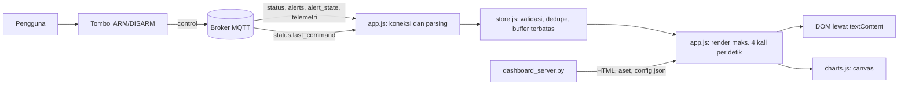

# Desain Dashboard WashAlert AI

Versi 1.0, Phase 7, 5 November 2026. Kebutuhan: FR-070 sampai FR-078, NFR-021. Perubahan: CR-011.

## Audit sebelum perubahan

| Kategori | Temuan |
|---|---|
| A. Sudah berjalan | Status, alasan, tahap, lama kerja, RMS rata-rata, grafik `motion_rms`, koneksi, ARM/DISARM |
| B. Belum ada | Panel model lengkap, alert, riwayat, kualitas sensor, keadaan usang dan offline |
| C. Kekurangan UI | Nilai `0 menit` dan `0.000` tampil sebelum ada data. Status hanya dibedakan warna |
| D. Kelemahan real-time | Satu render per pesan, sumbu berdasarkan indeks sehingga celah data tidak terlihat, tanpa dedupe |
| E. Masalah backend | Tidak ada konfirmasi perintah, tidak ada alasan berakhirnya alert, telemetri tidak menyebut sumbernya |
| F. Dipertahankan | MQTT over WebSocket, `dashboard_server.py`, `/config.json`, topik, satu halaman statis tanpa build |
| G. Perlu diubah | Tampilan, validasi pesan, kontrol dengan konfirmasi, dan tiga field backend |

Tidak ada framework baru. Dashboard tetap HTML, CSS, dan JavaScript statis agar mudah dijelaskan. Grafik ditulis sendiri di atas canvas karena kebutuhannya kecil.

## Sumber kebenaran

| Informasi | Sumber | Browser boleh menyimpulkan? |
|---|---|---|
| Status siklus, aktivitas, mode, model | Topik `status` dari detector | Tidak |
| Konfirmasi ARM/DISARM | `status.last_command` | Tidak. Tombol tidak mengubah tampilan status |
| Alert aktif dan akhirnya | `alerts`, `alert_state.ended_by` | Hanya menandai kedaluwarsa dari `valid_for_s` |
| Keadaan HP A dan HP B | Waktu terima `edge/<id>/telemetry` | Ya, disimpulkan. HP tidak punya Last Will |
| Keadaan detector | Status OFFLINE dari Last Will | Tidak |
| Riwayat | Memori tab | Ya, dan dinyatakan tidak tersimpan |

## Kontrak data baru

Semua aditif. Klien lama mengabaikannya.

| Payload | Field | Nilai | Ada saat |
|---|---|---|---|
| `status` | `last_command` | `ARM`, `DISARM` | Hanya pada balasan perintah |
| `alert_state` | `ended_by` | `acknowledged`, `superseded`, `disarmed`, `null` | `active=false` |
| telemetri | `data_source` | `android`, `simulator`, `synthetic_replay` | Edge baru |
| `/config.json` | `stale_after_s`, `offline_after_s` | Detik | Selalu |

Field status lain mengikuti `phase6_report.md`.

## Arsitektur

| File | Tugas |
|---|---|
| `dashboard/index.html` | Struktur dan CSP |
| `assets/css/dashboard.css` | Token warna, tata letak, tema terang dan gelap |
| `assets/js/store.js` | Keadaan tanpa DOM dan tanpa MQTT |
| `assets/js/charts.js` | Grafik deret waktu dengan pemutusan celah |
| `assets/js/app.js` | MQTT, perintah, render |
| `assets/vendor/` | MQTT.js dan font, tersimpan lokal |

## Sistem visual

- **Warna:** netral enamel `#e9eff2` dan panel `#fbfdfd`, teks `#142530`. Biru `#125f9e` informasi, hijau `#17693f` normal, kuning `#8a4e00` peringatan, merah `#a3221b` galat.
- **Huruf:** Atkinson Hyperlegible Next, dipilih untuk keterbacaan angka dan huruf pada layar proyektor. Angka memakai lebar tetap.
- **Elemen utama:** pintu mesin cuci yang menampilkan status siklus. Drum berputar hanya saat data live menunjukkan WASHING atau SPIN, dan tidak berputar jika pengguna meminta gerak dikurangi.
- **Linimasa:** tiga jalur sejajar memperlihatkan bahwa aktivitas IDLE tidak sama dengan DONE, dan kapan model digantikan aturan.
- **Status tanpa warna saja:** selalu ada teks. Koneksi juga memakai bentuk: bulat, segitiga, silang.

## Keadaan komponen

| Keadaan | Status mesin | Sensor | AI |
|---|---|---|---|
| Memuat | "Memuat" | "Menunggu data sensor" | "Belum diketahui" |
| Kosong | "Belum ada" | Placeholder tanpa angka | "Belum ada prediksi" |
| Live | Status, drum bergerak | "Live" | Nilai detector |
| Usang | Cincin putus kuning | "Data usang", celah bertanda | Nilai terakhir |
| Offline | Cincin merah | "HP A offline" | "Tidak tersedia" |
| Galat | "Galat" dan penyebabnya | "Broker terputus" | "Model tidak dimuat" dan alasannya |
| Pengembangan | Banner | Banner "MODE SIMULASI" | "MODEL PENGEMBANGAN (SINTETIS)" |

## Keamanan

- Isi dari jaringan ditulis lewat `textContent`, dan CSP melarang skrip inline serta sumber luar.
- `/config.json` tidak memuat kredensial. Form login hanya memegang akun di memori tab.
- Pada broker publik, siapa pun dapat mengirim status palsu yang akan tampil apa adanya, atau mengirim ARM/DISARM. Validasi tidak mencegah ini. `PROJECT_ID` bukan autentikasi, dan halaman menyatakannya di bagian bawah. Mitigasinya broker berakun dengan ACL.
