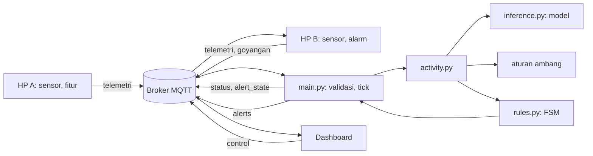
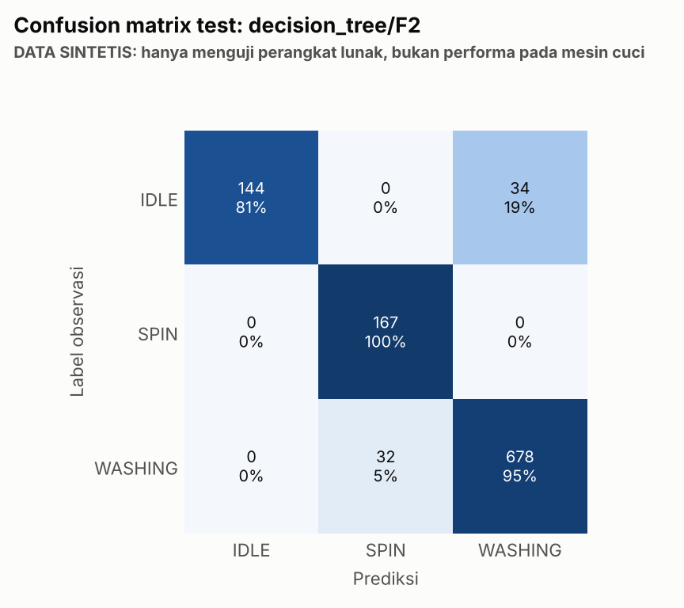

# Laporan Teknis WashAlert AI

**Sistem Pemantauan Mesin Cuci Berbasis IoT dengan Klasifikasi Aktivitas dan Finite State Machine**

Kelompok 12, mata kuliah Internet of Things. Nama dan NIM anggota: [isi]. Dosen: [isi]. Tanggal: [isi].

> **Pernyataan validitas.** Seluruh hasil ML dan pengujian pada laporan ini berasal dari data sintetis, simulator, dan broker lokal. Belum ada pengujian pada mesin cuci nyata, dan versi ini belum dijalankan di HP. Klaim performa pada dunia nyata tidak dapat dibuat dari laporan ini.

## BAB I. PENDAHULUAN

### 1.1 Latar belakang

Di kos dan laundry bersama, pemilik sering tidak tahu saat mesin cuci selesai. Cucian tertinggal di tabung, pengguna lain menunggu, dan pemilik harus berulang kali mengecek. Kelompok kami membuat WashAlert: HP yang diletakkan di atas mesin membaca getaran, laptop menjalankan FSM, dan HP pemilik memberi alarm lewat MQTT.

Materi mata kuliah kemudian memperkenalkan supervised learning. Proyek ini meningkatkan WashAlert dengan classifier aktivitas sambil menjaga fungsi IoT yang sudah ada.

### 1.2 Identifikasi masalah

Audit kode asli menemukan 30 temuan. Yang terpenting:

1. Program edge crash saat broker putus (A-01).
2. `motion_rms` hampir tidak melihat getaran horizontal (A-03).
3. Offset 0,15 m/s² mencegah DONE, dan offset 0,26 ke atas memicu WASHING palsu (A-05).
4. Jeda 130 detik pada mode real memicu DONE palsu (A-10).
5. DONE dapat terjadi setelah 1,13 menit, tanpa syarat durasi atau spin (A-11).
6. Tidak ada watchdog HP A, dan alert saat HP B offline hilang (A-17, A-21).
7. Klien lain pada broker publik dapat memalsukan alert dan DISARM (A-27).

### 1.3 Rumusan masalah

1. Bagaimana menentukan aktivitas mesin cuci dari sensor HP dengan pendekatan yang dapat dievaluasi?
2. Bagaimana menentukan siklus selesai tanpa menyamakan mesin diam dengan selesai?
3. Bagaimana menjaga sistem tetap berfungsi saat model, sensor, atau jaringan gagal?
4. Bagaimana membuktikan peningkatan dibanding sistem lama secara sah?

### 1.4 Tujuan

Mengintegrasikan supervised learning ke WashAlert, memperbaiki kelemahan hasil audit, menyediakan alat data dan evaluasi yang mencegah kebocoran, serta mendokumentasikan hasil dan batasannya secara terbuka.

### 1.5 Manfaat

Bagi pengguna: pemberitahuan cucian selesai. Bagi kelompok: pengalaman merancang sistem IoT dan ML dengan keterlacakan dari kebutuhan sampai pengujian.

### 1.6 Ruang lingkup

Satu mesin, satu HP A, satu HP B, dan satu detector per `PROJECT_ID`. Kelas aktivitas IDLE, WASHING, SPIN. Tidak mencakup deep learning, inference di HP, dan penyimpanan riwayat di server.

## BAB II. LANDASAN TEORI

### 2.1 Internet of Things

IoT menghubungkan benda fisik yang dapat mengindera atau bertindak ke jaringan [1]. Pada proyek ini, HP berperan sebagai perangkat sensor dan aktuator.

### 2.2 Accelerometer

Accelerometer mengukur percepatan pada tiga sumbu dalam m/s², termasuk komponen gravitasi saat HP diam. Karena itu, besar vektor saat diam mendekati 9,81 m/s², dan getaran terlihat sebagai perubahan di sekitarnya.

### 2.3 Gyroscope

Gyroscope mengukur kecepatan sudut dalam rad/s. Integral terhadap waktu memberi perkiraan rotasi.

### 2.4 Sensor fusion

Sensor fusion menggabungkan beberapa sensor agar informasinya lebih lengkap. WashAlert AI hanya memakai **penggabungan tingkat fitur**: fitur kedua sensor masuk ke classifier yang sama. Proyek ini tidak memakai filter estimasi orientasi seperti Kalman.

### 2.5 MQTT

MQTT adalah protokol publish/subscribe ringan yang memakai broker [2]. Fitur yang dipakai: QoS 1, pesan retained, Last Will. Kode memakai MQTT 3.1.1 lewat paho-mqtt.

### 2.6 Edge computing

Edge computing memproses data dekat sumbernya. HP menghitung fitur, sehingga hanya ringkasan yang dikirim. Model tetap berjalan di laptop, karena HP tidak membutuhkan scikit-learn.

### 2.7 Machine learning dan supervised learning

Supervised learning mempelajari pemetaan input ke output dari contoh berlabel, sesuai materi *AI for Everyone* [3]. Di sini input adalah fitur sensor, dan output adalah aktivitas.

Algoritma yang dibandingkan: Logistic Regression, Decision Tree, dan Random Forest [4], memakai scikit-learn [5].

### 2.8 Feature engineering

Feature engineering membentuk nilai masukan dari data mentah. Definisi fitur harus sama saat training dan inference.

### 2.9 Evaluasi model

Data dibagi agar pengujian memakai data yang tidak dilihat saat training. Pada deret waktu, jendela berdekatan sangat mirip, sehingga split per baris membocorkan informasi. Precision, recall, dan F1 dihitung per kelas, sedangkan macro-F1 merata-ratakannya tanpa bobot kelas.

### 2.10 Finite state machine

FSM memiliki himpunan state dan aturan transisi. FSM cocok untuk logika yang bergantung riwayat, tetapi FSM dengan ambang bukan ML.

### 2.11 Hybrid ML + FSM

Classifier memberi estimasi aktivitas sesaat, dan FSM menilai urutannya dari waktu ke waktu. Pembagian ini dipilih karena DONE tidak dapat diamati dari getaran sesaat.

## BAB III. ANALISIS DAN PERANCANGAN

### 3.1 Sistem lama

HP A dan HP B mengirim `motion_rms` dan `rotation_rad`. Detector menjalankan FSM `IDLE → WASHING ⇄ SPIN → DONE` dengan ambang, hysteresis, dan durasi. HP B bergetar saat DONE, dan goyangan mengonfirmasi.

Sistem lama memenuhi ketentuan tugas: 2 edge, 2 sensor, minimal 2 processing, dan satu protokol ke cloud. Ketentuan itu dipertahankan.

### 3.2 Kekurangan sistem lama

Lihat bagian 1.2. Daftar lengkap ada di SRS bagian 2.2.

### 3.3 Ringkasan SRS

SRS mengacu ISO/IEC/IEEE 29148 [6], berisi 143 kebutuhan dengan ID unik, kriteria penerimaan, dan sumber. Kebutuhan dari materi dosen dipisahkan dari rekomendasi rekayasa. Status terakhir ada pada bagian 5.10.

### 3.4 Ringkasan SDD

SDD mendefinisikan komponen C-01 sampai C-32, antarmuka, dan keterlacakan ke kebutuhan.

### 3.5 Arsitektur



### 3.6 Alur data

Sensor → fitur jendela di HP → telemetri v2 → validasi dan penolakan basi atau replay → jendela agregat 30 detik → model atau aturan → smoothing → FSM → status dan alert → HP B dan dashboard.

### 3.7 Desain dataset

Tiap sesi punya `raw.csv`, `labels.csv`, dan `meta.json`. Data nyata dan sintetis berada pada folder terpisah, dan validator menolak percampuran. Skema: `docs/dataset_schema.md`.

### 3.8 Desain fitur

F1 mempertahankan fitur lama. F2 memakai `acc_dyn_rms`, `acc_mag_ptp`, `gyro_rms`, `gyro_max`, yang dirancang tidak bergantung pada arah getaran. F3 menggabungkan keduanya.

### 3.9 Desain training

Validasi leave-one-cycle-out, grid kecil, baseline wajib, aturan pemilihan yang ditetapkan lebih dulu, dan test satu kali.

### 3.10 Desain deteksi hybrid

| Mode | Aktivitas | Prediksi tidak tersedia |
|---|---|---|
| RULE_ONLY | Aturan | Tidak berlaku |
| HYBRID | Model | Aturan pada jendela itu |
| ML_ONLY | Model | UNKNOWN, timer ditahan |

### 3.11 Desain komunikasi

| Topik (`washalert/<PROJECT_ID>/...`) | Pengirim | Penerima |
|---|---|---|
| `edge/<device>/telemetry` | HP A, HP B | Detector, dashboard |
| `status` (retained) | Detector | Dashboard |
| `alerts` | Detector | HP B, dashboard |
| `alert_state` (retained) | Detector | HP B, dashboard |
| `control` | Dashboard, `send_control.py` | Detector |

### 3.12 Desain dashboard

Dashboard hanya menampilkan data dari MQTT, dan ARM/DISARM dianggap berhasil setelah detector menjawab. Lihat `docs/dashboard_design.md`.

## BAB IV. IMPLEMENTASI

### 4.1 Lingkungan pengembangan

Pengujian dijalankan pada Linux, Python 3.13, scikit-learn 1.9.1, paho-mqtt, amqtt 0.12.1 sebagai broker lokal, Playwright dan Chromium. HP dan Windows tidak tersedia pada lingkungan pengujian.

### 4.2 Struktur proyek

Lihat README bagian 23. Kode lama dipertahankan, dan file aslinya masih dapat dibandingkan melalui `ml/baselines/legacy_rules.py`, salinan beku FSM lama.

### 4.3 Pembacaan sensor

`shared/sensors.py` memanggil `termux-sensor`, menandai kesegaran tiap sampel, dan melaporkan `sensor_fault` jika sensor berhenti. Satu kali kosong tidak menghentikan program.

### 4.4 Integrasi MQTT

`shared/mqtt_connection.py` memakai TLS bawaan. Non-TLS hanya berlaku dengan `ALLOW_INSECURE_LOCAL=true`. Edge dan detector dapat berjalan sebelum broker hidup, lalu menyambung otomatis.

### 4.5 Pengumpulan dataset

Tersedia `ml/measure_sampling.py`, `ml/record_session.py`, `ml/label_session.py`, dan `ml/validate_dataset.py`. Alat ini **baru diuji dengan `termux-sensor` tiruan**. Folder `data/real` masih kosong.

Sebagai pengganti sementara, `ml/generate_synthetic.py` membuat 10 sesi: 8 siklus dan 2 sesi idle. Semua berlabel sintetis.

### 4.6 Rekayasa fitur

`shared/features.py` menjadi satu-satunya definisi fitur, sehingga training dan inference memakai rumus yang sama.

### 4.7 Training

`ml/train.py` memeriksa hash dataset dan split, membuang grup test, menjalankan pencarian hyperparameter, menghitung baseline, memilih model, lalu menyimpan `model.joblib` dan `metadata.json`.

### 4.8 Pemilihan model

Terpilih `decision_tree/F2` dengan macro-F1 CV 0,848. Selisihnya dengan Random Forest F3 (0,838) kecil dibanding rentang antar fold. Decision tree juga lebih ringan.

### 4.9 Inference

`nodes/detector_service/inference.py` memeriksa hash sebelum deserialisasi, karena joblib dapat menjalankan kode. Hash ini mendeteksi kerusakan, bukan pemalsuan yang mengubah hash dan model sekaligus.

### 4.10 Integrasi FSM

`activity.py` memberi satu aktivitas, dan `rules.py` memutuskan siklus. Nilai usulan mode real: `min_run_s` 600, `done_s` 120, `done_nospin_s` 240, `start_s` 60, `remind_s` 300.

### 4.11 Alert dan konfirmasi

Alert memuat `alert_id`, `kind`, dan `valid_for_s`. HP B memvalidasi, membuang duplikat, dan menjalankan alarm di thread terpisah. Konfirmasi membutuhkan dua jendela goyang berurutan. `alert_state` retained membuat HP B yang baru tersambung tetap mengetahui alert aktif.

### 4.12 Dashboard

HTML, CSS, dan JavaScript statis, tanpa framework. Grafik memutus garis saat data hilang. Isi dari jaringan hanya ditulis lewat `textContent`.

### 4.13 Penanganan galat

Satu pesan rusak dihitung dan diabaikan. Exception pada satu pesan tidak menghentikan detector. Data sensor rusak menghasilkan aktivitas `UNKNOWN`, sehingga timer ditahan. HP A yang berhenti memicu `SENSOR_LOST`, dan timer diam direset.

### 4.14 Fallback

Model hilang, rusak, skema berbeda, atau pustaka hilang membuat `effective_mode` menjadi `RULE_ONLY`, dengan alasan yang tampil di status dan dashboard. Lima galat prediksi berturut-turut juga memindahkan sistem ke aturan.

## BAB V. PENGUJIAN DAN PEMBAHASAN

### 5.1 Metodologi

Bukti dipisahkan menurut tingkat: test otomatis, integrasi dengan broker lokal, browser, simulasi, perangkat keras, dan validasi nyata. Hanya empat yang pertama tersedia.

### 5.2 Unit test

Hasil lengkap ada di `docs/phase8_qa_report.md`. Seluruh 386 test lulus dengan broker lokal dan Chromium. Coverage modul inti: `activity.py` dan `inference.py` 100%, `rules.py` 99%, `messages.py` 98%, `features.py` 98%.

### 5.3 Integration test

Detector, edge, dan browser dijalankan sebagai proses nyata terhadap broker lokal amqtt, tanpa TLS. Yang diuji: siklus penuh, broker restart, detector restart, HP B terlambat tersambung, model rusak.

### 5.4 Pengujian end-to-end

`scripts/e2e_demo.py` menjalankan skenario A sampai J dengan `detector.py`, `hp_pemilik.py` sensor simulator, dashboard di Chromium, dan rekaman sintetis sebagai pengganti HP A. Hasil terakhir 43 dari 43 pemeriksaan lulus.

Putaran pertama hanya lulus 39 dari 43. Tiga kegagalan berasal dari script demo, dan satu dari pemeriksaan yang terlalu kaku. Keduanya sudah diperbaiki dan dicatat di `docs/phase7_report.md`. Pada Phase 6, satu putaran sesi C04 juga gagal karena prediksi yang berubah-ubah menunda DONE melewati batas tunggu 90 detik.

Uji ketahanan 60 menit dengan simulator dan mode HYBRID sintetis berjalan tanpa crash. Memori detector rata-rata 154,8 MB pada sepertiga awal dan 155,0 MB pada sepertiga akhir. Skenario ini hanya memuat satu siklus cuci.

### 5.5 Evaluasi ML (sintetis)

| Metode | Macro-F1 CV | Macro-F1 test | Accuracy test |
|---|---:|---:|---:|
| Decision tree/F2 | 0,848 | 0,920 | 0,937 |
| Baseline ambang | 0,494 | 0,628 | 0,531 |
| FSM lama dipetakan | 0,449 | 0,607 | 0,587 |
| Baseline mayoritas | 0,268 | 0,268 | 0,673 |

| Kelas | Precision | Recall | F1 | Support |
|---|---:|---:|---:|---:|
| IDLE | 1,000 | 0,809 | 0,894 | 178 |
| SPIN | 0,839 | 1,000 | 0,913 | 167 |
| WASHING | 0,952 | 0,955 | 0,954 | 710 |

Keunggulan atas baseline sebagian besar adalah akibat asumsi generator: profil getaran saya banyak memuat getaran horizontal, yang memang lemah pada `motion_rms`. Pada `--difficulty easy`, kandidat F2 mencapai macro-F1 CV sekitar 1,000. Skor mengikuti cara data dibuat.

### 5.6 Confusion matrix

| Label \ Prediksi | IDLE | SPIN | WASHING |
|---|---:|---:|---:|
| IDLE | 144 | 0 | 34 |
| SPIN | 0 | 167 | 0 |
| WASHING | 0 | 32 | 678 |



### 5.7 Perbandingan lama dan baru

Pada 2 siklus test sintetis, mode real:

| Kelompok | Terdeteksi | Terlewat | Alert palsu | Keterlambatan |
|---|---:|---:|---:|---:|
| FSM lama | 0/2 | 2 | 0 | Tidak ada |
| FSM baru + aturan | 0/2 | 2 | 0 | Tidak ada |
| HYBRID | 1/2 | 1 | 0 | 155,2 dtk |
| ML_ONLY | 1/2 | 1 | 0 | 161,4 dtk |

Data ini tidak cukup untuk menyimpulkan keunggulan: hanya 2 siklus, berasal dari generator yang sama dengan data latih, dan RMS diam sengaja berada di ambang. Perbaikan yang lebih pasti berasal dari perilaku yang diuji langsung: edge tidak lagi crash, ada watchdog, koreksi, dan konfirmasi dua jendela.

### 5.8 Pengukuran kinerja

Laptop cloud dan broker lokal, satu putaran demo 453 detik:

| Ukuran | Hasil | Target usulan SRS |
|---|---:|---|
| Inference | Median 0,56 ms, maksimum 4,33 ms | NFR-001 ≤ 100 ms p95 |
| Telemetri sampai status | Median 4,2 ms, p95 6,4 ms | NFR-002 ≤ 1 dtk p95 |
| Alert terbit sampai diterima | 3,1 dan 4,7 ms | Belum sampai alarm HP |
| CPU detector | 0,5% satu core | Tidak ada target |
| Memori puncak detector | 156 MB | Tidak ada target |

Angka ini tidak mewakili internet, HiveMQ, atau HP.

### 5.9 Analisis kesalahan

- **IDLE terbaca WASHING.** 34 dari 178 jendela IDLE test. Ini bisa memutus timer diam, dan menjadi penyebab satu siklus terlewat.
- **WASHING terbaca SPIN.** Pada demo sesi C05, 24 dari 35 status saat diberi data WASHING berstatus SPIN. Akibatnya `spin_seen` menjadi benar lebih awal, dan batas diam lebih pendek yang berlaku.
- **FSM.** Satu jendela non-IDLE mereset timer diam. FSM sengaja tidak disetel dengan data sintetis.

### 5.10 Kepatuhan kebutuhan

Dari 143 kebutuhan: 86 diimplementasikan dan teruji pada perangkat lunak, 25 sudah ada dan terverifikasi, 12 sudah dibuat tetapi belum dapat diuji, 10 sudah ada tetapi belum terverifikasi, dan 10 direncanakan. Tiga kebutuhan Must yang masih direncanakan menyangkut performa siklus nyata. Kebutuhan NFR-004, NFR-007, dan NFR-008 tidak dapat dinyatakan terpenuhi tanpa data nyata.

### 5.11 Keterbatasan

Lihat README bagian 22 dan laporan QA.

## BAB VI. PENUTUP

### 6.1 Kesimpulan

1. Classifier aktivitas sudah terhubung ke detector, dengan FSM sebagai pembuat keputusan selesai dan aturan sebagai fallback yang terlihat.
2. Kelemahan hasil audit seperti crash saat broker putus, tiadanya watchdog, dan konfirmasi satu jendela sudah diperbaiki dan diuji pada perangkat lunak.
3. Pipeline data dan ML berjalan dan dapat diulang, dengan pencegahan kebocoran yang diuji.
4. **Keunggulan ML dibanding aturan pada mesin cuci nyata belum terbukti**, karena belum ada dataset nyata.

### 6.2 Keterbatasan

Belum ada pengujian di HP dan mesin cuci, belum ada uji TLS ke HiveMQ pada versi ini, dan model masih sintetis. Selain itu keamanan broker publik tetap lemah, dan nilai ambang masih usulan.

### 6.3 Saran

1. Ukur laju sampling HP, lalu rekam minimal 8 siklus nyata sesuai panduan.
2. Latih ulang, buka test satu kali, dan jalankan perbandingan empat kelompok.
3. Tetapkan `CUCI_DONE_S` dari jeda nyata, dan pertimbangkan toleransi satu jendela pada timer diam jika data mendukung.
4. Pakai broker berakun dengan ACL.
5. Tambahkan Last Will pada edge, dan riwayat persisten jika dibutuhkan.

## Daftar Pustaka

[1] L. Atzori, A. Iera, dan G. Morabito, "The Internet of Things: A survey," *Computer Networks*, vol. 54, no. 15, hlm. 2787–2805, 2010.

[2] A. Banks dan R. Gupta (ed.), *MQTT Version 3.1.1*, OASIS Standard, 2014. https://docs.oasis-open.org/mqtt/mqtt/v3.1.1/mqtt-v3.1.1.html

[3] Materi kuliah *AI for Everyone 1* dan *Praktek Multicommunication 2 Arah dan Multisensor* dari dosen pengampu. [lengkapi nama dosen dan tahun]

[4] L. Breiman, "Random Forests," *Machine Learning*, vol. 45, no. 1, hlm. 5–32, 2001.

[5] F. Pedregosa dkk., "Scikit-learn: Machine Learning in Python," *Journal of Machine Learning Research*, vol. 12, hlm. 2825–2830, 2011.

[6] ISO/IEC/IEEE 29148:2018, *Systems and software engineering: Life cycle processes: Requirements engineering*.

Periksa rincian rujukan terhadap sumber aslinya sebelum dikumpulkan.

## Lampiran A. Diagram

Semua ada di `docs/system_diagrams/`: arsitektur lama dan baru, use case, konteks, DFD, sequence, activity, state machine, dan pipeline ML.



## Lampiran B. Hasil pengujian

`docs/phase8_qa_report.md`, `reports/e2e/phase7/e2e_report.json`, `reports/soak/soak_report.json`, `reports/arms/syn_hard_v1/arms.json`.

## Lampiran C. Contoh konfigurasi

```bash
PROJECT_ID=washalert_kelompok12
MQTT_HOST=broker.hivemq.com
MQTT_PORT=8883
MQTT_TLS=true
CUCI_MODE=real
DETECTION_MODE=RULE_ONLY
```

Lengkapnya: `.env.example` dan `demo/env.lokal.example`.

## Lampiran D. Penggunaan

README bagian 8 sampai 20, dan `docs/dashboard_user_guide.md`.
