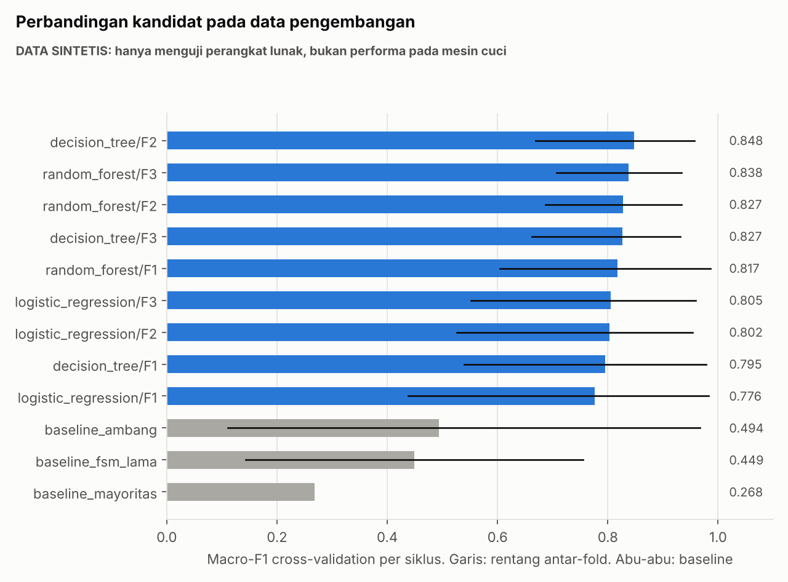

# Laporan Evaluasi Model: WashAlert AI

> **SEMUA ANGKA DI DOKUMEN INI BERASAL DARI DATA SINTETIS.** Angka ini hanya membuktikan pipeline berjalan dan tidak menunjukkan performa pada mesin cuci. Evaluasi pada mesin nyata berstatus **PENDING**.

Eksperimen: `exp_20261104T141944_624d6645`. Dataset: `syn_hard_v1` (SYNTHETIC), split `v1`, seed 42. Lingkungan: Linux-6.18.44-fc-v233-x86_64-with-glibc2.39, Python 3.13.18, scikit-learn 1.9.1.

## 1. Mengapa angka ini tidak boleh dipakai sebagai klaim

- Saya menulis profil getaran generator sendiri, dan profil itu banyak memuat getaran horizontal yang lemah pada `motion_rms`. **Keunggulan model atas baseline di sini sebagian besar adalah akibat asumsi generator.**
- Pada dataset sintetis mudah (`--difficulty easy`), kandidat F2 mencapai macro-F1 CV sekitar 1,000. Pada `hard`, nilainya 0,80–0,85. Skor mengikuti cara data dibuat, bukan kualitas sistem.
- Skor test lebih tinggi daripada skor CV hanya karena dua siklus test kebetulan lebih mudah. Rentang antar-fold jauh lebih informatif.

## 2. Status

| Tingkat | Status |
|---|---|
| A. Pipeline diimplementasikan | Ya |
| B. Pipeline diuji dengan data sintetis | Ya |
| C. Model dilatih dengan data nyata | **Belum** |
| D. Model divalidasi dengan held-out nyata | **Belum** |
| E. Model siap integrasi produksi | **Belum** |

## 3. Perbandingan pada data pengembangan

Validasi: leave-one-cycle-out, 6 fold. Aturan pemilihan: macro-F1 CV tertinggi; selisih <= 0.01 memilih yang lebih sederhana; p95 <= 100.0 ms. Metrik utama macro-F1. Sesi non-siklus selalu di training, sehingga tidak ikut divalidasi.

| Model | Parameter terbaik | Macro-F1 CV (rentang fold) | Macro-F1 validation terpisah | Accuracy OOF | Aktif diprediksi IDLE | Fit (dtk) | p95 (ms) | Ukuran (KB) |
|---|---|---:|---:|---:|---:|---:|---:|---:|
| decision_tree/F2 **(terpilih)** | {max_depth: 8, min_samples_leaf: 1} | 0.848 (0.670–0.957) | 0.811 | 0.844 | 0.137 | 0.022 | 0.264 | 9.1 |
| random_forest/F3 | {max_depth: null, max_features: sqrt, min_samples_leaf: 1, n_estimators: 100} | 0.838 (0.707–0.934) | 0.815 | 0.843 | 0.126 | 0.733 | 15.06 | 1855.9 |
| random_forest/F2 | {max_depth: null, max_features: sqrt, min_samples_leaf: 1, n_estimators: 100} | 0.827 (0.687–0.934) | 0.801 | 0.832 | 0.138 | 0.681 | 12.843 | 2051.0 |
| decision_tree/F3 | {max_depth: 8, min_samples_leaf: 5} | 0.827 (0.663–0.931) | 0.808 | 0.821 | 0.157 | 0.031 | 0.263 | 9.8 |
| random_forest/F1 | {max_depth: null, max_features: sqrt, min_samples_leaf: 5, n_estimators: 100} | 0.817 (0.605–0.986) | 0.765 | 0.804 | 0.176 | 0.555 | 12.355 | 1713.1 |
| logistic_regression/F3 | {C: 10.0} | 0.805 (0.552–0.960) | 0.749 | 0.782 | 0.221 | 0.046 | 0.562 | 2.2 |
| logistic_regression/F2 | {C: 10.0} | 0.802 (0.526–0.954) | 0.756 | 0.776 | 0.232 | 0.072 | 0.626 | 1.9 |
| decision_tree/F1 | {max_depth: 8, min_samples_leaf: 20} | 0.795 (0.539–0.978) | 0.768 | 0.780 | 0.206 | 0.014 | 0.242 | 6.9 |
| logistic_regression/F1 | {C: 10.0} | 0.776 (0.437–0.983) | 0.717 | 0.747 | 0.255 | 0.038 | 0.741 | 1.7 |
| baseline_ambang | Ambang Config lama per jendela agregat. Bukan ML | 0.494 (0.111–0.967) | - | 0.473 | 0.571 | - | - | - |
| baseline_fsm_lama | FSM lama mode real, state dipetakan ke aktivitas. DONE dianggap IDLE | 0.449 (0.143–0.755) | - | 0.460 | 0.467 | - | - | - |
| baseline_mayoritas | Tebakan kelas terbanyak | 0.268 (0.268–0.269) | - | 0.673 | 0.000 | - | - | - |

Waktu dan latensi diukur di container cloud, bukan laptop kalian.

**Terpilih: decision_tree/F2**. Menurut aturan yang ditetapkan sebelum test dibuka, kandidat ini memiliki skor CV tertinggi. Model ini juga ringan dan aturannya dapat dicetak. Selisih dengan kandidat lain kecil dibanding rentang antar-fold, sehingga pilihan ini lemah secara statistik dan dapat berubah pada data nyata.

## 4. Evaluasi akhir pada test (sekali)

1055 jendela dari siklus SYNM1_C04, SYNM1_C05.

| Metode pada test | Macro-F1 | Accuracy | Balanced acc. | Weighted F1 | Macro prec. | Macro rec. | Aktif diprediksi IDLE |
|---|---:|---:|---:|---:|---:|---:|---:|
| Model terpilih | 0.920 | 0.937 | 0.921 | 0.937 | 0.930 | 0.921 | 0.000 |
| Model + fallback aturan | 0.920 | 0.937 | 0.921 | 0.937 | 0.930 | 0.921 | 0.000 |
| Baseline ambang | 0.628 | 0.531 | 0.768 | 0.542 | 0.755 | 0.768 | 0.564 |
| FSM lama dipetakan | 0.607 | 0.587 | 0.603 | 0.628 | 0.647 | 0.603 | 0.351 |
| Baseline mayoritas | 0.268 | 0.673 | 0.333 | 0.541 | 0.224 | 0.333 | 0.000 |

Per kelas, model terpilih:

| Kelas | Precision | Recall | F1 | Support |
|---|---:|---:|---:|---:|
| IDLE | 1.000 | 0.809 | 0.894 | 178 |
| SPIN | 0.839 | 1.000 | 0.913 | 167 |
| WASHING | 0.952 | 0.955 | 0.954 | 710 |

Confusion matrix:

| Label \ Prediksi | IDLE | SPIN | WASHING |
|---|---:|---:|---:|
| IDLE | 144 | 0 | 34 |
| SPIN | 0 | 167 | 0 |
| WASHING | 0 | 32 | 678 |

Per sesi:

| Sesi | Jendela | Macro-F1 | Aktif terlama diprediksi IDLE (dtk) |
|---|---:|---:|---:|
| SYNTHETIC_SYNM1_C04 | 528 | 0.978 | 0.0 |
| SYNTHETIC_SYNM1_C05 | 527 | 0.864 | 0.0 |

Metrik terakhir paling relevan untuk false DONE. Kesalahan terbesar pada data ini adalah IDLE dengan getaran latar yang diprediksi WASHING, yang dapat memperlambat deteksi selesai. Pada data nyata hal ini harus diperiksa ulang.

## 5. Kontrol kebocoran

| Kontrol | Macro-F1 | Arti |
|---|---:|---|
| Validasi benar, per siklus | 0.848 | Skor yang dipakai |
| Label diacak | 0.224 | Mendekati tebakan. Tidak ada tanda kebocoran fitur |
| Split acak per baris, **tidak sah** | 0.948 | Lebih tinggi karena jendela siklus sama bocor. Inilah alasan split per baris dilarang |

## 6. Probabilitas

| Ukuran | Nilai |
|---|---:|
| Expected Calibration Error, out-of-fold | 0.141 |
| Terkalibrasi | Tidak |
| Ambang terpilih | 0.0 |
| Jendela test di bawah ambang | 0.0% |
| Jendela test di luar rentang training | 0.8% |

Aturan ambang: macro-F1 out-of-fold tertinggi saat jendela di bawah ambang memakai aturan; seri ke ambang terendah.

| Ambang | Macro-F1 dengan fallback | Cakupan model | Ketepatan saat model dipakai |
|---:|---:|---:|---:|
| 0.0 | 0.832 | 100.0% | 0.844 |
| 0.4 | 0.832 | 100.0% | 0.844 |
| 0.5 | 0.832 | 100.0% | 0.844 |
| 0.6 | 0.825 | 98.5% | 0.843 |
| 0.7 | 0.824 | 96.2% | 0.859 |
| 0.8 | 0.827 | 95.9% | 0.861 |
| 0.9 | 0.822 | 91.9% | 0.871 |

Pada data ini ambang tinggi tidak membantu, sehingga terpilih 0, dan fallback probabilitas rendah tidak aktif. Decision Tree memberi probabilitas kasar dan cenderung terlalu yakin. Nilai 0,60 pada SRS adalah usulan awal, dan digantikan hasil pemilihan pada data nyata.

## 7. Kurva belajar

| Siklus training | Macro-F1 rata-rata | Rentang |
|---:|---:|---:|
| 1 | 0.594 | 0.108–1.000 |
| 2 | 0.658 | 0.111–0.922 |
| 3 | 0.711 | 0.325–0.957 |
| 4 | 0.762 | 0.155–0.934 |
| 5 | 0.848 | 0.670–0.957 |

## 8. Tingkat siklus

Arm 1, FSM lama, mode real:

| Sesi | Alert palsu | Selesai terdeteksi | Keterlambatan (dtk) |
|---|---:|---|---:|
| SYNTHETIC_SYNM1_C04 | 0 | Tidak | None |
| SYNTHETIC_SYNM1_C05 | 0 | Tidak | None |

Pada generator hard, derau dan offset membuat `motion_rms` saat diam berada di atas ambang diam FSM lama 0,12, sehingga DONE tidak tercapai. Ini akibat generator, tetapi menunjukkan cara kegagalan yang sama dengan temuan audit A-05. Apakah terjadi di HP nyata belum diketahui.

Jeda terpanjang pada siklus pengembangan sintetis: 120.6 detik. Angka ini hanya menguji alat analisis. 

Perbandingan empat kelompok dijalankan pada Phase 6 (`python -m ml.compare_arms`, `reports/arms/syn_hard_v1/arms.json`):

| Kelompok | Terdeteksi | Terlewat | Alert palsu | Keterlambatan (dtk) |
|---|---:|---:|---:|---:|
| 1 FSM lama | 0/2 | 2 | 0 | Tidak ada |
| 2 FSM baru + aturan | 0/2 | 2 | 0 | Tidak ada |
| 3 HYBRID | 1/2 | 1 | 0 | 155,2 |
| 4 ML_ONLY | 1/2 | 1 | 0 | 161,4 |

Dua siklus dari generator yang sama dengan data latih tidak cukup untuk menyatakan model lebih baik.

## 9. Yang harus diulang dengan data nyata

Seluruh isi laporan ini. Perintahnya ada di `docs/ml_training_guide.md`.

Grafik ada di folder eksperimen: `class_distribution`, `model_comparison`, `confusion_oof`, `confusion_test`, `feature_importance`, `learning_curve`, `timeline_test`.
