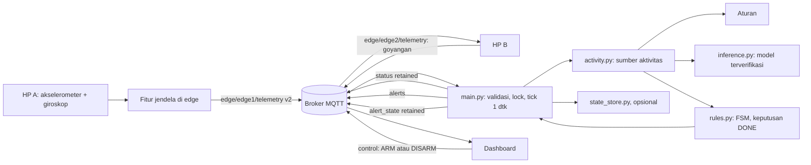

# Laporan Phase 6: Integrasi IoT dan Machine Learning

Tanggal 4 November 2026. Semua angka berasal dari eksekusi di lingkungan cloud dengan broker lokal dan data sintetis. Belum ada pengujian pada HP, mesin cuci, atau broker HiveMQ.

## 1. Ringkasan

Phase 6 selesai secara teknis pada tingkat perangkat lunak. Model memengaruhi aktivitas di detector, FSM tetap memutuskan DONE, dan siklus penuh sampai konfirmasi HP B berjalan lewat MQTT pada ketiga mode. Sistem **belum layak produksi** karena satu-satunya model dilatih dari data sintetis, dan model itu melewatkan 1 dari 2 penyelesaian pada replay held-out sintetis.

| Tingkat bukti | Status |
|---|---|
| IMPLEMENTED | Semua item Definition of Done |
| UNIT TESTED | Ya |
| INTEGRATION TESTED | Ya, broker lokal amqtt tanpa TLS |
| SIMULATION TESTED | Ya, demo A sampai J pada 2 sesi sintetis |
| HARDWARE TESTED | **Belum** |
| REAL-WORLD VALIDATED | **Belum** |

## 2. Audit praintegrasi dan kompatibilitas

| Komponen | Hasil | Catatan |
|---|---|---|
| Sensor HP A dan HP B | Kode ada, simulator teruji | Jalur Termux hanya diuji dengan tiruan pada fase ini |
| Fitur edge | Siap | Fitur dihitung di edge, agregasi 30 detik di detector. Lokasi tidak diubah |
| Telemetri v2 | Siap | Memuat semua fitur F2. Telemetri v1 tidak punya fitur, jadi jendela itu memakai aturan, bukan nilai palsu |
| Model | Siap untuk uji perangkat lunak | Hash, skema, urutan fitur, kelas, dan versi dependensi divalidasi saat start. `data_kind` sintetis |
| Dataset nyata | **Tidak ada** | `data/real` kosong |
| FSM dan MQTT | Diperluas aditif | 4 file test lama identik dengan baseline |
| Dashboard | Kompatibel | Hanya ditambah satu baris info mode. Redesign menjadi Phase 7 |

## 3. Arsitektur hasil implementasi



## 4. Perubahan kode

| File | Perubahan |
|---|---|
| `nodes/detector_service/activity.py` | Baru. Sumber aturan dan model, smoothing N=5, fallback, pemilihan mode |
| `nodes/detector_service/state_store.py` | Baru. Simpan state secara atomik, batas umur 6 jam (diusulkan) |
| `nodes/detector_service/rules.py` | `advance`, `tick`, `min_run_s`, batas diam tanpa spin, koreksi, watchdog, konfirmasi 2 jendela, `snapshot`/`restore` |
| `nodes/detector_service/main.py` | `DetectorService`, loop tick, status tambahan, alert ID, `alert_state`, log `[EVENT]` |
| `shared/messages.py` | `alert_json`, `parse_alert`, `extra` pada status |
| `shared/edge_runner.py` | `AlertReceiver`: validasi, dedupe, alarm di thread terpisah |
| `shared/alarm.py` | `clear_alarm`, judul per jenis alert |
| `ml/replay.py`, `ml/compare_arms.py` | Replay empat kelompok lewat `rules.py` produksi |
| `scripts/e2e_demo.py` | Demo A sampai J berlabel SIMULATION |
| `dashboard/index.html` | Satu baris info mode, aktivitas, model, fallback |
| `.env.example`, `.gitignore`, `README.md` | Konfigurasi dan panduan |
| `tests/test_activity.py`, `test_fsm_v2.py`, `test_alert_flow.py` | Baru |
| `tests/test_mqtt_integration.py`, `test_ml_pipeline.py`, `test_ml_inference.py` | Ditambah |

Satu test Phase 5, `test_detector_still_does_not_use_model`, sengaja diganti `test_model_reaches_fsm_only_through_activity_module`. Test lama menjaga agar model belum dipakai sebelum Phase 6, sehingga tujuannya sudah berakhir.

## 5. Inference

Model dimuat sekali saat start. `activity.py` menyusun jendela agregat dari telemetri, memanggil `inference.py`, lalu memberi FSM satu aktivitas. Inference berjalan di thread MQTT karena terukur cepat (median 0,8 ms, maksimum 17,4 ms), sehingga thread tambahan tidak diperlukan.

Probabilitas diterbitkan sebagai `model_probability` dan belum terkalibrasi (`probability_calibrated=false`). Ambang model sintetis bernilai 0,0, sehingga fallback probabilitas rendah baru teruji dengan model tiruan.

## 6. Mode dan FSM

| Mode | Aktivitas | Prediksi tak tersedia | Model gagal berulang |
|---|---|---|---|
| `RULE_ONLY` (default) | Aturan | Tidak berlaku | Tidak berlaku |
| `HYBRID` | Model | Aturan untuk jendela itu | Aturan, status `RULE_ONLY` |
| `ML_ONLY` (eksperimen) | Model | `UNKNOWN`, timer ditahan | Aturan, status `RULE_ONLY` |

| Keputusan | Asal |
|---|---|
| IDLE, WASHING, atau SPIN saat ini | Model atau aturan, sesuai mode |
| DONE, alert, pengingat, konfirmasi, koreksi, `SENSOR_LOST` | FSM, deterministik |

IDLE tidak sama dengan DONE. DONE butuh `min_run_s` dan diam selama `done_s`, atau `done_nospin_s` jika belum ada spin. Jeda yang lebih singkat tidak menghasilkan alert. Data sensor rusak menghasilkan `UNKNOWN` dan menahan timer, karena sampel basi dapat terlihat seperti mesin diam. Semua nilai waktu baru bersifat diusulkan dan `CUCI_DONE_S` harus ditetapkan dari jeda siklus nyata. Mode berubah hanya lewat restart.

## 7. Skema MQTT

Topik lama tetap. Topik baru: `alert_state` (retained).

| Payload | Field lama | Field baru (opsional) |
|---|---|---|
| Status | Tidak berubah | `detection_mode`, `effective_mode`, `model_status`, `fallback_reason`, `activity`, `activity_source`, `activity_reason`, `model_probability`, `inference_latency_ms`, `model_name`, `model_version`, `model_data_kind`, `probability_calibrated`, `classified_at_ms`, `alert_kind`, `spin_seen`, `sensor`, `rejected` |
| Alert | `event`, `run_minutes`, `reason`, `detected_at_ms` | `alert_id`, `kind`, `is_reminder`, `valid_for_s` |
| Telemetri | Tidak berubah pada fase ini | Tidak ada |

Status memakai nama SRS (`activity`, `model_probability`), bukan `activity_prediction` dan `prediction_probability` yang disarankan prompt. Nama lain untuk data yang sama tidak diterbitkan agar tidak ganda. Konfirmasi tetap memakai goyangan lewat telemetri HP B, tanpa topik baru. `cycle_id` tidak ditambahkan karena `alert_id` sudah cukup untuk dedupe.

## 8. Hasil pengujian

**Test otomatis:** `WASHALERT_SLOW=1 python -m unittest discover -s tests -t .` menjalankan 339 test, semuanya lulus (233 detik). Sebelum Phase 6 ada 230 test. `scripts.offline_demo` juga berjalan. Ini test perangkat lunak dan tidak menyentuh HP.

Satu test broker baru sempat gagal sesekali. Penyebabnya race dalam test: telemetri awal terkirim sebelum subscribe detector selesai. Test kini mengirim sampai siklus mulai, lalu lulus 8 dari 8 kali saat CPU dibebani.

| Area | Bukti |
|---|---|
| Alert duplikat, HP B absen, siklus berulang, DISARM saat siklus, konfirmasi basi dan replay | Unit, `test_fsm_v2.py` |
| WASHING atau SPIN, jeda, lalu kembali | Unit |
| Model hilang, rusak, label tak terduga, gagal saat berjalan, dependensi hilang | Unit dan broker |
| Reconnect broker, restart detector saat DONE, HP B terlambat tersambung | Broker lokal |
| Inti berjalan tanpa scikit-learn, numpy, joblib, dan paho | Subproses dengan paket diblok |

**Demo E2E (SIMULATION):** `detector.py`, `hp_pemilik.py --source simulator`, dashboard di Chromium, broker lokal, model sintetis, telemetri dari sesi sintetis C04 dan C05. HP A digantikan pengirim sintetis.

| Skenario | C04 | C05 |
|---|---|---|
| A IDLE, B WASHING, C SPIN | Lulus | Lulus |
| D jeda tanpa DONE | Lulus | Lulus |
| E DONE terkirim, alarm HP B, tanpa duplikat | Lulus | Lulus |
| F konfirmasi, notifikasi dihapus | Lulus | Lulus |
| G model rusak, fallback terlihat, siklus tetap jalan | Lulus | Lulus |
| H broker restart, state bertahan | Lulus | Lulus |
| I siklus kedua | Lulus | Lulus |
| J dashboard menerima data, DISARM dari tombol | Lulus | Lulus |
| Total pemeriksaan | 21/21 | 21/21 |

Dua catatan penting agar hasil ini tidak dibaca berlebihan:

- **Putaran pertama pada C04 gagal 5 dari 21 pemeriksaan.** Alert tidak muncul dalam batas tunggu 90 detik, karena prediksi model berubah-ubah pada data IDLE sintetis. Lulus 21/21 di atas terjadi setelah batas tunggu dinaikkan ke 180 detik. Kelemahan itu tetap ada dan tercatat pada bagian 10.
- Pada C05 fase B, status lebih sering SPIN (23) daripada WASHING (6) saat diberi data berlabel WASHING. Pemeriksaan B hanya mensyaratkan WASHING muncul, sehingga tetap lulus meski klasifikasinya buruk.

Setelah demo, jeda 0,5 detik ditambahkan antar goyangan pada script demo. Demo tidak diulang setelah perubahan kecil itu.

## 9. Perbandingan dan pengukuran

**Replay empat kelompok pada 2 siklus test SINTETIS** (mode real, `ml/compare_arms.py`). Bukan bukti performa nyata dan terlalu sedikit untuk kesimpulan statistik.

| Kelompok | Terdeteksi | Terlewat | Alert palsu | Keterlambatan |
|---|---|---|---|---|
| 1 FSM lama | 0/2 | 2 | 0 | Tidak ada |
| 2 FSM baru + aturan | 0/2 | 2 | 0 | Tidak ada |
| 3 HYBRID | 1/2 | 1 | 0 | 155,2 dtk |
| 4 ML_ONLY | 1/2 | 1 | 0 | 161,4 dtk |

Keunggulan model di sini belum boleh diklaim. RMS diam pada data ini sekitar 0,12 m/s², tepat di ambang `still_threshold`, karena generator sengaja memasukkan getaran latar. Rekaman juga berakhir sekitar 180 detik setelah mesin berhenti, sehingga deteksi yang lebih lambat tidak teramati. Model dilatih dari generator yang sama, sehingga hasil ini condong menguntungkan model.

**Pengukuran di laptop cloud dengan broker lokal** (dua putaran demo, sekitar 445 detik per putaran):

| Ukuran | Hasil | Target SRS (diusulkan) |
|---|---|---|
| Latensi inference | Median 0,80 dan 0,83 ms; maksimum 17,4 ms | NFR-001 ≤ 100 ms p95 |
| Telemetri sampai status | Median 6,6 dan 6,8 ms; p95 10,8 dan 11,8 ms | NFR-002 ≤ 1 dtk p95 |
| Alert terbit sampai diterima | 3,9 sampai 7,0 ms | NFR-003 mencakup jalur sampai alarm HP, belum teruji |
| CPU detector | 0,7% satu core | Tidak ada target |
| Memori puncak detector | 157 MB | Tidak ada target |
| Alert selesai | 2 untuk 2 siklus, tanpa duplikat | NFR-007, NFR-008 butuh siklus nyata |

Angka ini tidak mewakili jaringan internet atau HiveMQ.

## 10. Masalah yang diketahui

1. **Penyelesaian dapat terlewat.** Satu jendela non-IDLE mereset timer diam, sehingga prediksi yang berubah-ubah dapat menunda atau menggagalkan DONE. Saya sengaja tidak menyetel FSM dengan data sintetis, karena nilainya tidak akan berlaku pada mesin nyata dan siklus test sudah terlihat. Putuskan setelah ada data nyata.
2. **CR-006 belum diputuskan.** `abandon_s` nonaktif. Pada mode real, getaran singkat yang melewati `start_s` tetapi belum mencapai `min_run_s` membuat status tertahan di WASHING sampai ada aktivitas berikutnya, atau sampai DISARM dan ARM.
3. HP A yang belum pernah mengirim data tidak memicu `SENSOR_LOST`.
4. Pemulihan state aktif hanya jika `DETECTOR_STATE_PATH` diisi. Setelah restart, jendela agregat model dibangun ulang dan pelacakan sequence kosong, sehingga replay hanya dibatasi jendela waktu 30 detik.
5. `NFR-026` belum dikerjakan: pelacakan replay tumbuh mengikuti jumlah `boot_id`.
6. Artefak model dan data sintetis masuk `.gitignore`. Pada clone baru, test yang membutuhkannya dilewati sampai dibangun ulang.

## 11. Keamanan

| Hal | Keadaan | Risiko tersisa dan mitigasi |
|---|---|---|
| TLS | Default aktif; non-TLS perlu `ALLOW_INSECURE_LOCAL` | Koneksi TLS tidak diuji pada fase ini |
| Broker publik | HiveMQ publik, tanpa autentikasi | Siapa pun dapat membaca atau mengirim telemetri, alert palsu, goyangan palsu, dan ARM/DISARM. `PROJECT_ID` bukan autentikasi. Validasi skema tidak menghentikan pesan palsu yang formatnya benar. Mitigasi: broker berautentikasi dengan ACL. Python mendukung `MQTT_USERNAME`; dukungan dashboard (NFR-011) belum |
| Replay | Sequence per `boot_id` dan jendela 30 detik | `boot_id` baru melewati pemeriksaan sequence |
| Perintah | Hanya ARM dan DISARM diterima | Tanpa autentikasi pengirim |
| Artefak model | Hash diperiksa sebelum deserialisasi | Hash ada di samping model, jadi hanya mendeteksi kerusakan, bukan pemalsuan. Muat model hanya dari sumber tepercaya, karena joblib dapat menjalankan kode |
| Rahasia | Tidak ada kredensial di kode dan payload | `.env` diabaikan git |

## 12. Traceability

RTM v0.5: 143 kebutuhan. Existing and verified 23, Existing but not verified 12, Planned 20, Implemented but not tested 11, Implemented and tested 77. Status "tested" pada Phase 6 berarti perangkat lunak, bukan perangkat keras. Perubahan requirement: CR-009 (`ML_ONLY` runtime eksperimen) dan CR-010 (field status, `UNKNOWN` pada data rusak, `state_store` opsional). Keduanya berstatus diusulkan dan perlu disetujui kelompok.

Kebutuhan utama: FR-035, FR-038, FR-054, FR-055, FR-061, FR-065, FR-083. Masih menunggu data nyata: NFR-004, NFR-007, NFR-008, DML-020.

## 13. Cara menjalankan

```bash
python detector.py                 # RULE_ONLY, default
DETECTION_MODE=HYBRID ALLOW_SYNTHETIC_MODEL=true MODEL_PATH=models/development/SYNTHETIC_... python detector.py
WASHALERT_SLOW=1 python -m unittest discover -s tests -t .
python -m ml.compare_arms --sessions-dir data/synthetic --split data/manifests/split_syn_hard_v1_v1.json --model models/development/SYNTHETIC_... --allow-synthetic --out reports/arms/syn_hard_v1
python -m scripts.e2e_demo --model models/development/SYNTHETIC_... --out reports/e2e
```

## 14. Pengujian fisik yang masih diperlukan

- `hp_mesin.py` dan `hp_pemilik.py` di Termux dengan sensor nyata, termasuk `termux-notification-remove`.
- Koneksi TLS ke HiveMQ dari HP, laptop, dan dashboard.
- Rekaman siklus nyata, model dari data nyata, dan penetapan `CUCI_DONE_S`.
- Perbandingan empat kelompok pada siklus held-out nyata, yang menjadi dasar klaim peningkatan.

## 15. Kesiapan Phase 7

| Item | Status |
|---|---|
| Status memuat mode, mode efektif, aktivitas, sumber, probabilitas, versi model, fallback | Siap, teruji lewat broker |
| Kualitas sensor dan jumlah penolakan | Siap |
| `alert_state` dan jenis alert | Siap |
| Label data sintetis (`model_data_kind`) dan kalibrasi | Siap |
| Dashboard lama tetap tampil dan ARM/DISARM berjalan | Teruji di Chromium, broker lokal |
| Metrik evaluasi untuk ditampilkan | Hanya sintetis, wajib diberi label |
